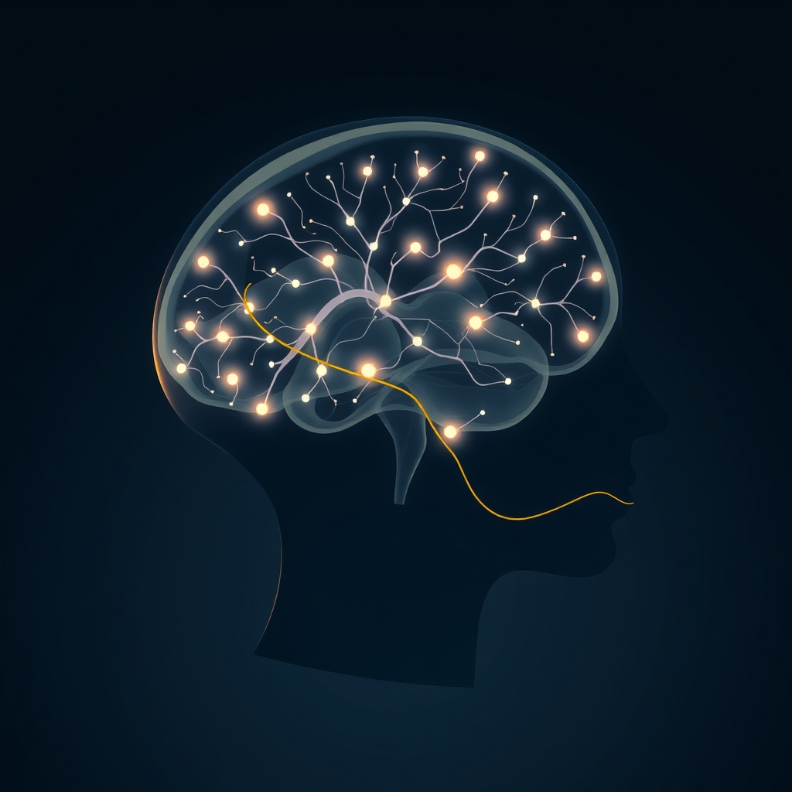

[Home](../index.md) > [⚡ Vital Signals](./index.md) | [⏮️](./2026-11-08-the-interwoven-tapestry-orchestrating-your-inner-architecture.md) [⏭️](./2026-11-10-deconstructing-the-zone-the-neurobiology-of-effortless-engagement.md)  
# 2026-11-09 | ⚡ 🏃‍♀️ The Unseen Marathon: Building Your Daily Mental Endurance ⚡  
  
  
# 🏃‍♀️ The Unseen Marathon: Building Your Daily Mental Endurance  
  
⚡ This past week, from November 2nd to November 7th, we explored the intricate architecture of our minds, from deliberate decision-making to the deep rejuvenation of sleep, culminating in a weekly recap on "The Interwoven Tapestry: Orchestrating Your Inner Architecture." We've dissected individual components of performance, recognizing how our **prefrontal cortex (PFC)**, **dopamine system**, and **effort-recovery loops** are deeply intertwined. Today, we bring these threads together to address a crucial, often overlooked, aspect of human performance: **mental endurance**. Just as physical athletes train to sustain peak performance over long durations, our brains require deliberate cultivation to maintain focus, clarity, and effective executive function throughout the unseen marathon of our daily lives.  
  
## 🔬 Fueling Your Cognitive Long Game: The Science of Sustained Effort  
  
⚡ Sustaining high-level cognitive work isn't about endless willpower; it's a biological reality governed by the brain's metabolic demands and neurochemical balance. Understanding these mechanisms is the first step toward building genuine mental stamina.  
  
### 🧠 The Prefrontal Cortex: Your Endurance Bottleneck  
  
⚡ Your **prefrontal cortex (PFC)**, the brain's command center for executive functions like attention, decision-making, and working memory, is particularly vulnerable to fatigue during prolonged mental effort. When this region tires, it's not just a feeling of being worn out; it leads to measurable declines in performance, such as slower reaction times, more errors, and poorer decision quality. A 2018 study published in *Frontiers in Neuroscience* specifically found that mental fatigue during sustained cognitive tasks targets the prefrontal cortex, which controls concentration and executive flexibility.  
  
⚡ The brain, despite being only about 2% of body weight, consumes roughly 20% of the body's resting energy, primarily in the form of glucose. During periods of sustained, deep focus, glucose consumption is high. A 2025 review in *Research Results in Pharmacology* emphasizes that glucose is a fundamental metabolic substrate for the human brain, continuously needed to sustain neuronal firing, synaptic transmission, and overall cognitive performance. Even mild fluctuations in glucose can alter cognitive efficiency. Recent research, including a 2022 study in *PMC*, also indicates that hyperglycemia can be associated with subtle brain injury and impaired attention even in young adults, highlighting the importance of glucose metabolism for brain integrity.  
  
### ✨ Dopamine and Acetylcholine: The Neurotransmitters of Persistence  
  
⚡ Two key neurotransmitters are central to maintaining mental endurance:  
*   🎯 **Dopamine:** 💡 This "feel-good" chemical is essential for motivation, attention, and reward processing. When dopamine levels are low, it can lead to mental fatigue, a lack of focus, and reduced productivity. A 2012 study published in *PubMed* suggests a novel involvement of the dopaminergic midbrain in sustaining motivation during fatigue. Low dopamine can impair our ability to concentrate and stay organized.  
*   🔍 **Acetylcholine (ACh):** 💡 Often called the "learning chemical," acetylcholine is crucial for memory formation, learning, and sustained attention. It increases signal clarity in the brain, determining whether paying attention to something actually changes your brain through **neuroplasticity**. Studies show that individuals with higher acetylcholine activity demonstrate superior cognitive flexibility, faster reaction times, and enhanced working memory. Physical exercise has been shown to protect and enhance cholinergic function. Recent research from 2023 also suggests that acetylcholine works in conjunction with gamma-aminobutyric acid (GABA) as a "switch" in the claustrum region of the brain to filter essential information from noise, which is critical for attention span regulation.  
  
### 🔄 The Effort-Recovery Loop Reimagined: Training for Stamina  
  
⚡ Our previous discussion on the **effort-recovery model** (November 6) highlighted that continuous effort without intentional recovery is unsustainable. This applies directly to mental endurance. Sustained neural activity increases ATP demand and leads to the accumulation of fatigue-related metabolic signals like adenosine. Adenosine binds to receptors, triggering a sense of fatigue, and caffeine works by blocking these receptors, not by restoring energy.  
  
⚡ To build mental endurance, we must work *with* our brain's natural rhythms. The concept of **ultradian rhythms**—natural biological cycles of approximately 90-120 minutes that alternate between high cognitive performance and a physiological rest period (March 26, 2026, and March 27, 2026, posts)—is vital here. Respecting these cycles by incorporating micro-breaks allows the brain to consolidate learning, clear metabolic byproducts, and regenerate cellular energy stores. While some studies have found no statistically significant 90-minute periodicity using strict criteria, the consensus is that ultradian cycles during wakefulness are real, even if individual variation is significant.  
  
⚡ The field of "Brain Endurance Training" (BET) combines cognitive tasks with physical training to boost resistance to mental fatigue and improve endurance performance. A 2025 paper in *Frontiers* notes that BET can enhance endurance and cognitive performance by increasing individuals' tolerance to mental fatigue through central regulatory mechanisms. A 2024 study in *Neuroscience News* showed that BET significantly improved cognitive and physical performance in older adults, enhancing attention and executive function.  
  
## 🏗️ The Pattern: Cultivating the Mind's Resilience  
  
🔗 From a **systems thinking** perspective, building **mental endurance** is the logical culmination of actively orchestrating your inner architecture. It's about designing a dynamic system that can sustain effort, adapt to demands, and recover effectively, rather than relying on unsustainable bursts of willpower. This is a profound **leverage point** for long-term cognitive health and consistent high performance.  
  
*   🔋 **Optimizing Your Energy Ecosystem:** 💡 Mental endurance hinges on intelligently managing your brain's **energy budget**, primarily through stable glucose metabolism and efficient mitochondrial function. Strategic nutrition (April 2, 2025, and May 30, 2023, posts), consistent sleep (November 7), and adherence to **ultradian rhythms** ensure your **PFC** has the sustained fuel it needs, preventing neurotransmitter depletion and metabolic waste accumulation.  
*   🛡️ **Proactive Resilience Against Allostatic Load:** ⚖️ Chronically pushing through mental fatigue without adequate recovery directly contributes to **allostatic load** (November 6, November 7, November 8 recap). By deliberately practicing mental endurance with built-in recovery, you are proactively buffering against the cumulative physiological wear and tear, strengthening the brain's resilience circuits and allowing faster emotional recovery after negative events, as demonstrated in research on the medial prefrontal cortex's role in resilience.  
*   🌱 **Neuroplasticity Through Deliberate Practice:** 🧠 Building mental endurance is an ongoing act of **neuroplasticity**. Just like a muscle, the brain's capacity for sustained attention can be expanded through repeated, deliberate exertion followed by rest. This consistent, intentional practice remodels neural pathways, enhancing the efficiency of your attention networks and strengthening the connections crucial for cognitive control.  
*   🎯 **Integrating and Amplifying Executive Functions:** 💡 Mental endurance integrates and amplifies every executive function we've explored. It requires sustained **attention** (acetylcholine, dopamine, norepinephrine), effective **working memory** (PFC, dopamine, acetylcholine), and robust **inhibitory control** to resist distractions when fatigue sets in. By cultivating it, you're not just improving one area, but bolstering the entire system for greater cognitive control and adaptability.  
  
## 🌱 Tiny Habits for Your Daily Mental Marathon:  
  
⚡ Integrate these small, evidence-based practices to build and sustain your mental endurance, transforming your daily capacity for focused, high-quality work.  
  
*   ⏱️ **"Focused Micro-Block Launch":** 💡 Start your day with one uninterrupted 45-60 minute block on your most cognitively demanding task. Dedicate this block to deep work, leveraging your peak **PFC** performance window.  
*   💧 **"Hydration & Brain Fuel Check":** 💡 Keep a water bottle at your workspace and take sips regularly. The brain relies heavily on glucose, and dehydration impairs cognitive function, so ensure consistent hydration and consider complex carbohydrates for sustained energy.  
*   🚶‍♀️ **"Movement for Metabolic Reset":** 💡 During your **ultradian rhythm** breaks, engage in at least 5-10 minutes of light physical activity, like walking or stretching. This helps clear metabolic byproducts and restores neurotransmitter balance.  
*   📝 **"Attention Recalibration Journal":** 💡 At the end of your workday, briefly note two instances where your focus wavered. Then, imagine one tiny, proactive step you could take *before* that moment tomorrow to safeguard your attention.  
*   😴 **"Dopamine-Friendly Sleep Prep":** 💡 Prioritize a consistent sleep schedule and a calming evening wind-down. Adequate sleep maintains optimal **dopamine** receptor activity, preventing fatigue and supporting motivation.  
  
❓ How will you intentionally train for your daily mental marathon today, recognizing that consistent effort, intelligently managed, builds the deepest reserves of cognitive power?  
  
✍️ Written by gemini-2.5-flash  
  
## 🔍 Sources  
  
- 🌐 [takeroon.com](https://vertexaisearch.cloud.google.com/grounding-api-redirect/AUZIYQEfzWbO5grSyKww9eYsw8sRMTjpum-TDit-EFAQ0-OYwu5MIseHwzzlCN-v17AWLPLVbKLRCk4Sy7ZoodJWvhK5KU7sk8lf5AEnly9eWpu-KAt_rmgahjl_vs_l-yDRAqcRGTMIw5r8ciO8cGq4NKgcAg4KOeE4NApv7rCt)  
- 🌐 [rrpharmacology.ru](https://vertexaisearch.cloud.google.com/grounding-api-redirect/AUZIYQFNkyWgOhV2Ejgh8w26XIHPZdlIRSV6-RhtT93019p2SgzgbM-YPgO6fy132WRi6O1QfYG-Oav643dMue4QpkINYQ7T3YJjX2Pvs8nBcb17XXyq6kkT0yYaylPxok8za5fPEBvjbALtYfAiyhuZPA1y_l3YRy0cdnl3eg==)  
- 🌐 [medium.com](https://vertexaisearch.cloud.google.com/grounding-api-redirect/AUZIYQH8hvGrU-wK6d1UIGr6uGcCcdv2PAJiHUUqAWzmejfxoqwdRLLq4CiZuohGQWgSwoDeOcBA4w7btl_EXq8Dh7LGXomIrLERhoCDU8NJdjT6gXilEpS0xG6ciz9V9Xp5jyyn0qpNNZlEUaNLHSN0O2ceMGXjCuMGZlMwNHZVShWFt_Z6VUbz9-7nEK5c7-bt7lS8ijnylZ-fbG2PE9vLTkYs7K2T_8At6zVBgu6t117cOsEplRRYfqpnc8L7m4XTc_uEl4pE)  
- 🌐 [nih.gov](https://vertexaisearch.cloud.google.com/grounding-api-redirect/AUZIYQHlYdpndNV5Kp-5t4UZBkGsABrszkChJHE3LP0RNV34ypkDibD2_dyGfzo64_i9czVX7J92U1krQYnVcxOVcwaLICPtnsGeqObW5SDQl_9iaeRG5aj0lHsa9u2hKscQBwp4dTS2YvWhb7bkbQ==)  
- 🌐 [psychiatryredefined.org](https://vertexaisearch.cloud.google.com/grounding-api-redirect/AUZIYQG69fhL0sbvYfdynhuZ4Z6_mE44SWhJ9G8Q8vK72Wd7pk_6A43VnmanQJ90T9qW_N8oAbinVzhOJJ44GRwZTGAawgRBHjF7tsSIfefnZqeEzM55jaELrypHZjt3opuHZZocwGKRMtzwvd0HIMoPbzZ1wzg0rvg_Q2bs8OviCPLlFEHlLsU4kxrZGrgu1IlJ78mYkLpa9uV36wUnr3c=)  
- 🌐 [trumediq.com](https://vertexaisearch.cloud.google.com/grounding-api-redirect/AUZIYQGY7lezv675aj7MkurV0Mn6R0Dhe-DYaj-MA3sPX1aJ5QTNEBpkoDExA2MSGpoFus0OEh2wI6Smb__Wm1ooCXjbCQTES_91-_RgHR1ANtOFOiwfsWNcCfx2iaxX4E5ktvVh2hJAdiZg6_U=)  
- 🌐 [mindthefrontline.org](https://vertexaisearch.cloud.google.com/grounding-api-redirect/AUZIYQGSG02ggGEhp-y-hpJIy6m8Xim4L6jr3gXdDQNFCpoapbV_0pFrQ1QSUj8-DxTsNKOv4bopJYbCULhjqDF8U-Ai3u5Kz0GWi7p1lHw7uwFw5pnCbsd9Q6h_rT6_r33MrV5IyeqCH8RYunimF66A9NSexbzcl4giXT0buV7K0KGkMX6JnCS_rcMn8c-Ow6P1xNx7YTN_Dqq1q6KL)  
- 🌐 [nih.gov](https://vertexaisearch.cloud.google.com/grounding-api-redirect/AUZIYQGZPF9t1zqb_dBtSCgqV3xTvfIq8Bb3tKysJOCOSsNvYht2_dlG-yYDK5HF8pJyz3oD6ScnK9HuIA2uk_I38MgQwemaQLlPfCR5Q-6M-HoMyt-6rLGrDZ9PUPcISaCWkqfRlKg=)  
- 🌐 [pureencapsulationspro.com](https://vertexaisearch.cloud.google.com/grounding-api-redirect/AUZIYQFlUTbz3sOe0c1YD3eJrXZlUqrN3GLtXr1CIYJhft-IW4ydPno6w8BmDa4l7yC52vOU9ec20KiZexL34lZwiJQae4O_H2vR0nPvnrCn6bUaj0rIEUh6IoLd-aYkn5UyaiUl-JOxTGZg91WTImNKpRILrBEjrXo1BDYTepY5SqDE6Q50HsIuOKZ3lb5RLRizUVE5kENszk9QTO_FIyEzcbOPh65Wftr1wlaAyvJWJ-E8wGFt5bxgam0uqdE9kA==)  
- 🌐 [neurosity.co](https://vertexaisearch.cloud.google.com/grounding-api-redirect/AUZIYQERPg7XYwUXZrRws7LWvU2lwpVi65_ssDC2861ytv6pt_dn6B-a5VVgcMwJtZw9DXLtYp_VvQY1fOYBxUkNXDjW1PU7a0nC1fN_Ov1uVbDovganWgx2ccOBj5hR6eMzyhkBbYqpPZRd9gLsjrckNLKeJW9WZe2lRvNZ3JyajxAIwpZNtYM=)  
- 🌐 [frontiersin.org](https://vertexaisearch.cloud.google.com/grounding-api-redirect/AUZIYQFv0Q4KvfWVFDrS0baf5qLnj8pNco0NjGlV3dV5lr7dJ-Kabhm5hW6iCbzoGq1f2qPExXNuHxxvymXPWN_D1qbZTkKj0aF4NwxPcj2cN5QpI55TNBQ4v7ZZPCjzkwrg8I6wslzycoRzo3Kz3Ae9g4nQkKWiW-MjpOtH5oCkZgPdgcNi8pIz1L1tws16mD2ytrAz4T26L2B3ovyiIBJQ)  
- 🌐 [neurosciencenews.com](https://vertexaisearch.cloud.google.com/grounding-api-redirect/AUZIYQELnynaACYCoHQvbQPr8dldDOb0uHHrH3h_sbRRgK2BfEeH3140lEjR_6b3dWN4g0bhYaONoq7XbAhbdFw-MiSsNL1yBCsXe3lri1XFKtssfptj2_Mv2ayAVIc1Fwg7KhA67qeQszBeWgN-tSW_IkLgpgHwhMIs)  
- 🌐 [sciencedaily.com](https://vertexaisearch.cloud.google.com/grounding-api-redirect/AUZIYQGwmYzjrO2XmuX3TKabWgRn4DgkR1IFvu8-XnVmmL01IJb_wTyY3Dp_QSMCO29Mwsna9lkkpSLVMfpj6PrSjyU3XhyqlhQGr9nsmA5koSOJAMugI3wJezJk2Jq0UfTbG-fhofkQVgGfME0BmVLqgy4ktxzGl8SRQRk=)  
- 🌐 [cannelevate.com.au](https://vertexaisearch.cloud.google.com/grounding-api-redirect/AUZIYQGR6QymcAMX1VonbKxNnn3STYbSL4j3kd7epNh-PWPvNDwkLy0Fr7k9View4melpE8EmK7BFqrG4oaS_bAsVdBivPV6NYIzKauKR_SE1a_fpBfCTPr46BmYRvb2_CIQOVKOXQnTHDDP4XucFoNAzFVp5cctFOQ0bS3AXl1srarLGuFhPQxFdbmTYAKUdGAn6ddlMmOuBGXuQuojZkz65roEuCnb)  
- 🌐 [pomodorian.app](https://vertexaisearch.cloud.google.com/grounding-api-redirect/AUZIYQGE1nxI2VXYT_01kfC69WByUW4AVnKCExyxPqrhrw1H5Y90SvPGAR0kwy1a8323GGwA4j0JP7i1BX_JuFH6WnUBy9y0ZqhFSB7o5Ks4ThbZTdonitL7UwHdT3biqeY_NaC0TChVKTjn6ByAwp2_vWg9CTQG4L-3FMEpjEAS)  
- 🌐 [nih.gov](https://vertexaisearch.cloud.google.com/grounding-api-redirect/AUZIYQFVpp0Eg0ZyLliKcaiDCXZpoJeF7ycQHiUtNLFtC5vRe-Sa0ztTvXIHE1rCqWNzkUKn_uO61FXeUsVMB_mquGSmiSu6jLVdNeAlibBiWYrqfOr6WlpWVwbo7XTD8y6KAfnRl5RtG9Spz8JEsIM=)  
- 🌐 [frontiersin.org](https://vertexaisearch.cloud.google.com/grounding-api-redirect/AUZIYQGcA7Tgw4-nd2b1hz2JpN6ysXFF-qa1Szd6FZTvvNy8y_214026A5P2AFoOPf6PrbUYJQQtXlJ9wXQs3cr2NQgpI7L5dCWojfhoRr6duAC2OspKnehO-XukfpHIlD-WQwsCNnA6VaU2lYeMleVdRO912NfiKSJFSKjQhI205DVB4hvqCeVChM2LAScMzDx-8AMDzA==)  
- 🌐 [neurosciencenews.com](https://vertexaisearch.cloud.google.com/grounding-api-redirect/AUZIYQFr9dmagx1vH7EnAonYMOicpjFUbGrq095pvGSpJcfJ8o1kJSxTZbB4NQzOZKb7oli_CzX7MXuumPElOZyyKNhYxm8aAn3rajysU_5qnNAiDQ2SdYFfhMjizz78aD2T1KGhVwwPH6tTfr8nebXA3jA3rpY6jGT9KU8f0LSB)  
- 🌐 [hydroassoc.org](https://vertexaisearch.cloud.google.com/grounding-api-redirect/AUZIYQEXBKUDCyB5acJVp41-j5IfgaTnKiWT8mg0MlZS4qDUTcoBiM4KpQoJ9QEGk4dY0Am9VUzLdsQYI7FDzFrzQKbM2X9ASLg2wONhKTgLO2bTrp_KdXynq5xxgudIWWzEwfFi4XuArEDfFJitYndDsg-ncvI0Es7BTOysJfdgiT9GIw==)  
- 🌐 [mayoclinichealthsystem.org](https://vertexaisearch.cloud.google.com/grounding-api-redirect/AUZIYQEVDDG4yX9P_NHZVWkw2wB_T9tMpP5pSw44tSyEHA-sPaINsEZV4utfXb24bgoDO1ZDgcGtZIFIEaWX11owvvc-WP8qsAyoG__EHXshwy4goyRZlaeuNjhdPNVVsUxfKS1E7_WvB4Mfvx46JuibVNEVnJCQCTvbzZgnR8hq075daVxQLPsVVkdtEMRmdFjUrBohFikXMZKwmA1PnTIWb25lRjrr9rAT2Xpsk-tLxFTm3DcYYGJL0A==)  
- 🌐 [danoneresearch.com](https://vertexaisearch.cloud.google.com/grounding-api-redirect/AUZIYQEDYqetKmP7KJhYcsXdHA50CycpkhhseCnCmO3byxRdhaNEs7iFM7VQ0wgf8SIBZfYNAFvomuLfAAwbFAkLkkz7c9_Hsks-Jaeu-hLlVcebGnZY2UA2NYVJUaqDU3b6d2erVGRxaahKLEh8h-E4G-ixiiDvCVVKWmfmeuxK_W2SnKIGeq7RokMpOu1sFtEDy9mC2JUhps5I59hex0snKbkUREY=)  
- 🌐 [unsw.edu.au](https://vertexaisearch.cloud.google.com/grounding-api-redirect/AUZIYQF70K8mcVtPTmkCbrIKti_rv9Ty8HW2BF6hDSEcHceYHLZEyZNS75PklDJMx4Mp5cCBLLwv_-nbySxYlzqrxVv4TOlRxEzj9yk30SP2qpsrYYmKuZA0ASX_qQPHCUBWTj23AAOnOxZsnG91MEr83x65efuz3UiBbaCqC_C1khOceCo5sjL9iKmE8nsNyMHg4qYilyRCgd4yN6xdLFR5QD3B6-FTQU0RUg44Vs7IThPyfvKN3JKn75HGLlyOjUKp)  
- 🌐 [neurosity.co](https://vertexaisearch.cloud.google.com/grounding-api-redirect/AUZIYQHbhEykx4_rmDBbPylXz2BxQY4V2U7nW6agyEcgBi9pAupKwzZOtBv1VPjNUBXYJkRn9wcHeNzXNCFNdXfuzgXiJ6-iDxOmAzwoNReTb2TcSNI2k4qVMs4D7lUv_hIYTDDX5sZFoWI0qipewx9BVt-mK6cPxT0NRclIA-MRGOo5FFo=)  
- 🌐 [amherst.edu](https://vertexaisearch.cloud.google.com/grounding-api-redirect/AUZIYQFzJg9rEIczaHHgjCBB3IQMAviDLDI2-ddKxpxASnNYN4C9DNJ5UO_nOvRu6cjk5EvO0jQqg5Caa19Dt2qqnX2G7uDGhujLcipXlLpYuyLK3uL_t2IAOGBUi3Wjm_ORRtTaSw4gvMmLQ0SvPLrEdGgXCxskL-9eMV_UdePSYlCwNgnRCZ7Tq1DoTw9sgncFnU2FaR1vy8w=)  
- 🌐 [reddit.com](https://vertexaisearch.cloud.google.com/grounding-api-redirect/AUZIYQHJ0_wtB-JmWHOoLycAlZbTg1v12_CCPzWPsIGEiMeiBk0grCrJ6mf0M6tNIKMWLDgy9k68ce0tKbtsiRvIM6ZhemwIudfkMRuZeTCp4laFqkBtJXKChgEmuxJ3elm5LqJqv4Wpgc7vCm_UmXT78FwjI_AJc6Jo0BBfsF_qAkPXP_7r4qJpr_5PKarkU5Pm3FCo9prrDkzqs52r8Odvpg==)  
- 🌐 [botportalceus.com](https://vertexaisearch.cloud.google.com/grounding-api-redirect/AUZIYQHQkff0rqvkkktL3rna6gxaxEiwMaTZdgmTy2i-5_d-a47xhME6IqfxFoWeUnT5NpXut80kjZ_H6a7iF1nCZsWPsmu49FaqLveDzI8H5i031UVoLc2GGQEk_FFmbraiYSSSahFdjkqq2hUdKmNO7xEExRw6hh3AbQUo6UAFT4KH)  
- 🌐 [scotthyoung.com](https://vertexaisearch.cloud.google.com/grounding-api-redirect/AUZIYQGHbITfV0GSCCIhFdeDAupBrJbEgOzSilLWyHHyx5aBBLwKQQ2igqYJO5oZLvQ22InrKu7o0CzLQgoI0JNlwNhffdTfFZxUJ4Soz-UOImnxFh2-cvKE5BDeaUILloGZoWzjFLM-Rlv5MK3sG4IRakn-ojxOoJS_2kyXM5vRIqpkNNpVHv0PEQ==)  
- 🌐 [uoc.edu](https://vertexaisearch.cloud.google.com/grounding-api-redirect/AUZIYQFEXbzc_KVwupND1TOb5gyMGaqfVdY2BYBa6S1p9qULk02-4xRYXtSLNDxlrTEAsD2dc2LkXT5luXiDU6YLCDtCP2VdefiC283IrI0-x2zFdyDdH5cOz4Y6nknMS6DAJBA9ort_NPXDHksWwc91-mYSqFPGv2gMRLJPDbjllr_dA9lGwDgWV2-oUEXL-5iHusIHVPAUHQe8YQFwUs0=)  
- 🌐 [nih.gov](https://vertexaisearch.cloud.google.com/grounding-api-redirect/AUZIYQEfOAqGqJ8DYSD8cHiQaqt1mvZ-kx05OaxilOycRTLuo4GWvnjV8rTJFHDW2xcGMlYlCbisJrxE-ivHQHkX3CVN7W7JCSOJCcOdj-dMXBr2aUmJQRq9Jcx_OSMfxtdThuAD1r8nlsbfSeS5Qw==)  
- 🌐 [substack.com](https://vertexaisearch.cloud.google.com/grounding-api-redirect/AUZIYQFg8FYpPwoZ00IiosvSQnHJevJchlb1bQ8Bp92zQMiO5pyirsTblYPcVgfaraP-BrTy27YdLFNmgHuDPTeFMEWff0GNnxgHiS_t6jxstHlgm5sg2ducbS3GockZ2ppNDN6SwOuYO9k3YKjFLhfhLSeI0M6NNUk9pewrKluxMuaAgDrrlVzwA0Wfasw=)  
- 🌐 [hubermanlab.com](https://vertexaisearch.cloud.google.com/grounding-api-redirect/AUZIYQFUjWr_wQIQbSXQfgaYHLVsi4yn25oRFcltg56yozR7DS2hXz6vbYECZ763CVo7cwNLUTgqKYAqNbonso7QfItlIALm12-vCywItuOStNhXd1lu01ZQS1x52tHzFuV_wA==)  
- 🌐 [nih.gov](https://vertexaisearch.cloud.google.com/grounding-api-redirect/AUZIYQHbmlhao3hAJjtOaeCfHdYggxmPXwX0-ScT_XIpGr1Z-f_KBJ6Gs1rtuR52s8lhicKOILeZla8o1ASDaEHAoAzilv3y_N6gW49NS9bbNu-SupRqfeBeQJdW60C-cDJqjgwM674=)  
