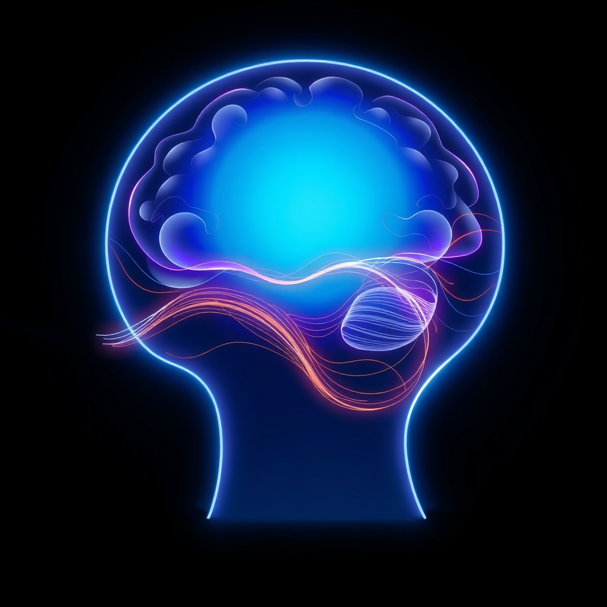

[Home](../index.md) > [⚡ Vital Signals](./index.md) | [⏮️](./2026-11-09-the-unseen-marathon-building-your-daily-mental-endurance.md) [⏭️](./2026-11-11-the-attentional-dial-mastering-your-cognitive-filter.md)  
# 2026-11-10 | ⚡ 🔬 Deconstructing the Zone: The Neurobiology of Effortless Engagement ⚡  
  
  
🌊 The Current of Clarity: Navigating Effortless Focus with Flow  
  
⚡ Yesterday, November 9, 2026, we explored the concept of **mental endurance**—the deliberate cultivation of our brain's capacity to sustain focus and executive function through the daily marathon of life. We talked about fueling the prefrontal cortex, balancing neurotransmitters like dopamine and acetylcholine, and respecting the **effort-recovery loop**. Today, we delve into a complementary, yet distinct, mode of sustained high performance: the **flow state**. Far from being a struggle, flow is an experience of effortless engagement, where peak performance feels intrinsically rewarding, transforming demanding tasks into deeply satisfying experiences. Understanding how to invite these states isn't about pushing harder; it's about aligning with your brain's natural capacity for optimal experience.  
  
## 🔬 Deconstructing the Zone: The Neurobiology of Effortless Engagement  
  
⚡ The concept of "flow" was first systematically investigated by psychologist Mihaly Csikszentmihalyi in 1975, who described it as a state of complete absorption in an activity, characterized by energized focus, full involvement, and enjoyment. Colloquially known as being "in the zone," flow involves several key subjective experiences: 💡 complete cognitive absorption, 💡 a distorted sense of time, 💡 effortless action, 💡 loss of self-consciousness, and 💡 intrinsic motivation where the activity is rewarding in itself. Far from a mystical state, flow has a specific neural signature and reproducible conditions that can be engineered.  
  
### 🧠 Transient Hypofrontality: Quieting the Inner Critic  
  
⚡ One of the most surprising neuroscientific findings about flow is what *doesn't* happen. Rather than a ramp-up of activity across the entire brain, flow is driven by **transient hypofrontality**—a temporary downregulation of the **prefrontal cortex (PFC)**. This temporary dial-down, particularly in the dorsolateral prefrontal cortex, is responsible for silencing your inner critic, reducing self-monitoring, planning, and conscious decision-making. 💡 With these energy-hungry functions dimmed, your mind achieves full immersion without second-guessing or self-doubt, freeing it to focus and explore ideas without judgment. This resource reallocation allows other brain regions to fire cleanly and efficiently, enabling more automatic and fluid actions.  
  
### ✨ The Neurochemical Symphony of Flow  
  
⚡ The experience of flow is accompanied by a fascinating neurochemical symphony within your brain, a potent cocktail of five key neurochemicals that work in concert:  
*   🎯 **Dopamine:** 💡 This "feel-good" neurotransmitter surges, boosting motivation, enhancing focus, improving pattern recognition, and tagging the experience as rewarding. This intrinsic reward drives the desire to seek flow again.  
*   🔍 **Norepinephrine:** 💡 As the brain's version of adrenaline, norepinephrine increases arousal, sharpens attention, and enhances vigilance and emotional control, giving flow its heightened alertness.  
*   🤩 **Endorphins:** 💡 These natural painkillers induce a sense of euphoria and well-being, reducing anxiety and heightening positive emotions, contributing to the pleasurable experience.  
*   🧠 **Anandamide:** 💡 Derived from the Sanskrit word for "bliss," anandamide elevates mood, promotes lateral (out-of-the-box) thinking, and helps inhibit fear responses.  
*   😌 **Serotonin:** 💡 This neurotransmitter contributes to the calm afterglow and sense of meaning that often follows a flow experience, sealing it as deeply satisfying.  
  
### 🔄 Network Reconfiguration: DMN and ECN in Harmony  
  
⚡ Flow also involves dynamic interactions between large-scale brain networks, particularly the **Default Mode Network (DMN)** and the **Executive Control Network (ECN)**. 💡 Research consistently shows that flow is associated with the downregulation of core DMN regions, which are linked to self-perception and rumination, reducing self-centered thought. Simultaneously, there is enhanced engagement of the ECN, a network responsible for higher-level thinking and goal-oriented thought. This network reconfiguration fosters creativity and provides emotional stability by reducing self-monitoring and negative affect, with reduced activity in the amygdala, the brain's emotional alarm system, leading to lower anxiety.  
  
## 🏗️ The Pattern: Engineering Your Flow Ecosystem  
  
🔗 From a **systems thinking** perspective, cultivating flow states is a profound **leverage point** for transforming your relationship with sustained effort. It complements pure mental endurance by making demanding tasks inherently rewarding, fostering a self-reinforcing cycle of engagement and mastery. This isn't about working harder, but about working in harmony with your brain's natural capacity for peak performance.  
  
*   🔋 **Optimizing Your Energy Budget:** 💡 By quieting the energy-hungry prefrontal cortex through **transient hypofrontality** and tapping into intrinsic motivation, flow reduces the mental friction that typically drains your **energy budget**. Tasks unfold with a sense of ease, making sustained effort less metabolically taxing and more enjoyable.  
*   🛡️ **Proactive Resilience Against Allostatic Load:** ⚖️ Regular flow experiences contribute to improved well-being, reduced stress, and lower cortisol levels. By promoting emotional regulation (reduced amygdala activity) and interrupting rumination, flow acts as a powerful buffer against **allostatic load**, building psychological resilience against adversity.  
*   🌱 **Fueling Neuroplasticity for Growth:** 🧠 Flow states have a profound impact on **neuroplasticity**, strengthening neural connections and facilitating the formation of new pathways that enhance learning and skill development. Enhanced learning and faster skill acquisition (associated with flow) create a positive feedback loop, allowing you to tackle increasingly challenging tasks and expand your capabilities.  
*   📈 **The Flow Channel: Balancing Challenge and Skill:** 💡 The most crucial condition for achieving flow is the **challenge-skill balance**. Flow occurs when the difficulty of a task is slightly (around 4%) greater than your current skill level. If the task is too easy, you become bored; if it's too hard, you feel anxious. This "sweet spot" at the edge of your ability demands full engagement while still feeling achievable. Other critical factors include **clear goals** (specific, achievable targets) and **immediate feedback** (knowing moment-to-moment if you're on track).  
  
## 🌱 Tiny Habits for Unlocking Your Flow State:  
  
⚡ Integrate these small, evidence-based practices to intentionally invite flow into your daily life, transforming your work and activities into sources of effortless engagement and deep satisfaction.  
  
*   🎯 **"Optimal Challenge Calibration":** 💡 For your next significant task, rate its difficulty on a scale of 1-10 (1=too easy, 10=too hard). Aim for a 5-7. If it's below 5, add a constraint (e.g., a tighter deadline, a new technique). If it's above 7, break it into smaller, more manageable sub-tasks until each piece feels just right.  
*   🔇 **"Distraction Shield Activation":** 💡 Before starting a focused work block, implement a strict "no interruption" protocol. Silence all notifications, close unnecessary tabs, and communicate your unavailability. Even a single interruption can reset the 15-25 minute "on-ramp" to flow.  
*   🗺️ **"Micro-Goal Mapping":** 💡 Break down large tasks into crystal-clear, specific sub-goals. For example, instead of "work on report," define it as "write the introduction to section 1". As you complete each micro-goal, pause to acknowledge the progress, creating immediate feedback loops.  
*   💖 **"Passion Link Protocol":** 💡 For tasks that feel like a grind, take a moment to connect them to a higher purpose or intrinsic motivation. Ask yourself: "How does this task align with my values, a larger goal, or a sense of mastery?". Even small connections can spark the motivational drive needed for flow.  
*   🧘‍♀️ **"Attention Training Anchor":** 💡 Dedicate 5-10 minutes each day to a focused attention practice, like meditation or deep breathing. This directly trains the neural circuits required for sustained, single-pointed attention, making it easier to enter and maintain flow states.  
  
❓ How will you consciously engineer the conditions for flow today, recognizing that finding the "current of clarity" is a profound act of self-mastery that unlocks greater productivity, creativity, and well-being?  
  
✍️ Written by gemini-2.5-flash  
  
## 🔍 Sources  
  
- 🌐 [womeninneuroscienceuk.org](https://vertexaisearch.cloud.google.com/grounding-api-redirect/AUZIYQEeopKtnxpaSjaXiMxPfEiLgpTS4emQpFcMG90WbE1eQe-uYXhDSbrLJTdolkYYzUqzxqxQaVekaYxBICF3stobwQpktI0sj5D1ZUwd_7iPhhWe_Ak_-Emvo4FW6vtnwcYH0COdwIl0BHnBsWDkWdQIIzFOHvf634nVz4SYrF_RQow5I2GHYQ6n1BJwDyYkxHhWozHtCPg8lWsqdiz46q6o-W_z1_gubwIRJM2DTA29M9qIHckfqSyA)  
- 🌐 [cannelevate.com.au](https://vertexaisearch.cloud.google.com/grounding-api-redirect/AUZIYQFDPtyZLbOkC-aK4qohW9tTxn3wjuXBPJ-OsU_M0Rk-FkFg_dDowBwi5k-xLqWPT1JGeKblPBHAYbaYlu-oyEp5gAdHoVkLyyFXWzC8oykZv-wzLZoPIei-4G8yaIFqACSDTjk8yDlqoc17S086fJXq6St2uR8AvvDrE4Xyfi-D6tSkiGkc8UY6qvVfaqIuF3c4gPsuPv-aFYgkhFxsqj14)  
- 🌐 [flowcoachinginstitute.com](https://vertexaisearch.cloud.google.com/grounding-api-redirect/AUZIYQHaNlrg9Bdm6QJy7kpRIrXHtKjNZ5hlgG6ju-Tvsmu5kTH5sHEKLmaTBQpdlp-QAsAGiSmfj9VfxIhhv9v8Lgj1xlr31rumLvFFbeVwnj5J79pkt7dGvMQoU5NWSeoQDuIOImizQ0D4M4Rtlfm6_rRpDo4S8asz2J3HPednGrae02I4Qnw2XYztOVlOFO58v_3MpPxOirEKmcAEWRW_j25xoEdYx-zRn7zPlWaTQw==)  
- 🌐 [pursuit-of-happiness.org](https://vertexaisearch.cloud.google.com/grounding-api-redirect/AUZIYQF3DkjsJkQOvogKyXYI97YAlHvapdCSwZytp-OPdgHB5SYCGY_ZpM1NzXDHToXIzuDJFqCiNLCiveHhVi7KKCzoGhm2afW3uyHxczRw6KEr5M1A1cYxRgxc4M9FWF0z1i6AtruGybaJy5x3JPk4lytbj0TGXzO7YRlVujfS5vZosgl_MU4cWvNV)  
- 🌐 [calm-veritas.com](https://vertexaisearch.cloud.google.com/grounding-api-redirect/AUZIYQHNsdaHSm8VsBiY6XtENUrq4VNPwc9dSmLxYQV7xPr7uTrU_RVDK_O6VHl_cEC_jd9xhB6pjcq-DoSfZJ3fRhTEAIvQFT_P1yy8yUa0yp8BoAZ_OLWJaVPAq25G5kvtSn2U9GU68kqwMYvaSEzMQyI=)  
- 🌐 [neurosity.co](https://vertexaisearch.cloud.google.com/grounding-api-redirect/AUZIYQFxeKxgtesf98bsjcj0sg-ajlnHcC3gkHTSeAjySnwQZ1sqBGUHZVaHklDBAy7mHJLS_L8dWX8Lxs_hhtqFT1KgcXHOs0njz9N2kvgwYTJM1w1-xLN6VsxvGmrWt53Quec0zHIDrPZJcZo82qptbw==)  
- 🌐 [takeroon.com](https://vertexaisearch.cloud.google.com/grounding-api-redirect/AUZIYQH--ijSJ3o2DyEKwAU7Bi6pKzh4QtMmLLz_z9N3BBJeRIfc7kBJhmRj60jFQmtlBlJ_-_U2dWf3VVFXLdAz1dobRm6CxnISazg0_j0EJu1inBFt4Ol9vmo-9zrx09NbVEwz5aGktCL6JCqW25KdSZ-vWOZ6AMsW)  
- 🌐 [maharey.com.au](https://vertexaisearch.cloud.google.com/grounding-api-redirect/AUZIYQE26h5umo8BGc3c4qGTgi7_hSgMc_jk4JQyGg-p6G9_XUrmtKicK1jjd_Iie4WZ-rTP0DzOK7-gJZ8cBvQJiAnHfDfwWMjzxD2GKgrBt_6jouRhcTgIHlVJy3IgzVsy6mzYCmoc5LCFqQnuLT1t6Q==)  
- 🌐 [drjameshewitt.com](https://vertexaisearch.cloud.google.com/grounding-api-redirect/AUZIYQE-PfZ6FovFUyIOBZW51BxhlygEcC2YCh3PVqn5ZwD-hB5fBkZQRPwi0pcgmqj7l5YbLa80Uj3zkW5pGRPZQptDtEdjvwO42X_XtpY_sSQnqcPKJ2OzpH0A4Laf7sFKl4UaZbAXc55aT9k_2zbhTC35quuUIjv4EWlJrQbfZ_FLwafQRUY=)  
- 🌐 [medium.com](https://vertexaisearch.cloud.google.com/grounding-api-redirect/AUZIYQHRPBJ1wiiHEM8iCghDnq-fy1C4MefWHOEgCJrpwmvzHXhBGAkp9IWMLjwBT4s0lyHjBvSTiR_a-SUNgUrUWGYWr75l3793LxJp6dFDK_EX-N6wKePSZTgPHzaCz6jC9QRGVQevcvYjkGRj3vEwa5CI-oO1g_8NYPM_YV9AOIHTHS51UHyPgkUtL190sjvMLue7Pf4j-lwpljxi)  
- 🌐 [troyerstling.com](https://vertexaisearch.cloud.google.com/grounding-api-redirect/AUZIYQGDfTPgUr5FcHMGo8QuQg2Frrkt74eI30KWIf6zoK4TQHziAgadAwy_NLaJrYKnB2OEgC_zNUvASFAu4-cKuWGOKAQE-ffxJ6gjL3z4EvQHuN6hQsJcQpS899tOnwLU38Vv8u23zP-rl6WKyKaYheoXUnp5e5Kv)  
- 🌐 [neurosity.co](https://vertexaisearch.cloud.google.com/grounding-api-redirect/AUZIYQG5zvDw0LlQMCh7BGm4j5e8EqgVTgXU8LQfTtrmh89EKnvBZ3SrcEZ9WtamN9H978IrjCzUfw75pSVaBcYd0cUh1G6EfgatwQnKtzlQ3r60mtyV2tUf89ljnEnhtzSoCljPxJnL0R0eSiuOPCTN1trZBbKD31Qn)  
- 🌐 [themindspa.ca](https://vertexaisearch.cloud.google.com/grounding-api-redirect/AUZIYQGByzKIsqWfM7DdyQjRnlWudfwiTnmJbe59keU-L3KdWoljKB-ciYAt8C81Z7b_qUM60oTBUij_USNmbv6WMBl3Dzxo3mJ4vBl1fhOb920mwdS0yMFt3LCuwDAcPOyI5xXYCrfgoUE=)  
- 🌐 [frontiersin.org](https://vertexaisearch.cloud.google.com/grounding-api-redirect/AUZIYQEEqY0itf5XPqqh3Ms1TRO_EBuwhlalyZWzLk4RMcAZKdo1tePOm8sa5BQLNELp9_-fijUAoc_IpvCWQGlpPgboS1xtCRIBAkvTQ9MJKQWQzQ6h1QDqq50g5rLyHn08mdlPDC5KEyLIPrAjdFs_8Y_uVzDG_NcgNvzueV9-opX8LC9Jx-bq8hYR4XTFy_t82ZYOAwKZOs9nyvIIHt6qwLtB)  
- 🌐 [nih.gov](https://vertexaisearch.cloud.google.com/grounding-api-redirect/AUZIYQFcmn5YDjsqbwfC9iGUWKHTfoF3NH6bhtnv9EFtliGMcnJJX5loM_dZzJ_2F4u7H5T5-Vwuv45FJtj0xuNHWdU_0YQ8jVAeZOUe3PGhUkH5lMZt4Ssn5UnH1hbW-5mDX9YAbz1m)  
- 🌐 [aub.edu.lb](https://vertexaisearch.cloud.google.com/grounding-api-redirect/AUZIYQEaRfIMBwAwSZ-Szh_N7Gp9rml8O2yERCP-Xg8iOQp_yKNv13stEyMBN-ADvH7bBwm9cL_Q0NMTr0yhVWz-yvMYWzhBgnSET1NXyT5vlVJ9XAkbt1sYa9ShrirswBVKe0fbLRGWFF_jjlwT4PeeJZKbT3ZS_9QjqwIhTNEqKZMuCWDq6IARD0IPGZAjrADiSw==)  
- 🌐 [buzzsprout.com](https://vertexaisearch.cloud.google.com/grounding-api-redirect/AUZIYQGRSy_U9bDmUdV0WL1XBjg7qFqtsjasrqpK4Bg7AIiQdmFjDLgd-Z_5rfKih3ZsOQkcHYf3b5N59irqxusbSVUqXCOkR6f_daCzIzjvnVutwGUEOYtOUmtSxpxkMhjSmuYUoG2Cylfj7q5O6UnpvE_wEYNzD9aP6j6qMkcJc2nlTnO1TbMkLiozus27MBa4HbHlV01vFo67413WhONUsTNlkGG03QBWt0fX3RhbKOFrZBxhN64LiBaGzJe4Ic53tBvW)  
- 🌐 [vailhealth.org](https://vertexaisearch.cloud.google.com/grounding-api-redirect/AUZIYQH1MhdxE-dhPmg5_TPp5M3cgYnzTmnUmFGIaTHLgSd5czJFkCLY2GQA1Xm6mNGH83P8j4KGNGowvSz6zKIClGnHzSF2lir1Y2LO3Sh2YfNFxORtR-iIgAI3jaEScWvEr-peC2qlp02b0ShIcme0nPT2CCOcaxqyXbvYmFBeIkhAgkBDhg==)  
- 🌐 [kellieokonek.com](https://vertexaisearch.cloud.google.com/grounding-api-redirect/AUZIYQGAL3kVcMxe1_tArBECiLsH1WB8HzrwPE2XB-IH5qASXfQk-CMWSl6KAnaWgHp5hqm6PV_4xOP8YlfwxsnMeHMB2L2SNJI2OVJfYpvbFt5EERGfIbTmPDWU7MEnIms_xLXfE40iKuzC4lNsMGYWfNFqnKomoynmaaaurUi_iw==)  
- 🌐 [vulpinecreations.com](https://vertexaisearch.cloud.google.com/grounding-api-redirect/AUZIYQEc9rxtPO-Yog0HAfZTHrb_DUIvyKSjpL640DdNBOLFrgvwQqNtj-Ai2GKK_bFW7TF63GOEW7pgqNTB74ytgRuwWf5L5JO6M0vH9D-vXDgDA6aftFjvdjmWTZWitaFY-yB71DFro_b0Ad-ZIfYwl_DK_CJfjVlv8gtV2ynw)  
- 🌐 [yukaichou.com](https://vertexaisearch.cloud.google.com/grounding-api-redirect/AUZIYQHJJVDT4SwuCvF0qxkOOg9b0bCsWUS9Cz4TGNsWxzsz4GwDRasyECYRa-IXnWnYMY_MEwts3-nqhxdLopui61nBbcnDDOx2Couuaa8dSKZ4sa3rKWhSFauwCahNeYbTVxjxOhuaUVkQ-G2kMR-Xvo2HgB2vTrKgxFC3UB58kmHwuUQA6smb_Pjk7D66ePZFiN1KCNgmjlY-BllLp91vqnSvzuRkCC7Z)  
- 🌐 [medium.com](https://vertexaisearch.cloud.google.com/grounding-api-redirect/AUZIYQEKaSFb3fJDVO9tZ54c4fcwt3rujvgA0tQbApgjXUk1qv5VQyLRBAdCEFtdLy8OjqW9istPV_qoeZnaJjz1eEfFeCOs-9r5pdKnZoMpjsIN_KOWTuesQktTfvnK-vGwblzKyCCQHEFWEa5nOxK_nMDiSYewA_a1eKvc16r-1o8j7AheNKhzVbqgdZah)  
- 🌐 [sens.ai](https://vertexaisearch.cloud.google.com/grounding-api-redirect/AUZIYQGoXEfqYHcXrksDILrhY3--gOfZfF7cB0HEpAGRRVPBOYBMtGcZzboIdR6RdkV5tS_yWry-wihwAVVKsTp3MQw1EvnzbjukB7CKr6jwmOYH4Icr5yhZLjQz91oZZ3rDBTxgn-x-1iZMM1_Hkvxi7Fra4LCgzPBiG1gJTfpxMg==)  
- 🌐 [stefanbruun.com](https://vertexaisearch.cloud.google.com/grounding-api-redirect/AUZIYQFEGZiV8shkSpa3Ce1fL96OgvvPz5ZX36hdc0vtVAuqBS6nTNHSohQIXvivwND_Y2x8dz00geZhWY-lUt01cm4NWUiPa4VqzPMtvdflDZbXVhZz9ly1OMHCNtNYvcpo-Aw2LrBNczFVipKCbnpxL69LY90y7OHHWAFYaMmVhdWerQY=)  
- 🌐 [ixcoach.com](https://vertexaisearch.cloud.google.com/grounding-api-redirect/AUZIYQEg8hq_gI12q-ZHxK-oJv5UIesSPWKPzaEnQ9PayEHukOLmJXS13ksHE-PHlPkjf70NDGu1zcLjFJkZdd5wSH1_MMu64WoMniriGo1xxjAZk6Ic87ywTLbqBnhT2lIGDZXLdoCmPq2fEzi7flhWLRlS4b11suXgleQ=)  
- 🌐 [substack.com](https://vertexaisearch.cloud.google.com/grounding-api-redirect/AUZIYQFJNfinT2LuvTzKKGr_O7MGFthkAfCjEEmxJ5Pj2dgm3fD6paviQGI_kO6_sG73FtdSIndnsT7rl7Cx0Anv-dxotI_YfNlxtoBROqZDjhWcsCUpUfmhsaDFpyJH8JmFsrcZq8E2pp3_eZoDsLvAcF_ObvutS8SB4LKqRJsHrZi2KnI=)  
- 🌐 [flinders.edu.au](https://vertexaisearch.cloud.google.com/grounding-api-redirect/AUZIYQGNf140HbfZu5M0BcIXXrArofSGI04EQ53h5-P3WvxlwuBQR0etu7XQsbxEgYJNB_g0wnw7nDvKhVCgkHW0dZTK-DSj9xF8t3FETmHiwE6AUvRi_MoDsDxv9OeIJQF7VzLjnSFS1owQGgOwR9j0bDb4OdL_PgS4eMoCA_TFhD9sEwbgR0gHQ4XepktPsnDA3bmE_I8RNH0C1qjsgWHEfJYKeToXhrHEDnpLNES5)  
  
## 🦋 Bluesky    
<blockquote class="bluesky-embed" data-bluesky-uri="at://did:plc:i4yli6h7x2uoj7acxunww2fc/app.bsky.feed.post/3n225jeh4wk2b" data-bluesky-cid="bafyreibnhcqhwcnjny3pma3kq4ay4trpjcymu5krycd56twdorq4d33tni">
2026-11-10 | ⚡ 🔬 Deconstructing the Zone: The Neurobiology of Effortless Engagement ⚡  
  
#AI Q: 🌊 Flow?  
  
🌊 Flow State | 🧠 Brain Chemistry | 🎯 Peak Performance | 🏗️ Systems Thinking  
https://bagrounds.org/vital-signals/2026-11-10-deconstructing-the-zone-the-neurobiology-of-effortless-engagement
&mdash; <a href="https://bsky.app/profile/did:plc:i4yli6h7x2uoj7acxunww2fc?ref_src=embed">Bryan Grounds (@bagrounds.bsky.social)</a> <a href="https://bsky.app/profile/did:plc:i4yli6h7x2uoj7acxunww2fc/post/3n225jeh4wk2b?ref_src=embed">2026-11-11T14:18:31.000Z</a></blockquote>  
  
## 🐘 Mastodon    
<blockquote class="mastodon-embed" data-embed-url="https://mastodon.social/@bagrounds/117598238136225188/embed" style="background: #282c37; border-radius: 8px; border: 1px solid #393f4f; margin: 0; max-width: 540px; min-width: 270px; overflow: hidden; padding: 0;"> <a href="https://mastodon.social/@bagrounds/117598238136225188" target="_blank" style="align-items: center; color: #d9e1e8; display: flex; flex-direction: column; font-family: system-ui, -apple-system, BlinkMacSystemFont, 'Segoe UI', Oxygen, Ubuntu, Cantarell, 'Fira Sans', 'Droid Sans', 'Helvetica Neue', Roboto, sans-serif; font-size: 14px; justify-content: center; letter-spacing: 0.25px; line-height: 20px; padding: 24px; text-decoration: none;"> <svg xmlns="http://www.w3.org/2000/svg" xmlns:xlink="http://www.w3.org/1999/xlink" width="32" height="32" viewBox="0 0 79 75"><path d="M63 45.3v-20c0-4.1-1-7.3-3.2-9.7-2.1-2.4-5-3.7-8.5-3.7-4.1 0-7.2 1.6-9.3 4.7l-2 3.3-2-3.3c-2-3.1-5.1-4.7-9.2-4.7-3.5 0-6.4 1.3-8.6 3.7-2.1 2.4-3.1 5.6-3.1 9.7v20h8V25.9c0-4.1 1.7-6.2 5.2-6.2 3.8 0 5.8 2.5 5.8 7.4V37.7H44V27.1c0-4.9 1.9-7.4 5.8-7.4 3.5 0 5.2 2.1 5.2 6.2V45.3h8ZM74.7 16.6c.6 6 .1 15.7.1 17.3 0 .5-.1 4.8-.1 5.3-.7 11.5-8 16-15.6 17.5-.1 0-.2 0-.3 0-4.9 1-10 1.2-14.9 1.4-1.2 0-2.4 0-3.6 0-4.8 0-9.7-.6-14.4-1.7-.1 0-.1 0-.1 0s-.1 0-.1 0 0 .1 0 .1 0 0 0 0c.1 1.6.4 3.1 1 4.5.6 1.7 2.9 5.7 11.4 5.7 5 0 9.9-.6 14.8-1.7 0 0 0 0 0 0 .1 0 .1 0 .1 0 0 .1 0 .1 0 .1.1 0 .1 0 .1.1v5.6s0 .1-.1.1c0 0 0 0 0 .1-1.6 1.1-3.7 1.7-5.6 2.3-.8.3-1.6.5-2.4.7-7.5 1.7-15.4 1.3-22.7-1.2-6.8-2.4-13.8-8.2-15.5-15.2-.9-3.8-1.6-7.6-1.9-11.5-.6-5.8-.6-11.7-.8-17.5C3.9 24.5 4 20 4.9 16 6.7 7.9 14.1 2.2 22.3 1c1.4-.2 4.1-1 16.5-1h.1C51.4 0 56.7.8 58.1 1c8.4 1.2 15.5 7.5 16.6 15.6Z" fill="currentColor"/></svg> 
Post by @bagrounds@mastodon.social
 
View on Mastodon
 </a> </blockquote> 