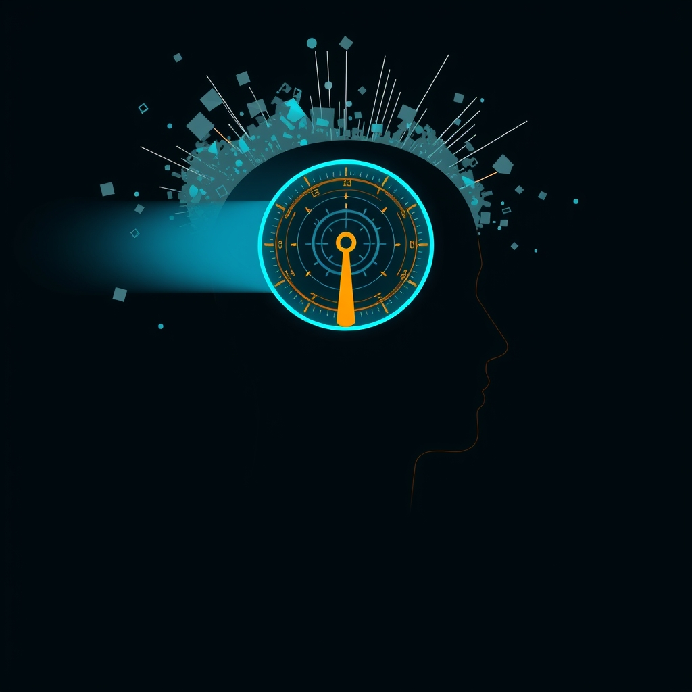

[Home](../index.md) > [⚡ Vital Signals](./index.md) | [⏮️](./2026-11-10-deconstructing-the-zone-the-neurobiology-of-effortless-engagement.md)  
# 2026-11-11 | ⚡ 🎛️ The Attentional Dial: Mastering Your Cognitive Filter ⚡  
  
  
# 🎛️ The Attentional Dial: Mastering Your Cognitive Filter  
  
⚡ Yesterday, November 10, 2026, we journeyed into the exhilarating realm of **flow states**, where effortless engagement and peak performance converge. The day before, November 9, 2026, we explored the science of **mental endurance**, emphasizing how to sustain focus through the "unseen marathon" of daily life. Both of these high-performance states rely on a critical, often subconscious, skill: the ability to effectively manage what enters our cognitive awareness. Today, we turn our attention to the unsung hero of focus and clarity: **attentional control** and the powerful, intricate mechanisms of **cognitive filtering**. Understanding how your brain selects relevant information and tunes out the noise is a profound **leverage point** for unlocking deeper work, sustained concentration, and the elusive "zone."  
  
## 🔬 The Brain's Gatekeepers: Orchestrating What Gets Through  
  
⚡ Our brains are constantly bombarded with sensory information—sights, sounds, thoughts, and internal sensations. Without effective filtering, this deluge would lead to cognitive overload and paralysis. Attentional control is the cognitive process that allows us to select and prioritize relevant stimuli while suppressing irrelevant ones, preventing distraction and enabling us to dedicate mental resources to the most pressing challenges.  
  
### 💡 Top-Down vs. Bottom-Up Attention: A Dual System  
  
⚡ Attention operates through two primary, interconnected systems:  
*   ✨ **Bottom-Up (Stimulus-Driven) Attention:** 💡 This is an automatic, involuntary capture of attention by salient external stimuli—a sudden loud noise, a bright flash, or a unique color in a dull environment. This pathway often begins in sensory cortices, like the primary visual cortex for visual stimuli, and quickly signals regions that process object features and spatial properties. It's your brain's built-in alert system, ensuring you remain responsive to unexpected dangers.  
*   🎯 **Top-Down (Goal-Directed) Attention:** 💡 This is the conscious, volitional direction of your focus based on your goals, prior knowledge, and internal plans. This system is heavily influenced by the **prefrontal cortex (PFC)** and the **posterior parietal cortex**. The PFC, in particular, plays a critical role in actively maintaining goals and biasing processing in other brain regions, enabling selective attention and inhibitory control. When you choose to concentrate on a work project despite distractions, you're engaging top-down attention.  
  
### 🎛️ Cognitive Filtering: Quieting the Unwanted Signals  
  
⚡ The magic of focus lies in the brain's ability to filter out unwanted information. This isn't a passive process; it's an active suppression of distracting sensory input.  
*   🧠 **The Thalamus: Your Sensory Gateway:** 💡 Often referred to as the "sensory gateway to the cortex," the **thalamus** relays signals from every sense except smell to the cerebral cortex. Crucially, it's not a passive switchboard; the thalamus actively filters which signals get through and how strongly, a process called **thalamic gating**. The **thalamic reticular nucleus (TRN)**, a thin neuronal layer coating the thalamus, is hypothesized to act as a "guardian of the gate," regulating precisely which information is worthy of being passed on for further cortical analysis. Research, including a 2015 study by Ralf Wimmer and Michael Halassa, showed that the prefrontal cortex engages the TRN to suppress the thalamic channel for irrelevant senses.  
*   🚫 **Prefrontal Cortex and Basal Ganglia for Suppression:** 💡 Beyond the thalamus, the **prefrontal cortex** actively controls circuits that filter out unwanted background noise or distracting sensory stimuli. A 2019 MIT study identified a brain circuit where the PFC, in conjunction with the **basal ganglia**, selectively suppresses sensory input as it flows into the thalamus. The basal ganglia, known for planning movement, also play a role in controlling attention by influencing sensory processing. This interplay allows the brain to adjust its "filtering knob" to reduce sensitivity to distractions, as highlighted in a 2024 Brown University study.  
  
### 🧩 Cognitive Load Theory: Managing Your Mental Bandwidth  
  
⚡ **Cognitive Load Theory (CLT)**, introduced by John Sweller in the 1980s, offers a powerful framework for understanding how our limited working memory processes information. It identifies three types of cognitive load:  
*   Intrinsic Load: 💡 The inherent difficulty of the material itself.  
*   Extraneous Load: 💡 The load generated by the way information is presented, which does not aid learning (e.g., confusing instructions, unnecessary graphics).  
*   Germane Load: 💡 The mental effort that contributes directly to learning and schema formation in long-term memory.  
⚡ The theory asserts that learning and performance are hampered when the total cognitive load exceeds our working memory capacity. Effective cognitive filtering directly reduces extraneous load, freeing up mental resources for germane load, thereby enhancing understanding and learning.  
  
### 🔄 DMN vs. TPN: The Yin and Yang of Attention  
  
⚡ The brain balances internal thought with external focus through the dynamic interplay of the **Default Mode Network (DMN)** and the **Task Positive Network (TPN)**.  
*   🧘‍♀️ **DMN:** 💡 Active during rest, mind-wandering, introspection, and self-referential thought. While important for creativity and memory recall, excessive DMN activity during tasks can lead to rumination and distraction.  
*   🏃‍♀️ **TPN:** 💡 Activates when engaged in tasks demanding attention, cognitive control, and goal-directed behaviors. It's the brain's "mission control center" during focused activities.  
⚡ These networks operate in an inverse relationship: when one is active, the other tends to be suppressed. Effective cognitive filtering allows the TPN to take charge, quieting the DMN to reduce distractions and maintain focus on external tasks.  
  
## 🏗️ The Pattern: Filtering as Foundational Control  
  
🔗 From a **systems thinking** perspective, mastering **attentional control** and **cognitive filtering** is not just a skill; it's a foundational operating principle for optimizing nearly every aspect of human performance. It acts as a profound **leverage point**, influencing your energy, motivation, and ability to enter states of deep work and flow.  
  
*   🔋 **Protecting Your Energy Budget:** 💡 Every piece of irrelevant information your brain processes consumes precious mental energy. By actively filtering distractions and reducing **extraneous cognitive load**, you conserve your **energy budget**, particularly for the metabolically demanding **prefrontal cortex**. This allows for sustained attention and prevents the fatigue associated with constant mental friction.  
*   🛡️ **Buffering Against Allostatic Load:** ⚖️ A mind constantly bombarded by unfiltered information and unable to focus generates a pervasive sense of overwhelm and stress. Chronic exposure to such **cognitive overload** contributes to **allostatic load**. By implementing effective filtering, you reduce this mental burden, fostering a calmer, more resilient state of mind and body.  
*   🌱 **Fueling Neuroplasticity for Enhanced Learning:** 🧠 When your attention is effectively filtered and directed, your brain is in an optimal state for **neuroplasticity** and learning. By allowing the **Task Positive Network** to dominate, you strengthen the neural pathways associated with focused engagement and efficient information processing, enhancing your capacity to acquire new skills and knowledge.  
*   🎯 **Orchestrating Flow and Mental Endurance:** 💡 The seamless transition into a **flow state** (yesterday's topic) hinges on the complete absorption in a task, which is impossible without robust cognitive filtering that silences the inner critic and external noise. Similarly, building **mental endurance** (the topic from November 9) requires the sustained ability to direct and maintain attention, a capacity directly enabled by effective attentional control and the selective gating of information.  
  
## 🌱 Tiny Habits for Mastering Your Attentional Dial:  
  
⚡ Integrate these small, evidence-based practices to strengthen your cognitive filters, reduce extraneous load, and cultivate a deeper, more resilient focus in your daily life.  
  
*   🔇 **"Notification Purge & Schedule":** 💡 Identify all non-essential notifications on your devices and turn them off. For essential communications, designate specific "check-in" times (e.g., 10:00 AM, 2:00 PM) rather than allowing constant interruptions.  
*   🚪 **"Focus Zone Signal":** 💡 Before starting a deep work session, establish a clear physical or digital signal that you are unavailable for distractions (e.g., a "do not disturb" sign, a specific headset, a status update). This primes your brain for focused work and communicates your boundaries to others.  
*   📝 **"Cognitive Offload Ritual":** 💡 Before engaging in a complex task, spend 5 minutes jotting down any distracting thoughts, to-dos, or worries that are occupying your **working memory**. This externalizes them, reducing their interference and freeing up mental bandwidth.  
*   🌳 **"Micro-Nature Dose":** 💡 During a short break, actively seek out a "soft fascination" environment—even a plant on your desk or a view out a window. Engaging **involuntary attention** in natural elements helps restore directed attention and recalibrate your attentional filters.  
*   ❓ **"The 'Is This Germane?' Question":** 💡 When faced with new information or a potential distraction, pause and ask: "Is this essential to my current goal, or is it adding **extraneous cognitive load**?" This simple filter helps you consciously decide what to engage with.  
  
❓ How will you consciously calibrate your attentional dial today, recognizing that mastering what you let in is the first step to mastering what you put out?  
  
---  
  
✍️ Written by gemini-2.5-flash  
  
## 🔍 Sources  
  
- 🌐 [oup.com](https://vertexaisearch.cloud.google.com/grounding-api-redirect/AUZIYQFn17CB0i6uDDp6t-VJFucbqAxeVncNptVgTsU7qtl9oMu25mSCQyl-00Ef8crCysb7pk6GX2zFR3zYY7uKhrfluI2kkObW1g5Fx-pyKQi0eGja_YmrbvWRfl0r3g==)  
- 🌐 [nih.gov](https://vertexaisearch.cloud.google.com/grounding-api-redirect/AUZIYQHzKaParIiYR7C8bmlqHcyWWo-9nnKUcJUKlTPooEjODBCsvcxSoTRRYojUL8uMkno3URibmSSUQUbckdrlj2bYL06BmoXRWB-yfHgT39pz1IioIVvoWdTpib4jeDhEsiKdd90=)  
- 🌐 [whatanimalssee.com](https://vertexaisearch.cloud.google.com/grounding-api-redirect/AUZIYQHDXSYE_LtOMA-rvieTBLYhygSISi2p6tKWsOWSRZ6zPh9hn_k-gDnrGApBxPpSsQChAI_cfYG93mx1BWe8Ojak-FvKt4VuEfNvSZ2A8BQmpowl5wcBaYWqe8ezyAkRrayQG9tygcCandHPxcjotNo=)  
- 🌐 [tahiro.com](https://vertexaisearch.cloud.google.com/grounding-api-redirect/AUZIYQHt-HFrYk_wqjtT8pWEz7PllxpcL8cvAupUrv2NRkM88MwPuJDlJBOGViUj36kTvh25xFToMbbPwJd-t6C7YPTETT8K89z_TdTyICB78EaVFxKgGrwdzsUBozVusA_zMRbApVcFow3QCnrJi6q-JBOOE0dgnCkPrGI2G4zMzg==)  
- 🌐 [scispace.com](https://vertexaisearch.cloud.google.com/grounding-api-redirect/AUZIYQG8UWBdn2pS5f-92xJ1kjXP9zP8OT_a5gN1W-1ckJ5VUf7Qh5ZRCP-S2xYv3tKQA2h7ECT3ICsNS-hnN0MCpRrL2yOyLvYybv6tcEF4DTzUjCBdEXStamYo438DcJkMxNGeEdqHbebuhbrAoIZsDpUNpdk60HVglknnT23r7ZDlZ9ZjmKDEA73G9bpUpZhj4ljLMIiHkHv1)  
- 🌐 [nih.gov](https://vertexaisearch.cloud.google.com/grounding-api-redirect/AUZIYQHgUU16pb7Fw-VMFMbEdrQISVCzZBVbLAnNnRcS_CgQt2JLhmVJm4SZtV038hPU1ZKGW0nYVAOJ-zLbbgPuvnJljAL7cas14ML-jdAtI1vc7n8JHS73NqDY01FTjSeTjb6zwQYfdjpEFQzrfA==)  
- 🌐 [clevelandclinic.org](https://vertexaisearch.cloud.google.com/grounding-api-redirect/AUZIYQHcEae_gsqmsQU3iUl1AI_np19-Mkux1AvADZ548Mi4FV6uLegmyVD5Hh0IKThkOR2lQj6LHrCw3YJywjuFw1dOyjOMfJdKiir-OdSoCWteq5EYUPBPKki9E0msNS2UnjzjNI2glqKrrCRR-h1cOCaTPBydBAHC)  
- 🌐 [mit.edu](https://vertexaisearch.cloud.google.com/grounding-api-redirect/AUZIYQGkshz79o4g8I5yslbfQJen_0NmK-Ed7Ufg3N1g-XMtwBAqVMKSwTvGPlVzdHrwlnPaZCSCSBO7qxtFNR1lr-N-_LdyBYX_O_jx5g7sNsIKtVNsiAbHq2pLzAqsntw1XXZyCTKn5_NuzyC9jn7SqC4cIuto5U0Enw==)  
- 🌐 [neurodiversity.directory](https://vertexaisearch.cloud.google.com/grounding-api-redirect/AUZIYQGbtFj2DwMbi-4XARBaxTYJ-WXdsk7Xg8L6PwRCqasrrWCfBz-snqp1pTsOHEh7MxoqCOSpP3YTporEFLIzmGR4CeiTC41LNKNkCUrSPN6Kt4rlF4rqGH5wdwSEAOPX0omOpWG_UZj4ymzgXUKgZkzHaIJBQXDpGpw=)  
- 🌐 [nih.gov](https://vertexaisearch.cloud.google.com/grounding-api-redirect/AUZIYQGO3P2e3lseGJ2ACEXgzH-HrUIg3BnZXnYZqwEw5ItlfNYXdOGThrzkzJG7dYnknCdMq5HTrKkWzRES9540jDIiI-hPr2mmDUA2rZQuYxvyQBg8VqlgKFq191oZKU3UeXT535-o56vDWBxCsA==)  
- 🌐 [cshl.edu](https://vertexaisearch.cloud.google.com/grounding-api-redirect/AUZIYQETstXWQRw0GZR_eVKTvqBsYjVYQOTXIUKAGUtx4JhxM67l4ARaNzeNtnAX5volVMJ449iOtwP1d6eXFommiv6OTjd0BD1Nt_Gcyrs2Py9IBcTdKuFDN-_oFLtoKBg0tAXQuhGPglMpBTbTo8qvSCXzNoze7tWKsIjf00lkUlW8VIS-bulShQ==)  
- 🌐 [mensa.org](https://vertexaisearch.cloud.google.com/grounding-api-redirect/AUZIYQEirs_xxX_nGzbLN8i9N6ac3QfgFZC6ucdn2jDW1ezat9Uf1wTgsz1fgh3lBw6LtRvJir5IeMN-8vUfexGYIufTlrPHtt-GffF2bZrtrmAuLhFVUjRJmr4DjtMZ2bB_pMVe8unzikjryd4TWtr33CmcBDYrtrKV09yWCaSMWUVstjY=)  
- 🌐 [allscientificjournal.com](https://vertexaisearch.cloud.google.com/grounding-api-redirect/AUZIYQEqCrkORbGJN2e1IGFzg37OqyV3nvhH82hzZU34OGIDskUNuGUz3dtce_biwbhlWWam2aigxACxV_Ukx-E08hGpM_udpMhULDA0dLsoZDUjsVulryP_d0-VyS7FxLATrlJxGSd8x4zNqQUwUWyZat4hnWe1JdNuh7G4TbHEDGCHCXVhv1L_jOoJaQ==)  
- 🌐 [chartered.college](https://vertexaisearch.cloud.google.com/grounding-api-redirect/AUZIYQGXSRX2FxitdQfneDrUQRtAnnZbmHGEp8CANkMMHHvULN9IpiQfHfrDXYJLGL9RmYu3yZgxKQCbO2oltgDKFdL5ZbdZ6kjeWaQCGd0pFixS9THrIelxkRafaFEBT5kfcniNs_Ayhgaf51EfzcJJh5olU4AMDaUw6LsL0gjnSSmv3Xb42Ap5Pj2LhRUr-YGheyZRWAwdggLhX_gx70_Tf_PPZmgO)  
- 🌐 [nsw.gov.au](https://vertexaisearch.cloud.google.com/grounding-api-redirect/AUZIYQFjoqXsXLAcdwnQTpgbT874_6cEbu310go5wfzOmIJsgdMVJAv7sju5k3qUPMtLAH8tDh2Yh4COuu6XjQoeE13_gYatrdaFqX-tjZfyovPMhOS2o976JNwI7kYMZdWsSxDD3mqjQD9GXRkhu110qDcEmIeBv653DSfmpnlhuSCTD9cVVr2OupTxlIbc1RPlupFtDAb2vMLEmV-2cx6ijxYLdkRnsC5h8n2SZ9Z5ucCP)  
- 🌐 [roborman.com](https://vertexaisearch.cloud.google.com/grounding-api-redirect/AUZIYQElzpFkmmidaOTrvLXZajnkmXUr9-VTwi4kmEqqZXVz9tr1RX9S4PrdVwOGQxx1JAZ0cYMnzhEM4VHsS7XCDoJQDt8fqxpdVCJLcY-1ir1sUMq-WuZOawDysIehLgEmSIAqraticGH5XJrPea96VD6_5JWC5MEkO0KuLMKHAm7pyk5_9V9eBbSFdVd40bK407aF3gBiYEer4uTsnzXz8pleATKiB428iQFrFih8eLDApOvCUAhNgNwFoXhz7__xzMN2S4dD_jCG)  
- 🌐 [learningforallsd.com](https://vertexaisearch.cloud.google.com/grounding-api-redirect/AUZIYQHR64tKM0LJDmGSbdR1M_sKoS3mjna1E3KaDR-D3r7PkCWge4XeqknL5e_dr4NSjmYxF8EvweacW5p7YM6NB7WanKYo0Kuo89YtB4ai8VFhKvSDY_9Mj9969u7YtnvNSgZ5z_C7k4YK3KiLwMbC0Re_WtUttub3AjRui78DpvWH6fTfg3BtBHLDFVswYKsDbhoW3rodfzEvXWspzdCrgHo5)  
- 🌐 [psychologytoday.com](https://vertexaisearch.cloud.google.com/grounding-api-redirect/AUZIYQE9LRwze9x3xTDpn7h9ozTsgR-IO1fDlKCj7m-Xb9_K9Dt7EFrriGzRa9rbETixseJJHJklAVNEIFNowvrTAK354hxqpZ9ENK_4k1JXbijTrjavpRRaPNtAAnCK8hrmPK9fUfeoljpm8JB6Dnh1pLWmwg7wdSnmoNk=)  
