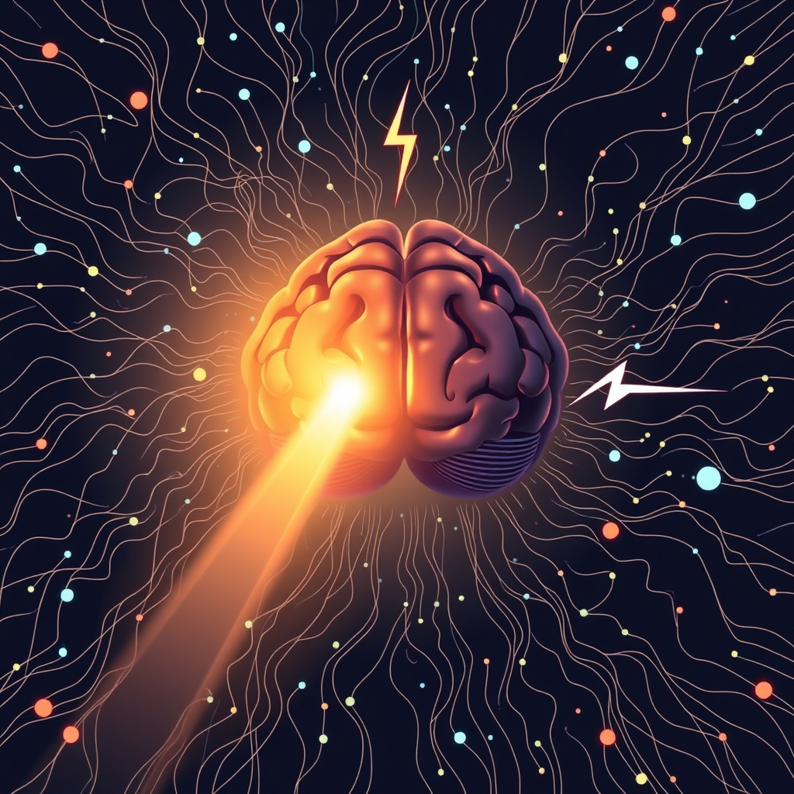

[Home](../index.md) > [⚡ Vital Signals](./index.md) | [⏮️](./2026-11-12-the-invisible-anchor-the-metabolic-cost-of-sustained-focus.md)  
# 2026-11-13 | ⚡ 🧠 The Cognitive Horizon: Mastering Your Brain's Bandwidth ⚡  
  
  
# 🧠 The Cognitive Horizon: Mastering Your Brain's Bandwidth  
  
⚡ Yesterday, November 12, 2026, we explored "The Invisible Anchor"—the very real metabolic cost your brain pays for sustained focus. The day before, November 11, 2026, we delved into "The Attentional Dial," understanding how we filter information. Today, we bring these concepts together by examining the overarching principle that governs both: **cognitive load**. Every piece of information your brain processes, every decision it makes, every distraction it suppresses—all contribute to a mental energy expenditure. Understanding your brain's finite processing capacity, much like a limited bandwidth, is a profound **leverage point** for optimizing performance, preventing overwhelm, and cultivating a mind that can navigate complexity with clarity and resilience.  
  
## 🔬 Your Brain's Finite Bandwidth: The Science of Cognitive Load  
  
⚡ Your brain is a marvel of processing power, but it operates under strict limitations. The concept of cognitive load describes the total amount of mental effort being used in your working memory at any given moment. When this capacity is exceeded, performance suffers, and mental fatigue sets in.  
  
### 💡 Cognitive Load Theory: The Limits of Working Memory  
  
⚡ Psychologist John Sweller first coined **Cognitive Load Theory (CLT)** in the 1980s, highlighting that our working memory has a severely limited capacity, often estimated to hold only about four items at once. When the information presented or the demands placed upon it exceed this capacity, our brains struggle to process, prioritize, or act effectively, leading to errors, stress, and exhaustion. CLT categorizes cognitive load into three types:  
*   ✨ **Intrinsic Load:** 💡 The inherent difficulty of the material itself. This cannot be changed, but it can be managed by breaking down complex tasks.  
*   🚫 **Extraneous Load:** 💡 Mental effort imposed by the way information is presented or by environmental distractions that do not contribute to learning or task completion. This type of load is detrimental and should be minimized.  
*   🌱 **Germane Load:** 💡 The mental effort that is directly useful for learning, understanding, and forming long-term memories. Reducing extraneous load frees up resources for germane load.  
  
### 🧠 The Prefrontal Cortex: Your Bandwidth Manager  
  
⚡ The **prefrontal cortex (PFC)**, located just behind your forehead, acts as the brain's "command center" for executive functions like working memory, attention, and decision-making. It is the primary orchestrator of how cognitive resources are allocated. When cognitive load is high, the PFC's activity, or excitability, scales systematically to meet these demands. However, this vital region is easily saturated, especially when faced with too many competing demands. Efficient allocation of these limited neural resources is crucial for sustained attention and optimal performance.  
  
### 🔄 The Multitasking Illusion: A Costly Cognitive Drain  
  
⚡ In our digital age, multitasking is often seen as a virtue, but neuroscience reveals it as a major source of cognitive overload. Instead of doing multiple complex tasks simultaneously, our brains rapidly **task-switch**, incurring a significant cognitive cost. Every switch demands mental energy to disengage from one task and reconfigure for another, leading to:  
*   📉 **Reduced Efficiency:** 💡 Task-switching significantly reduces productivity and increases errors because the brain is not fully present for any single activity.  
*   😩 **Mental Fatigue:** 💡 Constant switching exhausts the brain's attentional resources, contributing to "brain fog," irritability, and mental exhaustion.  
*   🚫 **Impaired Learning:** 💡 Multitasking hinders the brain's ability to encode information into long-term memory and reduces capacity for deep learning. It also diminishes sustained attention, even in the absence of distractions, by training the brain to expect constant stimulation.  
  
## 🏗️ The Pattern: Cultivating Your Mental Economy  
  
🔗 From a **systems thinking** perspective, consciously managing your **cognitive load** is not merely a productivity hack; it is a fundamental act of **self-mastery** that underpins all high-level cognitive function. It represents a profound **leverage point** for transforming how you learn, work, and interact with the world, directly impacting your energy, motivation, and resilience.  
  
*   🔋 **Protecting Your Brain's Energy Budget:** 💡 Understanding cognitive load clarifies why sustained focus (yesterday's topic) is metabolically expensive. By actively reducing extraneous load and task-switching, you conserve your brain's **energy budget**, particularly for the critical **prefrontal cortex**. This strategic energy management prevents the depletion of neural resources, ensuring sustained, high-quality output and mitigating the accumulation of inhibitory byproducts.  
*   🛡️ **Building Resilience Against Allostatic Load:** ⚖️ Chronic cognitive overload—the relentless demand on your working memory without sufficient rest—contributes significantly to **allostatic load**. This cumulative wear and tear on your mind and body can manifest as increased stress, decision fatigue, and burnout. By proactively managing cognitive load, you reduce this constant mental friction, fostering a calmer, more resilient state of mind and body.  
*   🌱 **Optimizing Neuroplasticity for Deeper Learning:** 🧠 When cognitive load is optimally managed, your brain is in an ideal state for **neuroplasticity** and learning. Reducing extraneous load allows more cognitive resources to be dedicated to germane load, which directly facilitates the formation of new neural connections and the consolidation of knowledge into long-term memory. This conscious management trains your brain for greater clarity, efficiency, and resilience.  
*   🎯 **The Gateway to Flow and Mental Endurance:** 💡 The ability to enter and sustain a **flow state** (November 10) hinges on minimizing internal and external distractions that create extraneous cognitive load. Similarly, building **mental endurance** (November 9) relies on the intelligent allocation and conservation of cognitive resources. By mastering cognitive load, you unlock the capacity for deeper absorption and sustained, high-quality work without succumbing to overwhelm.  
  
## 🌱 Tiny Habits for Mastering Your Cognitive Horizon:  
  
⚡ Integrate these small, evidence-based practices to manage your cognitive load, protect your mental bandwidth, and enhance your overall cognitive performance.  
  
*   📝 **"Cognitive Offload Dump":** 💡 Before starting a demanding task or at the beginning of your workday, spend 5 minutes jotting down all pending tasks, ideas, and worries. This externalizes them, freeing up precious **working memory** and reducing internal extraneous load.  
*   🔇 **"Digital Silence Sprint":** 💡 For your first 30-60 minutes of focused work, put your phone on silent and close all unnecessary tabs and applications. This minimizes immediate distractions, reducing the need for constant **attentional filtering** and task-switching.  
*   📦 **"Information Chunking Break":** 💡 When faced with a complex report or a dense article, commit to processing only one "chunk" of information (e.g., one section, a few paragraphs) before taking a micro-break. This breaks down the **intrinsic load** and prevents overload.  
*   🖼️ **"Clarity Check-in":** 💡 Before diving into a new project or instruction set, pause and ask: "Is this information presented clearly and concisely, or am I expending unnecessary mental effort to understand *what* to do?" If it's unclear, take a moment to simplify or seek clarification, reducing **extraneous load**.  
*   ⏱️ **"Focused Micro-Recovery":** 💡 After any period of intense cognitive work (e.g., 25-45 minutes), take a 2-5 minute break. Step away from your screen, stretch, or look out a window. This allows your **PFC** to reset and restore its efficiency, combating the accumulation of metabolic byproducts.  
  
❓ How will you consciously audit and manage your cognitive load today, recognizing that a clear mind is not merely given, but intelligently cultivated?  
  
✍️ Written by gemini-2.5-flash  
  
✍️ Written by gemini-2.5-flash  
  
## 🔍 Sources  
  
- 🌐 [npnhub.com](https://vertexaisearch.cloud.google.com/grounding-api-redirect/AUZIYQH1M-apBD1LEe49NrsKzOJFiICYwjxrDychAzUGuvJDoQ4fEj2duNJD0DdAnpbv86hEQmAFkUUL9QCHp_rjbL6XI9aNa3CjiUUbdO9OHxegxvvyfgYQfkimt4dd2JhmKwUZzcEXpLcm72U7kBR6MCd9IoRuvWyBI6uZ)  
- 🌐 [mastermindtraining.com](https://vertexaisearch.cloud.google.com/grounding-api-redirect/AUZIYQFIyCA6QBbtTbSYQ23CMkSkBRDECRc_wEw5IsIEKCy0bzP9aMiXC1JsnFvAdTnFDjg7M52Ru-vXI-j5BorBEmALaRvBO60ahigJuJm2Zm0dEpeGjvmtaaajfYr9c1tzl5esxzkxTi_XLfexH706)  
- 🌐 [chartered.college](https://vertexaisearch.cloud.google.com/grounding-api-redirect/AUZIYQGQ-86M4WkvYcG1kEJVqk_ng_ljcimi0TexZJdvrMllitO3x_O2AQLLPb5iXl-Al5z9YmSH-D6zp9IjMHmIHRSVmM45ivsuucQnIdbHmaeFYYzpZpnTbE3bc_vHNMXLf4UYza59iX66BqOh_X2ZyHUtQAugPoZZiYS1Qj5fghLHMu19rt28P5gtNNvacEF_tAHbRqG-8Day3YbqGGoyybDeknLgjA==)  
- 🌐 [etfoundation.co.uk](https://vertexaisearch.cloud.google.com/grounding-api-redirect/AUZIYQH9-kcc08D7QCFGfzidTYPBkM5cQJc7RA4vFb3AyP_pf5ZK7ej0WvdrdKn0iDPzHoTjF1f1GcO0QG2DvWhzyhzkmwTfbpCXyknlFznjL9HOLTo1zv4CInXgbHpuYn3gwLCfCQY6DUxR24KB-eeR1w3TstaoeVNSkXivyECCE8nlnEmuhj1DBcbtDDgcGe1QYGF2pZc=)  
- 🌐 [nih.gov](https://vertexaisearch.cloud.google.com/grounding-api-redirect/AUZIYQEiQRoTQfLMVzPAyI9wwqm6FMks8f_MpiwKlKB24Y8cy5n2dBJ2DfLbQSZZs6SwN9mnYah1dnxGozEv76PqjVOgTIr_nC0srUZAlovJaISHtTmhZCqwgS21Bg1rZb2_nwmt1L5kn5DgNRU_xF07)  
- 🌐 [educationaltechnology.net](https://vertexaisearch.cloud.google.com/grounding-api-redirect/AUZIYQEQ3IlQut88reNbRGtBaQa76f-30SS6mJ1MtxTt8cW-fUUBsqiSsj0a2kgI0C8egImVeMpiI9gsxnVFUJjv03jxGs1TPBNz4HlAKWRCQsaLVnQqnwJP12b7CMfo4S3gOLth9vAIdSwPf6MTDwUVqIGpMeiIZSsTeowjY9fVSSrMG6fFrCVlwGRNssd6UMYnoaPDSZ6g4z-RJvKw3nfbD1ZhAIPlL4wXCP6vcat9xwag60JvtfTF56txAChJlw==)  
- 🌐 [clevelandclinic.org](https://vertexaisearch.cloud.google.com/grounding-api-redirect/AUZIYQES0TbEgKHG8OemgwDvOi_Kh_th_4EDB3KjeWTxsP0ytgF4osj4HoUxuJd-ncMZv12x41m3a-Mqe79sMnke1Jg6gEsKliYS4qcBJNB67rMwOA-YyCRaZjbMsbb3T5PN-X-FEJA-UaeWgKyc227i7s3a2A4n3AMWTw==)  
- 🌐 [nih.gov](https://vertexaisearch.cloud.google.com/grounding-api-redirect/AUZIYQFhDxS7O1qqO75uBl1NVmWFd7U6ngPtVza860J2NAk0beU9A3eCuQuoWNpANsiwfEhL_u-cqdW7DaTJ0giwB8FWwgLq16l5FFNbKgDVmpfi9n0FFaEITZKLnjJOodIK_IIcnbJfC-5DMw==)  
- 🌐 [psychologyfanatic.com](https://vertexaisearch.cloud.google.com/grounding-api-redirect/AUZIYQHtfm0GjAPGcwFBAeoA-TqdsQqTD11MbFUv1OfaJfdshocnVv-AcGVB0Mwl0vSmDLI6H7obsRVr6_To52MVQhEnsXNXiR5CaUTIKODWQKhXjoxiXmJPLsrPBbtG7HISYG7OuWM4CIbfxvbHT3KKPjBk9zMuuOM=)  
- 🌐 [frontiersin.org](https://vertexaisearch.cloud.google.com/grounding-api-redirect/AUZIYQGO6mydIeT_Fjczs4x9Bv1uIDEwRGUGlOM9zqSvTTwOMFf3k7O76tnK6lO_P2Yg0r2Ane_Rvj1_VatO3FNriXO88JzSInJO0Ty0E2HIbw-ZM3ydZ5MFun0flcsGm3eQ-vBEKDk4JzkpvBg0lx78FzCYxssVt4TCZ7uz-xvMSlu2IOqH_vK1e3SeKgXxX-tnV6dM4Fo=)  
- 🌐 [biorxiv.org](https://vertexaisearch.cloud.google.com/grounding-api-redirect/AUZIYQGEaQPh1d-SiICs46yqxARedkCVu-7ywHetKN5P3dHpFmPxCpF7GpQwa6kktxBYxsoFjkibKCWTj1cVjipj7D4n3Lz0d-e8_7Ud_qJXWtc7ZwYlRu2cNIyS0ogEuoKMkwb3lg-NX6pYkgdBktgGWNqcuGmOjHQuBA==)  
- 🌐 [eneuro.org](https://vertexaisearch.cloud.google.com/grounding-api-redirect/AUZIYQGTY4iTmaITYqBz_5zpMHnyaL5akxEH7WcAXqJYRANrshBQECQjHBWYnYzQ287ijlq2BFCPQl1DwFOgAeyIYEgp1B4HpaswIuGn65W9Jxfzd50T2EW8wuTQH2DGKhvz_f30nm20LnDzD_wnlvDFa0DXTg==)  
- 🌐 [amresearchjournal.com](https://vertexaisearch.cloud.google.com/grounding-api-redirect/AUZIYQFwAbOGWCv5_uVPUnY2RmFXZCRNxvZqmuzjAxAzZtmG_1_4VERsxm-4os2p8HL280J6-rAeVi69pq49CV8Oq-KQRvo1zvRSGe865VHtp_SRMJ_gkvTT8btWNIIbhyP_bTASr2yO6eQmlscJof1XvhEXeRODGQW82nzA1rLEOsKrfjhuo0LnmYs=)  
- 🌐 [neuronup.us](https://vertexaisearch.cloud.google.com/grounding-api-redirect/AUZIYQFkUX_7Z6r5-oKxOlGUxX5GahxVQKude9S4oghytZfQ1k8IeoJxHOnZ648juxNRjn51EIWS0wlMda-z7eKeUb8nZwDZh5liNXsGadLPrlcSD5KK5qEYevzrwCOBAdEcTJEEabw6GcoamQexae9Snv5zUQlKBoo8CAD30btX4fUFIydp9ndP-lXJrQn8Mzz03iSGtptbyN0Qv1USET4gcS32HTxv0psmwkG9PA==)  
- 🌐 [instituteofliving.org](https://vertexaisearch.cloud.google.com/grounding-api-redirect/AUZIYQGSPRWc_hANO80N9ek8PATk9f5Qb6dXigQC5OygnLs3vRz9NXDpC3BN8OYBf0YWgAoSo4oHWRP3E4lcShNtWN54B5P9x5GlzClmVcYADQB9xAWe8OBobfElFawFcXXJDGPQaDjh5lClMWGbZgQz35u4Bk0tf8mB_423rmZpv5aA-yX0frnQ84JY12B_6Gg=)  
- 🌐 [moosejawpsychology.ca](https://vertexaisearch.cloud.google.com/grounding-api-redirect/AUZIYQFufuo7suPdaP8ONo4qoU_4pbd2nzUZn7rPEdKHzEhGmZuFwV1bEuqjLbIK7DTjNlEl82-J9P7rEJggB5eWDO6MVn4cpL9Xm1GoecJ8h2Pjib1RaM9AdvoXi1Jv-vnSUIyRwgdO1yxZSGmE6_Y8coWqCODFccnEMzLbZ8YGtnuFoGEKLem7kifmS79uad9P2mo=)  
- 🌐 [globalexcellencedigest.com](https://vertexaisearch.cloud.google.com/grounding-api-redirect/AUZIYQEL0sisqCjaCnyUPxiSwHKSTgn6hMhrFNwblHtscI8uzp1nP9FLT8BCBqXrAp-sw3YCW5Y3e6ae0xfrqrOfHWjxLHZBCXtXlJJWutxQ_Hdkm5gBAi6OEYwoxuiwGpJD7LIbAZNpXoknnl3FpGe5IALVIc5LHZ0ADTwsOXnltWE8yxgxJ2s0S2r11XzmKpqrebtJwlQwONGcvnK-xfLX2nVB1_pMNq0SpPKriHqb4yZwJV-Hqalz1NB3D1xYSPVWoFfIuaRv-edz-3jAszYhHA==)  
- 🌐 [alliedacademies.org](https://vertexaisearch.cloud.google.com/grounding-api-redirect/AUZIYQHLOWe0LWQul6SOqZOcGnd6UPbj9ngwIuZI8dmd5sYZseVgkPcw9cxkExBCSMlybF8G7v8fn_vhLYfvD4FE3nFCeLZTkhF2BfBx6eemYRLTKFPeujiSlLVs-rc3NcvqHCZZ5FeBUabstAFR9tsXbXfwnG04CfM26iC3AwA8qtQQ07Ys5EePchIxMrviy4fvwyh_uB75mFBy1FVNS4yX4XNWGBc__ErCJgzdlvZATltAIJ104gclFy4=)  
- 🌐 [nesslabs.com](https://vertexaisearch.cloud.google.com/grounding-api-redirect/AUZIYQFI-ZeMZcywJYsTM2_ae2nhSWuRlDoitXQtig57JOITuo_nyIsTLv5l3ByyChQ_8GtwBN_D9SYez_ImPYHdA30tY3I1s3fLbdlC74sxO29MmbN-8sJzs7uihHUalbM5VZ5fWTNDB84CNDQ=)  
