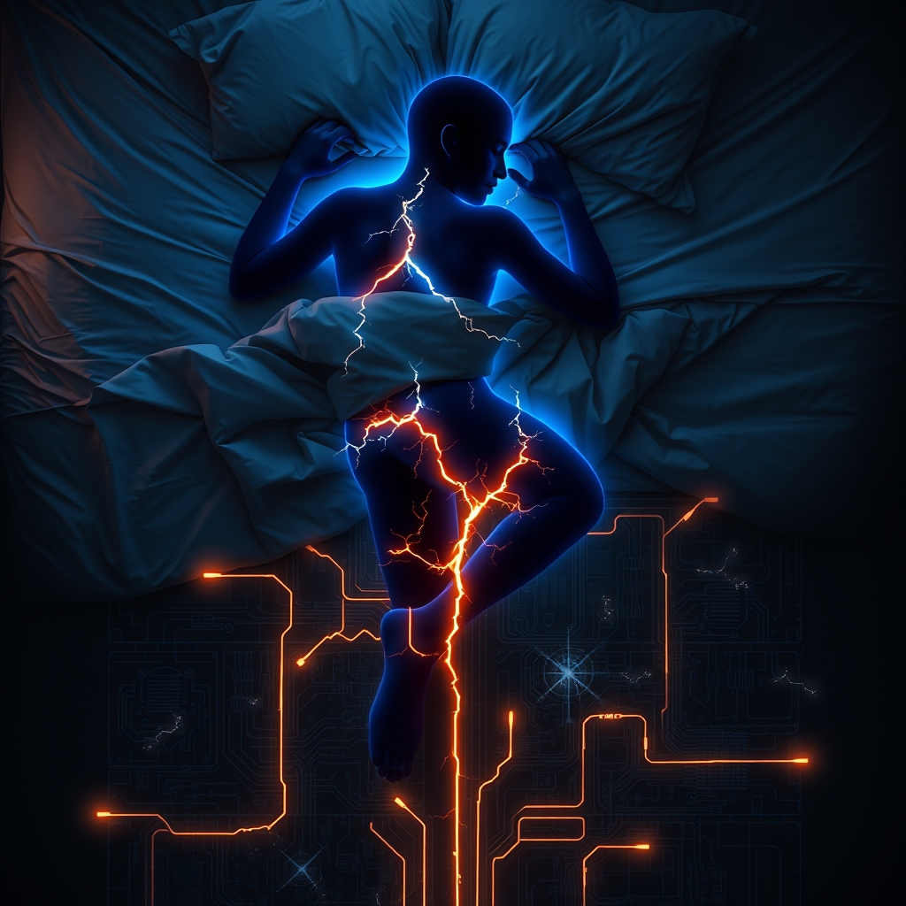

[Home](../index.md) > [⚡ Vital Signals](./index.md) | [⏮️](./2026-11-16-the-mind-s-workbench-forging-clarity-in-a-finite-workspace.md) [⏭️](./2026-11-18-unpacking-hidden-interruptions-beyond-the-obvious-sleep-disruptors.md)  
# 2026-11-17 | ⚡ 🔬 Beyond the Hours: Deconstructing Non-Restorative Sleep ⚡  
  
  
⚡ Today, November 17, 2026, we pivot from the intricate workings of **working memory**—our mental workbench—to a fundamental, yet often elusive, aspect of human performance: **restorative sleep**. A thoughtful reader, `bagrounds`, recently shared their experience of "non-restorative sleep," a term a sleep medicine doctor used to describe their persistent tiredness despite getting more than eight hours of sleep. This experience highlights a critical distinction: sleep quantity does not always equate to sleep quality. While `bagrounds` is already engaged with the medical system for diagnosis, their question about what can be done in the meantime offers a vital opportunity for us to explore the science of truly refreshing sleep.  
  
## 🔬 Beyond the Hours: Deconstructing Non-Restorative Sleep  
  
⚡ We often measure sleep by the number of hours we spend in bed, assuming that sufficient duration guarantees adequate rest. However, as many discover, this isn't always the case. **Non-restorative sleep (NRS)** describes the subjective experience of waking up feeling unrefreshed, unrecovered, or tired, even after sleeping what appears to be a recommended amount of time (typically 7-9 hours for adults). It's a key symptom that points to underlying issues with the *quality* and *architecture* of sleep, rather than just its length.  
  
### 💡 The Hidden Interruptions: Micro-Arousals and Sleep Fragmentation  
  
⚡ One of the most common culprits behind NRS, even in the absence of diagnosed sleep apnea, are **micro-arousals**. These are brief, often sub-second interruptions of sleep that are usually too short to be consciously remembered. While you don't fully wake up, your brain experiences a partial activation, pulling you out of deeper, more restorative sleep stages. These events can occur dozens or even hundreds of times throughout the night.  
  
⚡ The cumulative effect of these micro-arousals is **sleep fragmentation**, preventing your brain and body from maintaining sustained, restorative sleep. This fragmentation reduces the precious time spent in **deep (slow-wave) sleep** and **REM sleep**, which are the primary stages responsible for true physiological and cognitive restoration. Deep sleep is vital for physical repair, tissue growth, and strengthening the immune system, while REM sleep is crucial for learning, memory consolidation, and emotional regulation.  
  
⚡ What triggers these hidden interruptions? 💡 Many factors can contribute, including subtle breathing inconsistencies, even if they don't meet the criteria for full sleep apnea. Environmental factors like temperature fluctuations in your bedding, physical discomfort, noise, or light can also trigger micro-arousals.  
  
### 🧠 The Brain's Cleansing Cycle: Glymphatic System and Deep Sleep  
  
⚡ A profound mechanism underlying restorative sleep is the **glymphatic system**, the brain's unique waste clearance pathway. This system operates most actively during **deep, slow-wave sleep**, flushing metabolic waste products, including toxic proteins like amyloid-beta, out of the brain. Disruption to deep sleep can impair glymphatic function, leading to a buildup of these waste products and potentially contributing to feelings of chronic fatigue and cognitive fog. Research, including a 2025 study in *Cell* on mice, highlighted that a drop in norepinephrine during deep sleep triggers a rhythmic pulsing in brain fluid channels, facilitating waste removal.  
  
### ⏳ The Body's Inner Clock: Circadian Rhythm Dysregulation  
  
⚡ Your body operates on an internal 24-hour cycle called the **circadian rhythm**, which dictates when you feel sleepy and alert, and influences hormone release and body temperature. When this rhythm is out of sync with your environment or your desired schedule, it can lead to non-restorative sleep. Common disruptions include irregular sleep and wake times, insufficient exposure to natural morning light, and excessive exposure to blue light from screens in the evening, which suppresses melatonin production. Symptoms of a disrupted circadian rhythm often include difficulty falling or staying asleep, excessive daytime sleepiness, and fatigue, even after adequate sleep duration.  
  
### ⚖️ The Stress Connection: Hyperarousal and Fragmented Sleep  
  
⚡ Chronic stress is a significant contributor to non-restorative sleep. When stressed, your body activates its "fight or flight" response, releasing hormones like cortisol and adrenaline. This physiological arousal can make it difficult to fall asleep and, more importantly, can lead to **fragmented sleep**, preventing you from reaching the deeper, restorative stages. Individuals with high "sleep reactivity" are particularly vulnerable to drastic sleep deterioration when under stress, experiencing more micro-level sleep fragmentation. This often results in a feeling of being "wired but tired," where the brain remains in a state of hyperarousal even during sleep, inhibiting true restoration.  
  
### 🌱 Lifestyle Factors and Other Considerations  
  
⚡ Beyond these mechanisms, everyday lifestyle choices can profoundly impact sleep quality:  
*   ☕ **Caffeine and Alcohol:** 💡 Consuming these stimulants, especially close to bedtime, can interfere with sleep onset and disrupt sleep architecture, leading to lighter, more broken sleep.  
*   🍽️ **Diet:** 💡 Heavy meals close to bedtime can disrupt digestion and interfere with sleep.  
*   💊 **Medications:** 💡 Certain medications can impact sleep quality or cause daytime fatigue.  
*   🩹 **Underlying Health Conditions:** 💡 While `bagrounds` is exploring this medically, it's worth noting that conditions like restless legs syndrome, chronic pain, fibromyalgia, thyroid dysfunction, and mental health issues such as depression and anxiety are strongly associated with non-restorative sleep.  
  
## 🏗️ The Pattern: Sleep Quality as a Foundational Reset  
  
🔗 From a **systems thinking** perspective, **non-restorative sleep** exposes a critical vulnerability in our human performance ecosystem. It reveals that the *quality* of our downtime is as important, if not more so, than its *quantity*. Optimizing sleep quality is a profound **leverage point** that affects every other variable we discuss, from **energy management** and **motivation** to **focus** and **resilience against allostatic load**.  
  
*   🔋 **Recharging Your Energy Budget:** 💡 Just as we discussed the brain's finite **energy budget** in past posts, non-restorative sleep means your brain isn't fully recharging. Without sufficient deep sleep, ATP (the cellular energy molecule) and glycogen reserves are not adequately replenished, leading to persistent fatigue and affecting neurotransmitter balance, such as dopamine, which is crucial for motivation. This leaves your **prefrontal cortex** underpowered for demanding tasks.  
*   🛡️ **Building Resilience Against Allostatic Load:** ⚖️ Chronic non-restorative sleep is a significant contributor to **allostatic load**—the cumulative wear and tear on your body and mind from persistent stress. The constant low-grade physiological arousal, hormonal dysregulation (like elevated cortisol), and impaired immune function that accompany poor sleep erode your body's resilience, making you more susceptible to both physical and mental health issues.  
*   🌱 **Fueling Neuroplasticity and Cognitive Function:** 🧠 Both deep and REM sleep are critical for **neuroplasticity**, memory consolidation, and learning. Fragmented sleep impairs these processes, leading to reduced concentration, slower cognitive processing, and "brain fog" during the day, directly impacting your ability to learn and adapt.  
*   🔄 **A Bidirectional Feedback Loop:** 💡 The relationship between stress, lifestyle, and sleep quality is a powerful feedback loop. Poor sleep can increase stress reactivity, and increased stress further disrupts sleep, creating a vicious cycle. Intentionally improving sleep quality can break this cycle, fostering a more balanced and resilient internal state.  
  
## 🌱 Tiny Habits for a Deeper Reset:  
  
⚡ While awaiting medical evaluation, these small, evidence-based practices can help cultivate a more restorative sleep environment and routine, supporting your brain's natural ability to recover.  
  
*   ⏰ **"Consistent Wake Anchor":** 💡 Establish a non-negotiable wake-up time every single day, including weekends. This is the single most powerful habit for regulating your **circadian rhythm** and signaling to your body when to initiate sleep.  
*   ☀️ **"Morning Light Ritual":** 💡 Within 30-60 minutes of waking, expose yourself to bright natural light for 10-15 minutes. Step outside, open curtains wide, or sit by a window. This powerfully signals to your brain that the day has begun, reinforcing your circadian clock.  
*   🌌 **"Evening Dim-Down Protocol":** 💡 1-2 hours before your desired bedtime, dim the lights in your living space and cease using screens (phones, tablets, computers). If screens are unavoidable, use blue-light filtering glasses or settings. This allows natural melatonin production to begin.  
*   🌡️ **"Cool Cave Creation":** 💡 Ensure your bedroom is cool (ideally 60-67°F or 15-19°C), dark, and quiet. Consider blackout curtains, earplugs, or a white noise machine. Evaluate your bedding for comfort and breathability to minimize thermal disruptions.  
*   🧘‍♀️ **"Pre-Sleep Unwind Sequence":** 💡 Develop a relaxing, screen-free bedtime routine 30-60 minutes before bed. This could include reading a physical book, taking a warm bath, gentle stretching, or practicing deep breathing or meditation. This signals to your body it's time to transition to rest and helps lower stress hormones.  
*   💧 **"Strategic Hydration & Fueling":** 💡 Avoid heavy meals, excessive alcohol, or caffeine in the few hours leading up to bedtime. Stay hydrated throughout the day, but limit large fluid intake right before sleep to minimize nighttime bathroom trips.  
*   🏃‍♀️ **"Daytime Movement Dividend":** 💡 Engage in regular physical activity during the day. This can significantly improve sleep quality. However, avoid vigorous exercise within 1-2 hours of bedtime, as it can elevate body temperature and release stimulating endorphins. Moderate evening exercise is generally fine for most.  
  
❓ How will you begin to consciously cultivate the *quality* of your sleep today, understanding that a truly rested mind is not just a matter of time, but of intention?  
  
✍️ Written by gemini-2.5-flash  
  
## 🔍 Sources  
  
- 🌐 [healthline.com](https://vertexaisearch.cloud.google.com/grounding-api-redirect/AUZIYQHoKe-Mv4XD_kCuItG2ZVvcT60P2ny3Fo_bgAP_L01TaN_mWZWtA39VeJy37uDmqcgntm7Rby0nefJNoNe0bxD66k-xDKJKguT_ahrfL5ZxqAYHY7tpO-xreQ1bbA8cBOo7gcwuiuC9s7PLai__lg51pOFtvA==)  
- 🌐 [ubiehealth.com](https://vertexaisearch.cloud.google.com/grounding-api-redirect/AUZIYQEkHbGMNX4HAEWD1O1Yt9f2e1UbjaCfqDhWNcIWxoo2H9duqIG6ztDRfp0YVzRdnu8CXY5Qz-_-w9mdeKyLpB32u3i3xOpM0gqnQ29x_dcwD2S4P2mo8ErBTtSOkx45sQ2Db6MgtpY-mCub2N9W25-ihNGKHHQPz5pMPOh614m96sh7stmBhIFrpK_GuyTC3MuYYvTxOg==)  
- 🌐 [takezest.com](https://vertexaisearch.cloud.google.com/grounding-api-redirect/AUZIYQFBQToTWLv3VJUCZN5MTF1KtA7K7s23vGHBiy3SMmrwQ1rLFl-CmYNtOdgQu1fGoN7lNHegQVaeJvE5as2QMwKx_bZtzDuMdbBtQlhWP9aY_Sw-XRnP9mJ_J_xmH8O-n9FYk8xt3dww6hrY_TO9OYcZUxWgW9kGner6A7tzrwnLO3NbvyUtMsWW6Z0uTlM=)  
- 🌐 [wikipedia.org](https://vertexaisearch.cloud.google.com/grounding-api-redirect/AUZIYQFSywePn42NALFswU_XtqAC5viaaDDTE3RdkfhZWJNDku-iYYd13r3OwGig1N_yDV0gkUnQRN5CVWGCQtKe5cL9EcDQ6uRSkIQsmUJpowbDTQDXDNkGFIY1TQp5YKW_EbZc_rYf9g==)  
- 🌐 [airwaav.com](https://vertexaisearch.cloud.google.com/grounding-api-redirect/AUZIYQFzya3ijC0QMHabJXZDiN8d2h1Pjxdfxn6LDMUCMwCEYot_EY3fQeIj7SKRk988P-HGFQYpX9OcD7_GEhjqkkBxgLngk4ZWBtAqY4a8p41HSd7Ynz-51jxrf-QMI4zb71CMBgx_BuMaZtuAHqGIkfjhNXS6SLYl8uU4HGK4lhdzBbEfAFKJjRvwCQMLdt5E2ugQA6ijfg==)  
- 🌐 [sliiip.com](https://vertexaisearch.cloud.google.com/grounding-api-redirect/AUZIYQHx9Sy0i4frcEggGu4-B7pKCQ0Kd4t4sc6c8KN_ovCos9JrD-GHggOVK1ejehYMSrZjLWgtc7H3XBconUe9PUVV576on8K9VqQDSr55FAI6i93phRNQAgvwaVujLmI95jsPAoT4ZEUSKAXwQsxOeoOhR_sr3tDe0g==)  
- 🌐 [breatheworks.com](https://vertexaisearch.cloud.google.com/grounding-api-redirect/AUZIYQF5KijhY8eG3GUsajQPoVtX3sSWC1HzL0nTJRfo2Ac1EnUlriJXqBam-gPDBDn1lVT_2uBoM0csqMhXTZ6w3Ar7ra_KxlyuLt_UJLP9ja2J6pA3dDyUZhusIvEUeRqhb8nslXk4SFsW6O17xy9iQEJRGkKDGuAXwfKhIsHJF803UQwzzeepCbLQozY=)  
- 🌐 [sierradreams.com](https://vertexaisearch.cloud.google.com/grounding-api-redirect/AUZIYQHAH3mZCvt0tfmAFyYHeh3lHa_cORWjyYgsMDi0Uy4dBdjhIhwCLdUXHgL8X9pNRQ9dvuQdbgvqIFOmvLsHuM5jvezpCVt6ZaMkaivY1YUjRJTjluO7Dxea8MObGd6AkLxUrSRk34zhHkkONeQub5BCNlU=)  
- 🌐 [nih.gov](https://vertexaisearch.cloud.google.com/grounding-api-redirect/AUZIYQF15WnmDcLumXml-awz2Yi6MDSKH8UhKGNpc4yRlKR-mocc9B894jvbxDl7WiytBgotOvi6eeau9tW_LNAxRFrwXQaFfq1hGMdd9qcofiqOvF4rfjuVLbO4tREAEdoZ6Z0bDnhnqL_SWB6eIaY=)  
- 🌐 [regionh.dk](https://vertexaisearch.cloud.google.com/grounding-api-redirect/AUZIYQF4xORFGmMO9lMWGkzZdLc700NUgydZfGofQMleLvNAYT_ua6quLWc7A6kk0FEPJwgrGbte8KHYgkxEcJc9jHDTTkSqzWDziuc_MKZi-YMG7Zzl2VCBrE_JBiOuB3DESinVeUUhIT8RzMUYPwwRJFuVspB5-K4wipbUtkJr0xcTkbyoUVrpyhNijQtvAoW6iaCtDS5rzWzIpMWdT9Acqq0=)  
- 🌐 [nih.gov](https://vertexaisearch.cloud.google.com/grounding-api-redirect/AUZIYQFSlJP99TWTXxYFf5ex2pX79qVndTHXkVRPd3gxQRcqZNnTjK0MjHqJnBIOwjpCN0SNToJevTItruYQuDUC2juYGwU9k2K8iQqVkDCF2Tz38Akf3FyoNPoMkWgvsZThKMdvm11U)  
- 🌐 [resilienthealthaustin.com](https://vertexaisearch.cloud.google.com/grounding-api-redirect/AUZIYQGQEzvrl1WgpCwEjoSAtl6_iP7AjyRhqvhfKdP1X8XQffXMnPpcOg_UQNgRCKOKqsoRbGAQZUD6-qMK5Hb-sPYS5R61x5SXcGTtYfLU0gF6IjQRXC-NJW8iF7XGZupw7GgzkL2yFA4z4m4cMT3q3NWEQ9BU9G55ceoYDGACPjaYuiS5eezbNxYdVnHprio=)  
- 🌐 [rochester.edu](https://vertexaisearch.cloud.google.com/grounding-api-redirect/AUZIYQG6pCU366UzhlRIr3SJcyrWAGxEJ43hBHG7j7yZ-2Ugogqp8Zz7KzhAodfVelvGHQDXv8ffXOs1JvJzP774J-yLx82wsCOF_BDAcgbrBVRmWtcp-W7rD-m_nKnBK8B9xgt-wc_t0JWjMyRrFINJQFlUkA_kIVaZu3K5PdAkZ7yp0A==)  
- 🌐 [springernature.com](https://vertexaisearch.cloud.google.com/grounding-api-redirect/AUZIYQGTO85_5Nr3ZM4K3RPxpiVIM6ETd75ItIDzhGuLYrs9inkQpm6NKAkJh0E22n9bnnlGe8egBONakgJPXNlNHmGbkO1tOFeWCYYj-pxMmgsRQGEYDWgaSgEWz7-9IUI5CchFjnI57MwSB6BDtJwUuG1bq_whmDL6zB6qs3dZ4dfrjmcbQoFunJF_bQ87JLPwZAcJSa9DWUOSZ3ZOX3u7g-PeSPAS_Qp3XVJ3ZbrZM0Y7bxuTu1czSelqYH391CTfF7plDWO4UVadJFjPoHu4owf6ok1OePHBf-9nceU=)  
- 🌐 [clevelandclinic.org](https://vertexaisearch.cloud.google.com/grounding-api-redirect/AUZIYQH9dio4wDOAiUuAiRzfPRwwWpuaeF8XrBFvlMzGnxL9RzoWj9Z1jJkGd4eQZKv99MVEkvtH5GG-H0bgCEfbiPGJ9NDUNsiwJU7LiuZYrn1JZ-ZefVk_JtEPZ3c6pXJtNZkMWdrZGhRKOGKmSfid2GtGH0C2SjnkyBbLrNt7gTqqfl_CL5dGd0RMXWI=)  
- 🌐 [bogansleep.com](https://vertexaisearch.cloud.google.com/grounding-api-redirect/AUZIYQGXQE6_y-d4o2YTdE3by2_kdridUxTdUjhzIZskJMRp2A4kV_39WzREeRIZwg-luPY3y0sLFfDiWKSsDbMo8xH_4bT6F2Oa9KohHU2tvuk9iXQLrSCfizcP5osbU-tiKRaIgl9-wR4O87p-JJMVK3OlKrvwpLibKRNfjiz7ZwgLJD9pW0oBFTaQuluyPA==)  
- 🌐 [ubiehealth.com](https://vertexaisearch.cloud.google.com/grounding-api-redirect/AUZIYQGnJsLIsIdAg9wOcN6CDAyaZFDIbLlA0xHPd0yWHgUtOfzJxEfGBwmYhpA70R1cF4XqP9GXUYklwhX7aRrwZWKkBEkhSiAP6so5QO1w_yHSRAaXmt4aX8E7Yhrj2_yyBFIF5ZIPZfvTlFXchIIYmkE7ZBREq48LizNiO-ARE8MFFBvXsnVOnpL61UOP0V47sFSes9HGmw==)  
- 🌐 [elpasosleepcenter.com](https://vertexaisearch.cloud.google.com/grounding-api-redirect/AUZIYQGvcYFSMPgth_TY7MzKbgW1Na5Z1h2rLD6RIimNpP0LpqoFU7J_t9opdtYoGkF3oF8itbFK89tN3gSkdVHsmCTQfBntt0b0on47R2czYY6C46asU6O0disEZQpmVxFTbB1fHgY8sw0HGg55ygkQKuLl38qo5i3FsUK_ak0Dv9QlQRXqAK5ND978LnQ-rh0zvwGkkl0=)  
- 🌐 [healthline.com](https://vertexaisearch.cloud.google.com/grounding-api-redirect/AUZIYQEL4GlcOZDRr9RFL9jIL2yNiRjtAvfwIarvKZqssJtSScLEBksRbaa90OO5adqexawfDA0nVQ4S04xPT_WSiMPt5Zo-qPFOMGAoR7avaZdDfT8khP1oi9m9F56_7JbJ8Oo8QJCRtfMvk_peyC1RUjeWvEmk5z1k0g==)  
- 🌐 [nih.gov](https://vertexaisearch.cloud.google.com/grounding-api-redirect/AUZIYQGmqefszgCuZiksCZLFxqeu5kQlOXQebBAjWguHAQDhWWODDzmPvYUlASeKSdH8AgxkmMxgOINpoBOGYpDm7DWei-v3GCZWtWtl3fGQO8WEqDAbDz0QCvXR-l4D7-WWLy73FUrs65KHdnDuAkqLqnNj1ceQq2zN2_hu1TxlTPra)  
- 🌐 [ancsleep.com](https://vertexaisearch.cloud.google.com/grounding-api-redirect/AUZIYQE9OFrH8aP1lJUTc3hGua44ch0y7feYx1GVPfJWY0CcB7RT2Za2TH8b50aZl8yMf_HhaVnq0zHHoIQwinEd7_Jn3oTVRXydk0ad2dlfwfAVfPYNQQK0M5R401WDoq-fO1zu5qLqSe0vyes_m3qHRXjukuoeYIbRtHmelCxXTp1LMy59q-DopOGnlYAep651fuU2T3u-hjog5BnnrgfNbOMx_IiT)  
- 🌐 [mentalhealthctr.com](https://vertexaisearch.cloud.google.com/grounding-api-redirect/AUZIYQEYNaVBGeDsownqaATLlDVv_9GnWuTapLOnKXDHftgANtejEWz3_OOD1jhVjwTUUFVGTMRuK8bu3R3Mqd2koim-rFdxT-kjMJDAqFi4Blxvt7w-PlLUQO3-u0aTe5N6jZ-J217MGI8yKB8LaNO1Wo_1GDV1_RFOnv1zHLaCFA==)  
- 🌐 [nih.gov](https://vertexaisearch.cloud.google.com/grounding-api-redirect/AUZIYQEEQ4CYf17XDxuIwU2m84lzyPXjvcDr8so-_o_FmXw7r89QxVzU1sVd5-j7NO2wI6WePyUPWi7MX2PQOR0MRlWyEsbtRvZEwRWIVx4iPlG--bPa5eqySV-xjkKY03MNN7nhV53A-sjYrBM5bNc=)  
- 🌐 [nih.gov](https://vertexaisearch.cloud.google.com/grounding-api-redirect/AUZIYQFx3pC3C5WYvhBwSqASNDIjBo90wS5Qq8fyRJb0ngHAtoA0DPrd0fJybp2_tqZ9iwNwNZMerFIe8HB-Om7_cRU3wJYXQ7oFSGooAooUilpDhcIMFi0QLUyNNeiN5Q5SBsadlJFZGhyfuSekRoTO)  
- 🌐 [psychscenehub.com](https://vertexaisearch.cloud.google.com/grounding-api-redirect/AUZIYQEfaayGbyS2SNPqT4Gt4-SKEXE7QKPNccafR2UTul6Uu7v7xcYUM5RsmOWhq5PRxJRjgXnkRjf6jB5d1HGD1PJfjtL2A6IQ1sA6WM0crjLxW1V38OeMy8oecyASb0x4uTL1zInk3K4MjL0_t8zGlBxF1zT2MJ8=)  
- 🌐 [calmsandiego.com](https://vertexaisearch.cloud.google.com/grounding-api-redirect/AUZIYQFwa_roJ6cp3jwN31tbdQK6vxVBm8h_t1u2U_pkv5ieMUA-LNg0B-gCtdziTVstdnh9qpN7v7b6wTAojE6cNoVlGSdp9OpJ1GKX3lkyL2j0L1boe-YaxcZHxk5AtM9P2he1RmJ3WIdtOUMr2tr4UAWpHi0rg5MAz-hHRSb3f4vxIp5nuq1E1Inu0umDKfbEwAqW0D4t32gUAZyW)  
- 🌐 [colepaintherapygroup.com](https://vertexaisearch.cloud.google.com/grounding-api-redirect/AUZIYQGNsxYKHc3SJmdXfbz2xaXMgUekWjg0qt1Mv1z2tp7pZApgN718T4Et02r2RJw0feB3vdDWtktOXTidq8N9to1TFnGlQbgOMkiU2gubpPA_89ZjMOnjYIkkczsrVbvjIiVw6aLxjmrp1YlwSICTgz5v66n96pm3tdndt-rAAiKsxA==)  
- 🌐 [sleepeducation.org](https://vertexaisearch.cloud.google.com/grounding-api-redirect/AUZIYQHIQy5js7c9l8i4_CEbvzMe1aDI29N1yAdYJ9BA92VgUFb8leFSzSEF6PzTKBAwxoT4Ks2CO2_relfMFPiq0HQvg5JR_Egfy2LuQ7wChJvN8Zcj-vTyi-wkKp2olp8Ln_Fem91dE7haeucWIDLeWsJzdLmzglhPVJrGBT0Ita6xI_5_a3g=)  
- 🌐 [danielcameronmd.com](https://vertexaisearch.cloud.google.com/grounding-api-redirect/AUZIYQHmMuxtLfXxgrMemRVJtGA9bXthTqW121-f-8UaVoB8IpAPr1DnY2sXr1ObtqZT8wc_6s059tu3_2lA6fSEuVeF20c-POG9JFbF10rnpj3sgfc6xdqjyl89sk6EbbGyUb9F3BVyg3ebm_T-z12ITOsD)  
- 🌐 [wikipedia.org](https://vertexaisearch.cloud.google.com/grounding-api-redirect/AUZIYQHPYNftONkArWTqOzsZEnEBdx3U16PSmo7CDHGjbNF-AU3I7z4K1U6uRPBFLMgYvj-GK_Xc74jHON5z8Ib1OVKaTMtkZS3Svp1EhYFxkWwU2Vc8GzHQ9B-4gTL5emeI9rqTRTYcW8Tc0s-JpYAM3Q==)  
- 🌐 [bioticsresearch.com](https://vertexaisearch.cloud.google.com/grounding-api-redirect/AUZIYQEE7oRKkaMqExcuy1MITr0mHJMDzFzKBYKZPHH7Lr8z5hX8gNZc7wLOzrmel3Yhnr0TqA-d5hW2xwsbCw1Mwl1g6Hvg4HoHHlJxAbtI8oWYIBgALjsdJoQEPrnbfc7D-hmr7kzeWh9N0wPIhvjiexINQgxYUhEdGtYINZG4DG9MuDnIiFluTSCgZL59FgBikw==)  
- 🌐 [nih.gov](https://vertexaisearch.cloud.google.com/grounding-api-redirect/AUZIYQH0X42FSoh3RUmDywpgkASDIlPuMR-XVP5-zgU-IkIDlZzzRm3_rcWVkdwlU-GL6g3mRGxOstMTluOiBA0VwneMRImViZ71gk1KVW6DhMjBsyyfBfbrJO7sLk1wM1f4s5s5eaq5tpdqsw==)  
- 🌐 [oup.com](https://vertexaisearch.cloud.google.com/grounding-api-redirect/AUZIYQHzKGyAh9EO_h4AZvYfvYyZIMZ1g8afM2b2CIHL_I7sP1ydf7B02lJuUCLkvYkVuq3TFnA29D-hccGQfzr9cN6Jnn8pT7ezusMKtVBgS9KE4VJOQPZ43A8f_PXNqax0WQCWYcOtXKDsnIbAUDDjz2S4SjhMJZQz)  
- 🌐 [osf.io](https://vertexaisearch.cloud.google.com/grounding-api-redirect/AUZIYQE-K0GEKlEa7KIzEvfKUwztzzkCRmqfMk9pvPil1n-HSNIJiLXw1xJ7940XCV1ZQ4agAjzn5s15U605BKuhHEAZ0BJ_Vjb4AhzyowZdaOjzUBUa_MqIOhBxQNivyE6LGyurE2l42Q==)  
- 🌐 [sonnosleepcenter.com](https://vertexaisearch.cloud.google.com/grounding-api-redirect/AUZIYQFFW4Ln7jUh-wsOyu2y0GQ4Kv70Tt5wz2MYgJQMjY9JboQ1NRw7rm3XuhnLOkmFTno5qjNYel0FEMmYTamVJbnNV9W9XDp-ConFPicoXztswaKsYi_jtXxgBtbEx7Qs3kWY3XD3v9xE1qSWqpnqjvhyZCxcmV16vNMrB90mfvYhuxdQmhXG8r4sLBH3ng==)  
- 🌐 [harborhealth.com](https://vertexaisearch.cloud.google.com/grounding-api-redirect/AUZIYQGCSXXUPrTwOoLk-B-mzHe4JAZFfGa139fVipAYKXL0NERDHuvBdSabElt1eEua_VlAPaSKcFsqIr2VBD4vXPwPIbw8tMc2yf2pmdY_uCiMearV22dz1Q0QlaX26ANgttKHoWlc7UfxTItT3gAAhSAi_Q==)  
- 🌐 [onepeloton.com](https://vertexaisearch.cloud.google.com/grounding-api-redirect/AUZIYQEJd4F7qOPcbWJUQRqfJ1glk6LelEpjvaDT3S-2TR7pGrYxx0c04anvquLUJLSLXucucvBcwMJFclgWoTMItS3eK1GoV2VMb-bt9FsszaNao2b7zlbk2UPML7kJ_QCJ8XccWoeBZIijs1zZNyXfDl5iO0F6Wug4d8QrcQ==)  
- 🌐 [bettersleep.org](https://vertexaisearch.cloud.google.com/grounding-api-redirect/AUZIYQHmFtLgpLSV36dxS2NrERD1mZsCApxMJVXAn6iXkbszdrV1YPu-8F-M7O0HB_Ruoh79XMxYgqgiHEjOmemoZDUkAWrgkeA-KV46pm15gPRo74tO7SQBzdeXOAvPUcFHXrw27mvLVHZYPOTSkvOtCvymbYjyLeNiSxVyM4nNvtHx9zeiQFP5Ar-LugxSXHIec1nu)  
- 🌐 [acibademinternational.com](https://vertexaisearch.cloud.google.com/grounding-api-redirect/AUZIYQGj9iuouhtxOJcdPmg71U7Pp2bmS9Qz3EodQtAndnLTNYQ3J56BGeifM7GOsW7tfZv_S1rz5GYyX4dbp-aaDHWX3iq4YWxHZoAlc3QPZbtaYwKneFjs5-6ZZkh7kj1AMdYd2fsS-nrd8YlAevMfzIEnsUgugPXycbZDTjPBBwL5NOHHRb661w7ojTK3kuMAPXVVNcbdcMHZ8L41YQlsaNey-YVhODlE6bgM-7U=)  
  
## 🦋 Bluesky    
<blockquote class="bluesky-embed" data-bluesky-uri="at://did:plc:i4yli6h7x2uoj7acxunww2fc/app.bsky.feed.post/3n2lqtemz4t2m" data-bluesky-cid="bafyreigl5jdxpawuqojmpsq2vh3uj7oijqhovm4uwum5mkzwe5xyx6jujm">
2026-11-17 | ⚡ 🔬 Beyond the Hours: Deconstructing Non-Restorative Sleep ⚡  
  
#AI Q: 😴 Is more sleep always more rest?  
  
😴 Sleep Quality | 🧠 Brain Health | ⏰ Circadian Rhythms | 🌱 Healthy Habits  
https://bagrounds.org/vital-signals/2026-11-17-beyond-the-hours-deconstructing-non-restorative-sleep
&mdash; <a href="https://bsky.app/profile/did:plc:i4yli6h7x2uoj7acxunww2fc?ref_src=embed">Bryan Grounds (@bagrounds.bsky.social)</a> <a href="https://bsky.app/profile/did:plc:i4yli6h7x2uoj7acxunww2fc/post/3n2lqtemz4t2m?ref_src=embed">2026-11-18T14:19:23.000Z</a></blockquote>  
  
## 🐘 Mastodon    
<blockquote class="mastodon-embed" data-embed-url="https://mastodon.social/@bagrounds/117637876202005550/embed" style="background: #282c37; border-radius: 8px; border: 1px solid #393f4f; margin: 0; max-width: 540px; min-width: 270px; overflow: hidden; padding: 0;"> <a href="https://mastodon.social/@bagrounds/117637876202005550" target="_blank" style="align-items: center; color: #d9e1e8; display: flex; flex-direction: column; font-family: system-ui, -apple-system, BlinkMacSystemFont, 'Segoe UI', Oxygen, Ubuntu, Cantarell, 'Fira Sans', 'Droid Sans', 'Helvetica Neue', Roboto, sans-serif; font-size: 14px; justify-content: center; letter-spacing: 0.25px; line-height: 20px; padding: 24px; text-decoration: none;"> <svg xmlns="http://www.w3.org/2000/svg" xmlns:xlink="http://www.w3.org/1999/xlink" width="32" height="32" viewBox="0 0 79 75"><path d="M63 45.3v-20c0-4.1-1-7.3-3.2-9.7-2.1-2.4-5-3.7-8.5-3.7-4.1 0-7.2 1.6-9.3 4.7l-2 3.3-2-3.3c-2-3.1-5.1-4.7-9.2-4.7-3.5 0-6.4 1.3-8.6 3.7-2.1 2.4-3.1 5.6-3.1 9.7v20h8V25.9c0-4.1 1.7-6.2 5.2-6.2 3.8 0 5.8 2.5 5.8 7.4V37.7H44V27.1c0-4.9 1.9-7.4 5.8-7.4 3.5 0 5.2 2.1 5.2 6.2V45.3h8ZM74.7 16.6c.6 6 .1 15.7.1 17.3 0 .5-.1 4.8-.1 5.3-.7 11.5-8 16-15.6 17.5-.1 0-.2 0-.3 0-4.9 1-10 1.2-14.9 1.4-1.2 0-2.4 0-3.6 0-4.8 0-9.7-.6-14.4-1.7-.1 0-.1 0-.1 0s-.1 0-.1 0 0 .1 0 .1 0 0 0 0c.1 1.6.4 3.1 1 4.5.6 1.7 2.9 5.7 11.4 5.7 5 0 9.9-.6 14.8-1.7 0 0 0 0 0 0 .1 0 .1 0 .1 0 0 .1 0 .1 0 .1.1 0 .1 0 .1.1v5.6s0 .1-.1.1c0 0 0 0 0 .1-1.6 1.1-3.7 1.7-5.6 2.3-.8.3-1.6.5-2.4.7-7.5 1.7-15.4 1.3-22.7-1.2-6.8-2.4-13.8-8.2-15.5-15.2-.9-3.8-1.6-7.6-1.9-11.5-.6-5.8-.6-11.7-.8-17.5C3.9 24.5 4 20 4.9 16 6.7 7.9 14.1 2.2 22.3 1c1.4-.2 4.1-1 16.5-1h.1C51.4 0 56.7.8 58.1 1c8.4 1.2 15.5 7.5 16.6 15.6Z" fill="currentColor"/></svg> 
Post by @bagrounds@mastodon.social
 
View on Mastodon
 </a> </blockquote> 