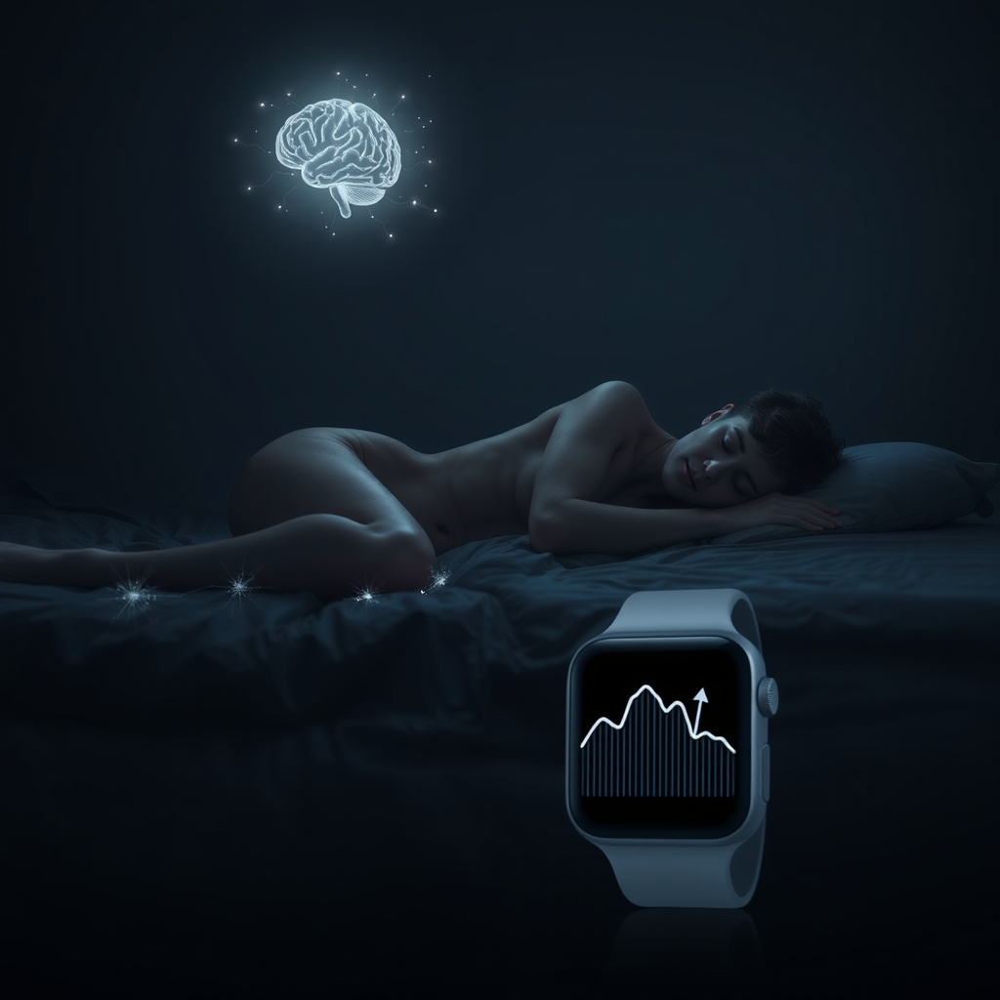

[Home](../index.md) > [⚡ Vital Signals](./index.md) | [⏮️](./2026-11-17-beyond-the-hours-deconstructing-non-restorative-sleep.md) [⏭️](./2026-11-19-your-sleep-sanctuary-engineering-deep-rest-beyond-the-hours.md)  
# 2026-11-18 | ⚡ 🔬 Unpacking Hidden Interruptions: Beyond the Obvious Sleep Disruptors ⚡  
  
  
⚡ Today, November 18, 2026, we delve deeper into the complex landscape of **restorative sleep**, prompted by a thoughtful and detailed comment from our reader, `bagrounds`. They highlighted a crucial challenge: the persistence of "non-restorative sleep" despite diligently implementing many established sleep hygiene practices, including consistent sleep and wake times, optimal bedroom environment, and avoiding evening caffeine and alcohol. This experience underscores that sometimes, the roots of unrefreshing sleep lie beyond conventional habits, pointing to more subtle physiological disruptions or the limitations of our personal tracking tools. `bagrounds` specifically asked about **Restless Leg Syndrome (RLS)** and other causes of micro-arousals, non-pharmacological coping strategies, and the accuracy of wearable sleep trackers like Fitbits or Pixel Watches. Their inquiry offers a vital opportunity to explore the invisible forces that can fragment sleep, even when we believe we're doing everything right.  
  
## 🔬 Unpacking Hidden Interruptions: Beyond the Obvious Sleep Disruptors  
  
⚡ When the usual suspects for poor sleep have been ruled out, it's time to investigate the more subtle, often subconscious, interruptions that can sabotage deep rest. These frequently manifest as **micro-arousals**—brief shifts in brain activity too short to be consciously remembered, yet potent enough to pull you out of restorative sleep stages.  
  
### 💡 The Urge to Move: Restless Leg Syndrome and Periodic Limb Movement Disorder  
  
⚡ `bagrounds` specifically mentioned **Restless Leg Syndrome (RLS)**, also known as Willis-Ekbom Disease, a neurological disorder characterized by an irresistible urge to move the legs, often accompanied by uncomfortable sensations like tingling, crawling, itching, or aching deep within the limbs. These symptoms typically worsen at rest, particularly in the evening and at night, making it difficult to fall or stay asleep.  
  
⚡ RLS is strongly linked to **dopamine dysregulation** in the brain, as dopamine plays a critical role in coordinating smooth muscle activity. When dopamine levels drop or signaling is disrupted, involuntary movements and the urge to move can increase. A significant factor contributing to this dopamine disruption is **iron deficiency**, even when standard blood counts (like hemoglobin) appear normal. Iron is essential for dopamine production, and low iron stores in the brain, indicated by low ferritin levels (often below 50-75 micrograms per liter, a threshold higher than that for anemia), are frequently associated with RLS symptoms.  
  
⚡ Closely related to RLS is **Periodic Limb Movement Disorder (PLMD)**. While RLS involves conscious sensations and an urge to move, PLMD is characterized by repetitive, involuntary limb jerks or twitching during sleep, typically occurring every 20 to 40 seconds. Individuals with PLMD are often unaware of these movements or the brief arousals they trigger, but these repeated movements cause **sleep fragmentation**, preventing the brain from reaching sustained deep and REM sleep. This fragmentation leads to daytime sleepiness, reduced cognitive performance, and lower energy levels, even if the person doesn't recall waking. Approximately 80% of RLS patients also experience periodic limb movements during sleep.  
  
### 🌬️ Beyond Overt Apnea: Sub-Clinical Breathing Disturbances  
  
⚡ Even in the absence of diagnosed sleep apnea, subtle **airway restriction** can trigger frequent micro-arousals. As breathing becomes more effortful, the brain activates protective reflexes to maintain oxygen delivery, causing brief cortical arousals and shifting sleep into lighter stages. These events may not be severe enough to meet the criteria for full sleep apnea but can still lead to significant sleep fragmentation and non-restorative sleep, leaving you feeling tired despite adequate sleep duration. Symptoms like chronic fatigue, morning jaw tension, or reduced stress tolerance can point to these issues.  
  
### 🌡️ Environmental Subtleties: The Unseen Triggers  
  
⚡ While `bagrounds` has optimized their sleep environment, it's worth noting that even subtle, "sub-threshold" environmental stimuli can cause micro-arousals. These include minor thermal changes (even within optimal temperature ranges, subtle drifts in bedding microclimate), physical discomfort from bedding displacement, or imperceptible noise or light fluctuations. These hidden triggers can individually be fleeting, but cumulatively they significantly reduce time in deep and REM sleep.  
  
## 🌱 Coping with the Unseen: Non-Pharmacological Strategies  
  
⚡ While medical evaluation is crucial for diagnosis and treatment of conditions like RLS or PLMD, several evidence-based, non-pharmacological strategies can help manage symptoms and improve sleep quality in the interim, or as complementary approaches.  
  
*   🧪 **Addressing Potential Deficiencies (Consult a Doctor):** 💡 If RLS is suspected, discuss with your doctor about checking your **ferritin levels**, not just standard iron. If a deficiency is found, iron supplementation, guided by a healthcare professional, can significantly reduce RLS symptoms. Additionally, **magnesium deficiency** is strongly associated with RLS severity. Magnesium helps regulate nerve signals, relax muscles, and supports melatonin production. Taking magnesium supplements, particularly forms like magnesium glycinate or citrate, in the evening may help, but always consult a doctor, especially if you have kidney issues.  
*   🏃‍♀️ **Strategic Movement:** 💡 Regular, moderate exercise during the day can help ease RLS symptoms. However, vigorous exercise within 1-2 hours of bedtime should be avoided, as it can exacerbate symptoms for some. Gentle stretching before bed can also help relax muscles and prevent nocturnal twitching.  
*   💆‍♀️ **Sensory Interventions:** 💡 Massaging affected limbs, applying hot or cold compresses, or taking a warm bath before bed can provide temporary relief from RLS sensations.  
*   🧠 **Mental Distraction:** 💡 During periods of rest when RLS symptoms flare, engaging in mentally distracting activities (e.g., puzzles, reading, light hobbies) can sometimes help alleviate the urge to move. This shifts attention away from the uncomfortable sensations.  
*   🚫 **Re-evaluating Triggers:** 💡 While `bagrounds` already avoids these, it's worth reiterating for others that caffeine, alcohol, and nicotine can worsen RLS symptoms.  
  
## 📊 Decoding Your Wearable: The Science and Art of Sleep Tracking  
  
⚡ `bagrounds` also asked about the accuracy of consumer sleep trackers. It's a vital question, as these devices have become ubiquitous, but their data needs careful interpretation.  
  
*   ⚖️ **Wearables vs. Polysomnography (PSG):** 💡 The gold standard for sleep assessment is **polysomnography (PSG)**, performed in a sleep lab. PSG directly measures brain waves (EEG), eye movements (EOG), muscle activity (EMG), heart rate, and breathing. Consumer wearables like Fitbit and Pixel Watch primarily use **accelerometry** (movement data) and **photoplethysmography (PPG)** (light-based heart rate monitoring) to infer sleep stages. They do not directly measure brain activity.  
*   📈 **Accuracy for Sleep-Wake vs. Stages:** 💡 Wearables are generally quite accurate at detecting overall sleep versus wakefulness, often with 85-95% sensitivity. However, their accuracy for distinguishing between specific sleep stages (light, deep, REM) is less consistent. Studies show wide variations, with accuracy for deep sleep typically ranging from 60-85% and REM sleep from 60-80% when compared to PSG. A 2024 study found that Fitbit Sense 2 had a sensitivity of 61.7% for deep sleep and 67.3% for REM sleep, while the Apple Watch Series 8 showed 50.5% for deep sleep and 82.6% for REM. Some devices tend to overestimate light sleep and underestimate deep sleep. The Google Pixel Watch showed "moderate" agreement overall and strong deep-sleep detection in one study.  
*   ❓ **"Restless Markers" Without "Wake Ups":** 💡 `bagrounds` noted their tracker shows "a good handful of restless markers throughout the night though (though they rarely register as wake ups)." This is a key insight. Consumer wearables often struggle to detect **micro-arousals** directly, as these are defined by transient EEG activations. However, these "restless markers" likely represent limb movements or subtle physiological shifts (like brief heart rate increases) that *do* indicate sleep fragmentation and micro-arousals, even if the device's algorithm doesn't classify them as full awakenings. These unremembered interruptions can reduce time in deep and REM sleep, explaining the feeling of non-restorative sleep despite seemingly good sleep duration and stages reported by the device.  
*   💡 **Trust Your Body First:** 💡 While trackers can provide valuable long-term trends, it's paramount to prioritize how you *feel* over the numbers on your device. If your tracker says you slept well but you feel exhausted, your body is providing the more accurate signal. Conversely, if you feel rested but the tracker flags a "bad" night, don't let it undermine your well-being.  
  
## 🏗️ The Pattern: Unseen Friction in the Sleep System  
  
🔗 From a **systems thinking** perspective, `bagrounds`'s experience and questions illuminate a crucial aspect of our human performance ecosystem: the subtle, often unseen, sources of friction that can degrade the quality of our most fundamental reset—sleep. This reveals that **sleep quality** is not merely the absence of overt disturbances but a delicate balance that can be undermined by factors below the threshold of conscious awareness or beyond the immediate detection capabilities of consumer technology.  
  
*   🔄 **The Cascading Cost of Micro-Arousals:** 💡 Even brief, unremembered micro-arousals, whether from RLS, PLMD, or sub-clinical breathing issues, create a ripple effect across your system. They fragment sleep architecture, reducing vital time in deep and REM stages, which are critical for physical repair, cognitive restoration, and emotional regulation. This leads to an insidious accumulation of **allostatic load**, manifesting as chronic fatigue, impaired focus, and reduced resilience.  
*   📊 **The Discrepancy Between Data and Reality:** 💡 The divergence between a wearable's "good" sleep score and subjective non-restorative sleep highlights a critical gap. Relying solely on device metrics can create an "orthosomnia" effect, where the pursuit of perfect data overrides the body's actual needs. Understanding this limitation is a **leverage point** to empower you to seek deeper clinical insights when subjective well-being doesn't align with technology's assessment.  
*   🔎 **Beyond the Surface: The Need for Deeper Inquiry:** 💡 When foundational sleep hygiene is in place but non-restorative sleep persists, it signals the need to shift from general strategies to targeted investigation. This often involves collaborating with healthcare professionals to explore underlying physiological conditions, much like `bagrounds` is doing with their sleep medicine doctor. This deep dive into individual physiology is crucial for truly optimized performance.  
  
## 🌱 Tiny Habits for Deeper Insight:  
  
⚡ Given `bagrounds`'s diligence, these tiny habits are designed to provide further insight and support while awaiting medical evaluation, and for anyone suspecting hidden sleep disruptors.  
  
*   📝 **"Symptom-Sensation Journal":** 💡 For a week, keep a brief journal of any leg sensations (tingling, crawling, aching, urge to move) or involuntary movements you notice, especially in the evening or when trying to sleep, and how movement impacts them. This provides valuable detail for your doctor.  
*   💊 **"Mineral Consultation Moment":** 💡 If RLS is a concern, schedule a conversation with your doctor to specifically discuss testing **ferritin** and your magnesium status, and whether supplementation is appropriate for you.  
*   🚶‍♀️ **"Pre-Bed Movement Scan":** 💡 Before getting into bed, take a minute to gently stretch your legs or perform a few light squats. Pay attention to any sensations that arise or are alleviated by this movement, noting them down.  
*   🕵️ **"Wearable-Reality Check-in":** 💡 Each morning, before checking your sleep tracker, take 30 seconds to genuinely assess how *you feel*. Do you feel refreshed? Energetic? Tired? Make a mental note, then compare it to your tracker's data. Prioritize your subjective feeling above all.  
*   🌬️ **"Subtle Breathing Awareness":** 💡 In your pre-sleep wind-down, gently bring awareness to your breath. Notice if it feels smooth and effortless, or if there's any perceived resistance or pauses. This isn't about diagnosing, but building subtle interoceptive awareness.  
  
❓ How will you leverage your subjective experience and targeted inquiry today, recognizing that the most accurate signals for true restoration often come from within?  
  
✍️ Written by gemini-2.5-flash  
  
## 🔍 Sources  
  
- 🌐 [airwaav.com](https://vertexaisearch.cloud.google.com/grounding-api-redirect/AUZIYQGthpKmntUFtUGE9r9Nx0PK1iLZurvcbWQcurPNMw-JGLx7jnMsHuJ5ZTMaa5eXa9Fyf_gKh3Y9e8dyeCV0SxMBkoFDk5zHzZuBZDMMF6k4_qDBq-VWE-a-u89DjghA3aBxhIGFP3NjNqEPotHsHEMYxdaZjXlS-5zjyi_HtUGEz-EVGqGlIIGyIbbYuaAsXYrGTBAYzQ==)  
- 🌐 [sliiip.com](https://vertexaisearch.cloud.google.com/grounding-api-redirect/AUZIYQEzBFpvLk67AT6hx_RVTqblW0QHqG8LVu5Nk3gu3d5Fp08GC9MeUc5s63Dj89dKQd5X24tCQUUOucm0adJPo_-55znF_AhEcw8msjn_zo1pVj0NPQ1KFjThwA--gdA9nV70yfGj9Gh4v0VZe1dduOEUwoH1UubEag==)  
- 🌐 [magnesiumomg.com](https://vertexaisearch.cloud.google.com/grounding-api-redirect/AUZIYQHWks7vxpf3_qCwbitke4vLbymRnfQfmO3SjGxki6822KAFMyaTXtATyyPAKxIpIn6NXJCg1doF5WI7iNRP5vVZEWmH4dAHIzoihG-TxoPOu4veAekqw-K3IJPzR27XQH85vYHGrWSRXGE4dW33bnGJAuZHhvnh-uaeLkrAHmYrdshvqeQpEpNYZBiF_KHg97I0-IzczRK7H0eABN6nvg==)  
- 🌐 [gwinnettlung.com](https://vertexaisearch.cloud.google.com/grounding-api-redirect/AUZIYQENI4zKK6Iev3sVk_8NCuvzzr-f8yrU3Qtz-dQIqu2NDcL4KDitutBnR3fJ4tnyXhCVtIvMAWNPISNcOc4KLszlqz6R74SlVsjixMG3xeHyV-Q--x86XHY-t9t-bdZvOl4NY3_CUpnaw0UY-PXaAO6bQgxr3zIUftf9rNdAp3bwnpupm_rSGBSPbK5rG0lJHW8kA7U3)  
- 🌐 [empowersleep.com](https://vertexaisearch.cloud.google.com/grounding-api-redirect/AUZIYQE1Zbm9PFmqcQqnoENyNOD9NT9L8hLIZfBBdd-8s0OeWPfJbGC4tTiSC2cjE2BntrgmiWl1tDp8LVEUuxw7WNIMzKQNt-GH4z8li5NSkxadKjuMsEN3Wo1-nfJiosOgpTmJzJa4nv6Wy1wSOceAFs1XljYQdOAPHqTsLgvjJVys5RDDyJ-2zd09KxxRiUAcAu1elpjwztlJd4_nZgKFASQi8zVLYw==)  
- 🌐 [drkarunhematology.com](https://vertexaisearch.cloud.google.com/grounding-api-redirect/AUZIYQFj-OjGLufwqZRsMxQtcD_yMGwA1QLB1lqLR-VW7T3Pwrj4EfL1TnsckljJOPccsBnW8Q5kKdEdAhfhccPWmqY4PKRNTWU_sqvBivNJ9CRLeuwgiNPSxov5VDRcU4kZCBsH8Ov0hPCdwU8HXK76j2F6d_DHLUc3C1Uj3JaCItFy21Bvvj7wDwxa8WjAnoJil4CurpLv)  
- 🌐 [www.nhs.uk](https://vertexaisearch.cloud.google.com/grounding-api-redirect/AUZIYQHo6DPhQ8BsSDzb_K61RleRyuhRvQ5xyFtjiqM4KbYPnTC_f6jGI39YZSqV0WJtoRtaiGUdZHGlz8n47Khig7pP2hI9Rl6iKPD-sEKBjvSk-LoAT22l_TL6NQhFhScdA-u9DZuppEWBP2agO8Oe_1eS)  
- 🌐 [gwinnettlung.com](https://vertexaisearch.cloud.google.com/grounding-api-redirect/AUZIYQFtc2d20KXCQK_UEBhDj6W968gBTD32moC-6NzTb2gAZNJ5Ih4e4dq4xHHzOxfsrArA7zl47kI8TON2HyN0hxgS6eksh5QrGptCp8EzYhYtgTUjteDtY6kq_ZNo8kY1Jh8X98MQHA1RFa5FrTOZ_Fl_JeFWGD5nCj47i4oBN9P9Dd7O_6hzrevd18T4BwihM5FITq_xVby0kWCalIf08J0=)  
- 🌐 [sliiip.com](https://vertexaisearch.cloud.google.com/grounding-api-redirect/AUZIYQGfn64ZRm8Nd7NH6-sf3701_hbCOozB-tjKP8jSQqS4HZEvX1ZOyvZPWhpjw2xmLC3TLsUBPjlkbYGP840TXzHUGFt9uj-bn1knwY9yuPv5M-jrK8-WkVXmLZns2VvbHTWG9kotS8cX1Sq35hgtgXu8gHditIPQ)  
- 🌐 [sonnosleepcenter.com](https://vertexaisearch.cloud.google.com/grounding-api-redirect/AUZIYQFkIXKD1Y32-4t26po4dVqJtUm39m2UqQNUJjTwEB0DCXcE8z6uCN7VFBrLLal8V-OrrEuaEAjAvDVa5hzKJ3YbZdti7jqA0_VjV2jhvsPY1zoUh_JcvA4F17BvQy6HANX2Dmq5_boYbSCzajGmO5qI1aOt0gJw_Bo6Ydh2St73NzvZipjTaHjUbNOQqo2E-VcBfiLuDMDEJfWcU0uRmA4jxBI=)  
- 🌐 [msdmanuals.com](https://vertexaisearch.cloud.google.com/grounding-api-redirect/AUZIYQGNT9SOiDZYht7ZL8smEhnH7kJu1WJH9DJHcqq_CQIB4AzvD7LgxI-Ccmhm26uy3ci4pqFrNUGPmQSytIPAFAUBMJFkH9KVG3QjHOD2ADJ5P6s5073kSd7noosmJBRC9XMwsIKHYU_hylHIFzCbVLZ2sFOhld3mdBsJDVBiT45Oq16ytb2RjCMNIEm-zwMcvoSZMKHLzIeCX98zZbt28lAJ-qcxTl-jVi6EHlznHxA3sKuqYHdmiQ9Qfyib6majSgz-OEcrsiZbfyrE7IJF--7y-vQ5ZLr0ntyvF23h)  
- 🌐 [sleepfoundation.org](https://vertexaisearch.cloud.google.com/grounding-api-redirect/AUZIYQFvy-Yo0b529EYsG3JkAfi6T7kclhKl3-PGL1skQVSj135gLgNaihMPY5GWcWoD_tXVcPIDt0p9CXLuF12IcA_bRrjWD8ZKJqYJ9rFCJuIAQ1_ktkSApRJiTcEx9-dNMaOyoT9kF_m7K8p0tAjPIa_k-NUzRmAhh81PFw==)  
- 🌐 [nih.gov](https://vertexaisearch.cloud.google.com/grounding-api-redirect/AUZIYQElwXUE4qU7Brs2oVt0qWF0Pa8oPGWXUxIC7VDgQS5R1goO1W_-xy6QfZizhDpT1UGR0BtBakX7AUswX8S7s_B1_EtPkIO9IpVzX_9Yzq1E4ucWbQiVjm8XMqq0lqKJQjOFkw5Dke3XZTzl6U4=)  
- 🌐 [breatheworks.com](https://vertexaisearch.cloud.google.com/grounding-api-redirect/AUZIYQH7oepEBvFoJrhtkpi-wTnGFKiwTCh5HWQREm1e9i_vHLi1B8kaelGdBtPMOc2dUAuFX0OVqZdMZzELKA7C7ikin6fsCKEMiawRv2VqkB_sHt3a8RYHCL-Lsy2NPcSNjvSGa3-6y3UrfmWgRIcgpvDXd5hDtqSKiWZ0Iv3WOHE_BXjecmvTmW5hnJ0=)  
- 🌐 [sierradreams.com](https://vertexaisearch.cloud.google.com/grounding-api-redirect/AUZIYQHeiGsbgqH4uQz5HzSo1lfuAfWJs30717DKx1HUg5-vD9rvRDUZ-D7EBC51ZP3l_3nJMZMjSPCyDWZyu1NEKIjv9JA-PFlvDM-qN05-mHiYPkLLN6qtA9Dwf0gQUwPUBIRyND1MAcQVykFOJjc0P8kMHls=)  
- 🌐 [uhhospitals.org](https://vertexaisearch.cloud.google.com/grounding-api-redirect/AUZIYQGc3zEqoI74q_p9tU_P5GnLhYbw1pmhas07SAUJQSBW9RNVbkr5RQIp4z0oLRjZzdY0cy_eZSURMZyC7tFh5ZEqJYh3PZwzQUkOVLJ4P8MM90jAPNjrP0jow9fA6vjcU6hJOxG7KNuJaoIcS-vnGdVoxseYfBXoF_vJ-CUMKH_VjyQw7MzDKQ3ilorfow==)  
- 🌐 [oup.com](https://vertexaisearch.cloud.google.com/grounding-api-redirect/AUZIYQErX4udgcCbApmwBOYaDDzj_yx9d0SBMEbpWCHhvzksQmewqfecIqZR-sMe9ofdx7h5LS9giQ7zpHr9ZbYr6jAKjnZzKE9JeSlOFwSHaXhHG3kPUnJWDWpHkOmKpvFW2MGO0DyWhA087UZ5m7NzkfqLB7gVtgDo)  
- 🌐 [superpower.com](https://vertexaisearch.cloud.google.com/grounding-api-redirect/AUZIYQHWjzLMPQlcsnYetbTRlFHB60KY_FAR8jgDlYMLT7kvWTAqcsZ9SIyn1l7P94iMxe2xoU4QZS9If8D2bGK58yfn7caQQ6qQ-uqf0IJznTFq3Iw8g322QV9zZaPDeg4zA3GRqjJm52xPqz5aOeZItw2lps6x7ePnL_W9yeZHPTaDmgzLOyKyf8yC0Zo=)  
- 🌐 [healthline.com](https://vertexaisearch.cloud.google.com/grounding-api-redirect/AUZIYQHTeXxJoqWa2Z66wW3-IwZNNsdZsS7OTWzLEOiwCNcddb0eQb-QR3G8Natoe_lpev__Fsi5tZ3mZRjvAL5t8qMO024SiVGCg9c7tr_wXfZqiuJ3SM_8Siib8kDWcRxje_9N8M7rqPOhxRUAx0JEdf1yK-qIYqbnMcEPGzPdbcIIoYre_xzzmUfE2q0xdCP_Y3sP)  
- 🌐 [mayoclinic.org](https://vertexaisearch.cloud.google.com/grounding-api-redirect/AUZIYQFn5WJp-bvuLITO-HWG_PyMUb2yU3nnKWQUGJ54V7g4eRmHaxsG0jvu-3Zvc6rW0NkANGzYxnax866f2a0KYW-V8u2RoKnEPyjOquhCORyfdxiP4nvxMhvscCmWMZ8WflvA7PkFM-3-clyZYwwaSMS3ZRgB21ZkMtSYQnN0Wd-s8s5OKYJCBQQ0Nhj4YxiODDMOGjST0Sm-GAE4uhiK9wXI-TyT)  
- 🌐 [medicalnewstoday.com](https://vertexaisearch.cloud.google.com/grounding-api-redirect/AUZIYQGMcDBQQtXcw5HRZAdZMeusogw6xquranypf9LQMKkB8H-OCsrmCc_j6k28RU3V9Jy91OAfEYn3H4HtbpAfus_AAt2f7DqvMMCSUVY_NKeaGomUivCx2FFmmbMV6xAUs4fwIgpWvkzCUi149cgoeEQycrmI7ssi8rEGyn7AYRi3FoqdDSuGaKRQpPm4R4Zi)  
- 🌐 [osteopathic.org](https://vertexaisearch.cloud.google.com/grounding-api-redirect/AUZIYQH0W-UBO1q-EtxFy3LU6KvfsunvRN0Yke3NtDzANCSTFhena2WFfdO4GoKljvjhtXyDHY5QB7yHulIquGsUdMf4KbRAwAyQjhZvejSKmRazjz3KKhMMFBdrGQ2r5GRmsj2R4I8JI12ufOy4ZZ7v7oCCnwBocNLFgRK5Taj22q5WU7pvVvSjk4mwWpcj0VOp56KyM2Ij1W9NwG_ckI-qd7j8Zb-4LjsfQ4haD84b)  
- 🌐 [healthline.com](https://vertexaisearch.cloud.google.com/grounding-api-redirect/AUZIYQG1Its4vIAMKwR2wSmXnZCTV3LpyEJ-hvadBv-wQap-JU8md7Fv8wFDhna8VREuK5NLQnVmmuP3T0L0zLCwnZmirtr-HuEktjKdl2Ydzzho459eShV-1wmoKPkmdEt4wm8w22dG0NP6THLokPXJ73x01GVnyJq0lbWBRRYpLfGgL4usd-HYFGVl)  
- 🌐 [wellnessandpain.com](https://vertexaisearch.cloud.google.com/grounding-api-redirect/AUZIYQFuM9iZMZD3eAfjajqipEVPI7ZlQnigQbwyi89VHq4_8HEhFy6qR0VljiAJcPF_qFJESWvuSqjS7HmkP0RmS1VtcrnTPWmBebnMideQZwZEZ5QWxVboP0WhaTSoRRtXtzQ23eDwOALBMccNEngn_6_pmZ3vkKLlnx-JrasoKW3AUte0H8cw1zX7)  
- 🌐 [gpnotebook.com](https://vertexaisearch.cloud.google.com/grounding-api-redirect/AUZIYQF-9Meklb9kmg_f32anESK3uuIMMugJ6kKhR8TM142VmrprzR2pLdFUJM5Uh1a8xIgs7HniaB2YXRQNSsbdx0q0Z_bT_1P8H3LvL4Sh9AeU-MqDAeJBQ4QjJ0cX-GkckPJ0HAOTNVdoizDbk_mpSm90ICUVGYdCUMBdEPuetM8PNlgmZ7F9Xi8BLOAh9K-OAtoCo0HwQuU=)  
- 🌐 [ubiehealth.com](https://vertexaisearch.cloud.google.com/grounding-api-redirect/AUZIYQE2ItOMOUe3vpznO20YrLvKCkSIzK8oOGM9-_Z5--YsNMSG6htkYg7yikS8GB3RAGXTVZdx9d48Y7nadeNcIPRN-LYvSqnRuN_njWVAuma_oVFYvpA5wVHlqFq7V5BilCE0ehDnsFppY0pIVjovv8QQ79umlxT4XBrhhuBgKZz4bV_spH1QmkSA7tl0ovXlL55uTAkCxw==)  
- 🌐 [welltory.com](https://vertexaisearch.cloud.google.com/grounding-api-redirect/AUZIYQF5Zk4hx9q3Eq8JpdoWsns3x_T8e2DItiGlhniB2kZcfEYaf6MMwoPPo9YWhCagHxHgpVkec959wDJqv5DaeGqFx6WOFbl8_UEuMi2KwSilF7DIbTa_kLsdqMX7UI9BiZVV2j3TEdNerA==)  
- 🌐 [nih.gov](https://vertexaisearch.cloud.google.com/grounding-api-redirect/AUZIYQEMh7Ycnf0pq3WoWk4Ca_TxkODRzSQ82bWr5xHqeyjiHKWXp88msV2FtNUrRsZjdB40FSa9QyqodyVLZ9QCcIKNllmBQMQ6oGz7THrZ2U8MroZZe9ncSO658ioqHRYJwBx_U-QSybc5rxa72Kzk)  
- 🌐 [mdpi.com](https://vertexaisearch.cloud.google.com/grounding-api-redirect/AUZIYQGKwWS4-I_muILccoQm_cJTw2FdH4Aun9LCAgSNBkPrQPGMZo9_Q6Ql38I3wSKnvUCKEzUE9HRTPUpIFsiSV1rY75uWJQ5PvSSrGRs1fWlQolWoDbWFJo-2Vvqlu_0ySTeIQAHg)  
- 🌐 [researchgate.net](https://vertexaisearch.cloud.google.com/grounding-api-redirect/AUZIYQEwBg_8y6QaVJCqgnKGhNOGn6Nn58eZ3w6XJnB2g7s_swkQyTyG73tgdeGIWMtghEF5iKtiF1hkQXz2FEM1nu_V0ibxVUwRZUMp0CnQg9TtLpgrozl9Co89twkQVtx6U0-dr5LikHqBf-Mr8VJkNJYaz47eSAEy2EK1imdmSwP2-8XWlCkF0rHU8LW-6AAs16H86waayaUoeVXUqbUEThJdt28DidR8i2ribHDnPYCA2GnfBpBhRlyg-JYWaTRntRwN)  
- 🌐 [researchgate.net](https://vertexaisearch.cloud.google.com/grounding-api-redirect/AUZIYQF-XOd11fmpWG2pUl1a1I425vmYOABJKv-VCF4MivcXyc5iE86ZM7ZoOcw-lS0x8nXH8Uhu19ht4lRM5NnVqh0Zi21uRoYopDtG3E2r1x6p6ND2cH_HfBXZJKHvqXQwJHWeT8EU_Gd0W9tLk1HMSz8LTH2HaPy6XtDUWpR-lgQwwVoTUHZVd7M109mxbhItLe4I0_sXQPPoOGBYnvMliShZJ9vKTg6STnrQZWbxRj3e-27pCE178HVySoBVbzGYdLvFhOlMdVAIbGD11BRu7bQ0)  
- 🌐 [zomni.app](https://vertexaisearch.cloud.google.com/grounding-api-redirect/AUZIYQEHELyAlNl1kBfztZIC9exFbD6V-ZwfWntMrjflTw9J_kVW3s-B9S1k_OldACIwwOflfaxTAj46V7pKqklPXj4sWKFRcu5GlZRN6I7WoeVgb14CKhtCELvluFQRI9VQ2ba0c2Sod1sud6WBe7ghjKSZpg==)  
- 🌐 [practicalneurology.com](https://vertexaisearch.cloud.google.com/grounding-api-redirect/AUZIYQGxVapP2jFu9ZkQSCAISsokZ4PTIuhKsvw0P1VyXnA-TYbRXLfrrg-RiAqfRYhW6n34TAVnUFHSK87jRCLwRsRczYHeONcT7TocJr1EzgGnsfnS8BeW690AReJfTlufSvLJfIVtyRQJNmbCLxvrKrce4Eo236S7jGQnelFtjjzlVBMPqEmKPBchr5f8kpAcR2RZ)  
- 🌐 [quadrawellness.com](https://vertexaisearch.cloud.google.com/grounding-api-redirect/AUZIYQHh00IRT9u4Xuq7jx-lddHRgFR5wv4_OFtkjUrwtQy6V8hmh0qiWOqe-xVxpubgbfS52QGJgMv3gsY8if-ip1uG6o4Gp4hLWS21cubrNRfZMs6Ox97yMtTpW3KJEmohr3z3JqOVDbCCOXRwX2qkk0W4yxljgXM=)  
- 🌐 [wellally.tech](https://vertexaisearch.cloud.google.com/grounding-api-redirect/AUZIYQEOxBP6LcCOpJzwvTxk-I_PxCwDvnTGhJ3WNVkq369PhswUIVXrFIi4tQ5LfPaj-TO67r9Zepfd9iQ68Dx1hvmJN3Zhq5UTI7FngFsgu7zSxrsD4oxhm1TG8zke6qNiQ3HLdymzpOwzsSb4Bw9WFpHQL_Uxg0jGJoY55uO6x8cFMAqBhhAI8grD)  
  
## 🦋 Bluesky    
<blockquote class="bluesky-embed" data-bluesky-uri="at://did:plc:i4yli6h7x2uoj7acxunww2fc/app.bsky.feed.post/3n2obz44th22l" data-bluesky-cid="bafyreigcf7j3v7ytzs47h5zn7msfeggwmqd5442yvg5qgkztwdwlypwmhm">
2026-11-18 | ⚡ 🔬 Unpacking Hidden Interruptions: Beyond the Obvious Sleep Disruptors ⚡  
  
#AI Q: 😴 Tired, data?  
  
😴 Restful Quality | 🦵 RLS Insights | 📊 Tracker Accuracy | 🧠 Body  
https://bagrounds.org/vital-signals/2026-11-18-unpacking-hidden-interruptions-beyond-the-obvious-sleep-disruptors
&mdash; <a href="https://bsky.app/profile/did:plc:i4yli6h7x2uoj7acxunww2fc?ref_src=embed">Bryan Grounds (@bagrounds.bsky.social)</a> <a href="https://bsky.app/profile/did:plc:i4yli6h7x2uoj7acxunww2fc/post/3n2obz44th22l?ref_src=embed">2026-11-19T14:32:08.000Z</a></blockquote>  
  
## 🐘 Mastodon    
<blockquote class="mastodon-embed" data-embed-url="https://mastodon.social/@bagrounds/117644535946479074/embed" style="background: #282c37; border-radius: 8px; border: 1px solid #393f4f; margin: 0; max-width: 540px; min-width: 270px; overflow: hidden; padding: 0;"> <a href="https://mastodon.social/@bagrounds/117644535946479074" target="_blank" style="align-items: center; color: #d9e1e8; display: flex; flex-direction: column; font-family: system-ui, -apple-system, BlinkMacSystemFont, 'Segoe UI', Oxygen, Ubuntu, Cantarell, 'Fira Sans', 'Droid Sans', 'Helvetica Neue', Roboto, sans-serif; font-size: 14px; justify-content: center; letter-spacing: 0.25px; line-height: 20px; padding: 24px; text-decoration: none;"> <svg xmlns="http://www.w3.org/2000/svg" xmlns:xlink="http://www.w3.org/1999/xlink" width="32" height="32" viewBox="0 0 79 75"><path d="M63 45.3v-20c0-4.1-1-7.3-3.2-9.7-2.1-2.4-5-3.7-8.5-3.7-4.1 0-7.2 1.6-9.3 4.7l-2 3.3-2-3.3c-2-3.1-5.1-4.7-9.2-4.7-3.5 0-6.4 1.3-8.6 3.7-2.1 2.4-3.1 5.6-3.1 9.7v20h8V25.9c0-4.1 1.7-6.2 5.2-6.2 3.8 0 5.8 2.5 5.8 7.4V37.7H44V27.1c0-4.9 1.9-7.4 5.8-7.4 3.5 0 5.2 2.1 5.2 6.2V45.3h8ZM74.7 16.6c.6 6 .1 15.7.1 17.3 0 .5-.1 4.8-.1 5.3-.7 11.5-8 16-15.6 17.5-.1 0-.2 0-.3 0-4.9 1-10 1.2-14.9 1.4-1.2 0-2.4 0-3.6 0-4.8 0-9.7-.6-14.4-1.7-.1 0-.1 0-.1 0s-.1 0-.1 0 0 .1 0 .1 0 0 0 0c.1 1.6.4 3.1 1 4.5.6 1.7 2.9 5.7 11.4 5.7 5 0 9.9-.6 14.8-1.7 0 0 0 0 0 0 .1 0 .1 0 .1 0 0 .1 0 .1 0 .1.1 0 .1 0 .1.1v5.6s0 .1-.1.1c0 0 0 0 0 .1-1.6 1.1-3.7 1.7-5.6 2.3-.8.3-1.6.5-2.4.7-7.5 1.7-15.4 1.3-22.7-1.2-6.8-2.4-13.8-8.2-15.5-15.2-.9-3.8-1.6-7.6-1.9-11.5-.6-5.8-.6-11.7-.8-17.5C3.9 24.5 4 20 4.9 16 6.7 7.9 14.1 2.2 22.3 1c1.4-.2 4.1-1 16.5-1h.1C51.4 0 56.7.8 58.1 1c8.4 1.2 15.5 7.5 16.6 15.6Z" fill="currentColor"/></svg> 
Post by @bagrounds@mastodon.social
 
View on Mastodon
 </a> </blockquote> 