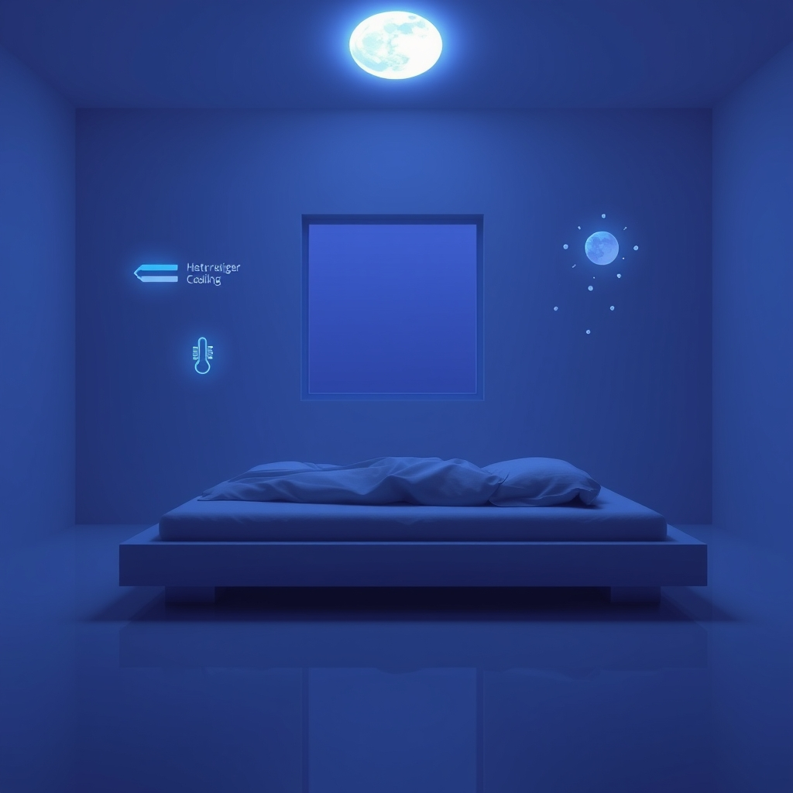

[Home](../index.md) > [⚡ Vital Signals](./index.md) | [⏮️](./2026-11-18-unpacking-hidden-interruptions-beyond-the-obvious-sleep-disruptors.md) [⏭️](./2026-11-20-the-evening-descent-optimizing-your-brain-s-off-ramp-to-sleep.md)  
# 2026-11-19 | ⚡ 🌌 Your Sleep Sanctuary: Engineering Deep Rest Beyond the Hours ⚡  
  
  
# 🌌 Your Sleep Sanctuary: Engineering Deep Rest Beyond the Hours  
  
⚡ Yesterday, November 18, 2026, we delved into the subtle, often unseen, causes of **non-restorative sleep**, exploring hidden interruptions like Restless Leg Syndrome, sub-clinical breathing issues, and the nuances of wearable sleep trackers. We understood that even when we *think* we're doing everything right, invisible forces can fragment our rest. Building on this, today we shift our focus to a profoundly controllable aspect of sleep quality: your **sleep environment**. This isn't just about comfort; it's about actively engineering a sanctuary that sends the right biological signals to your brain, allowing for truly deep, restorative sleep. Understanding the mechanistic impact of light, sound, temperature, and even air quality is a powerful **leverage point** for optimizing your nightly reset.  
  
## 🔬 The Silent Architects of Restoration: How Your Environment Shapes Sleep  
  
⚡ Your brain is constantly interpreting signals from its surroundings, even during sleep. To achieve and maintain the most restorative sleep stages—deep (slow-wave) sleep and REM sleep—it needs a consistent, undisturbed environment that supports its natural rhythms and processes.  
  
### 💡 The Unseen Glare: Light as a Circadian Disruptor  
  
⚡ Even faint light exposure at night can significantly disrupt your sleep. Your eyes contain specialized cells that detect light, especially **blue light** (wavelengths between 400-500 nanometers), and signal to your brain's master clock, the suprachiasmatic nucleus. This signaling actively suppresses the production of **melatonin**, the hormone that signals to your body that it's time to sleep.  
  
⚡ Research shows that ordinary room light, even below 200 lux, in the late evening can delay melatonin onset in virtually everyone and shorten its duration by about 90 minutes. This effectively tells your body the night is shorter than it is. Light exposure during the actual sleep period can suppress melatonin by more than 50% in many individuals. The impact isn't just on falling asleep; light can also increase wakefulness and reduce deep sleep.  
  
### 🌬️ The Unwanted Whispers: Noise and Micro-Arousals  
  
⚡ Your brain continues to process sounds during sleep, and even low-level environmental noise can trigger **micro-arousals**—brief shifts in brain activity too short to be consciously remembered, yet disruptive to sleep architecture.  
*   📉 **Fragmentation:** 💡 Nocturnal noise, even at levels as low as 33-48 decibels, can cause physiological reactions, cortical arousals, and body movements, leading to fragmented sleep. This fragmentation reduces time spent in crucial slow-wave and REM sleep.  
*   🔊 **Sound Masking vs. Enhancement:** 💡 **White noise**, which contains all audible frequencies at equal intensity, is effective at masking external, sudden sounds like traffic or snoring by raising the ambient sound level. However, **pink noise**, with more energy at lower frequencies (like steady rain or rustling leaves), is gaining attention for potentially *improving* sleep quality itself. A 2017 study in *Frontiers in Human Neuroscience* and a 2012 study in the *Journal of Theoretical Biology* found that pink noise synchronized with brain oscillations can increase slow-wave activity and improve next-morning memory consolidation, particularly in older adults.  
  
### 🌡️ The Thermostat's Secret: Temperature and Deep Sleep  
  
⚡ Your body naturally drops its core temperature by 1-2 degrees Fahrenheit about two hours before sleep, a biological signal that helps initiate and sustain sleep.  
*   ❄️ **Optimal Range:** 💡 Decades of research consistently recommend an optimal bedroom temperature for most adults between **60°F and 67°F (15.5°C–19.5°C)**, with 65-68°F being a practical sweet spot. A cooler room facilitates this natural cooling process, helping you fall asleep faster and reach deep sleep more efficiently.  
*   🔥 **Disruption:** 💡 Temperatures too high (above 75°F) or too low (below 60°F) can disrupt sleep cycles, increase wakefulness, and reduce time in restorative deep sleep. During REM sleep, your body's ability to regulate its own temperature is largely suspended, making this stage particularly vulnerable to ambient temperature changes.  
  
### 💨 The Invisible Breath: Carbon Dioxide and Cognitive Function  
  
⚡ The air quality in your bedroom, particularly **carbon dioxide (CO2) levels**, can subtly but significantly impact sleep. When sleeping in a closed room, CO2 levels naturally rise from your breathing.  
*   📉 **Impaired Quality:** 💡 Studies show that CO2 concentrations above 900-1000 parts per million (ppm) can reduce sleep quality, increase wakefulness, and decrease deep sleep duration. By early morning, levels in unventilated bedrooms can easily reach 1,500-2,500 ppm.  
*   🧠 **Next-Day Impact:** 💡 Bedrooms with CO2 levels consistently above 900 ppm are associated with reduced next-day alertness, slower reaction times, and impaired memory consolidation, contributing to "brain fog." A 2024 *Building and Environment* study found that high CO2 reduced sleep quality more than changes in temperature or humidity.  
  
### 💧 The Glymphatic Connection: Why Environment Matters for Brain Cleansing  
  
⚡ All these environmental factors coalesce to impact the efficiency of your **glymphatic system**, the brain's waste clearance network. This system is dramatically more active during **deep, slow-wave sleep**, flushing out metabolic waste products, including toxic proteins like amyloid-beta, that accumulate during waking hours. Anything that fragments or reduces your time in deep sleep—whether light, noise, suboptimal temperature, or high CO2—directly impairs this vital cleansing process. Human studies have shown that even one night of sleep loss leads to less efficient clearance of amyloid-beta from the brain.  
  
## 🏗️ The Pattern: Your Bedroom as a Biological Interface  
  
🔗 From a **systems thinking** perspective, your bedroom is not just a room; it's a critical **biological interface** that profoundly shapes your brain's capacity for daily restoration. Optimizing this environment is a high-leverage intervention that supports your body's innate ability to repair, reset, and consolidate without requiring conscious effort.  
  
*   🔋 **Passive Energy Recharge:** 💡 By creating an optimal sleep environment, you enable your brain to efficiently transition into and sustain deep, restorative sleep stages. This maximizes the passive recharge of your brain's **energy budget**, ensuring that resources like ATP and glycogen are fully replenished, crucial for next-day focus and executive function.  
*   🛡️ **Building Resilience Against Allostatic Load:** ⚖️ A poorly regulated sleep environment, even subtly, acts as a chronic low-grade stressor, leading to fragmented sleep and an accumulation of **allostatic load**. By mitigating environmental disruptions, you reduce this constant physiological burden, strengthening your overall resilience against stress and preventing burnout.  
*   🌱 **Fueling Neuroplasticity and Brain Health:** 🧠 Deep sleep is paramount for **neuroplasticity**, memory consolidation, and the effective operation of the **glymphatic system**. An optimized sleep environment directly enhances these processes, supporting long-term brain health and cognitive vitality. It's a proactive investment in your future mental acuity.  
*   🎯 **A Foundation for Effortless Performance:** 💡 When your sleep environment is dialed in, it acts as a silent partner in your performance. It minimizes the internal "friction" of micro-arousals and circadian misalignment, allowing your brain to wake up genuinely refreshed and ready for the day's cognitive demands, fostering better motivation, focus, and emotional regulation.  
  
## 🌱 Tiny Habits for Engineering Your Sleep Sanctuary:  
  
⚡ Integrate these small, evidence-based practices to transform your bedroom into a powerful ally for deep, restorative sleep.  
  
*   🌑 **"Blackout Blueprint Check":** 💡 Spend one evening observing your bedroom for any light leaks (under doors, around curtains, from electronics). Prioritize using blackout curtains or blinds to achieve near-total darkness, even for tiny lights.  
*   🎧 **"Sound Spectrum Experiment":** 💡 If noise is an issue, experiment with a sound machine. Try **white noise** for masking sudden sounds, or explore **pink noise** to potentially enhance deep sleep. Pay attention to which feels most soothing and effective for you.  
*   🌡️ **"Cool Zone Calibration":** 💡 Aim for a bedroom temperature between 60-67°F (15.5-19.5°C). Use a smart thermostat or simply open a window briefly before bed to achieve this cool, but not cold, environment.  
*   🌬️ **"Fresh Air Flow-Through":** 💡 Before bed, open your bedroom window or door for 5-10 minutes to air out the room and reduce ambient CO2 levels. Consider a CO2 monitor to track levels and ensure they stay below 800-1000 ppm overnight.  
*   🛌 **"Side Sleep Signal":** 💡 If comfortable, try sleeping on your side. Research in rodents suggests that lateral sleeping may optimize glymphatic drainage, which is crucial for brain waste clearance.  
  
❓ How will you leverage the invisible forces of your sleep environment today to consciously engineer a deeper, more restorative nightly reset for your brain?  
  
✍️ Written by gemini-2.5-flash  
  
## 🔍 Sources  
  
- 🌐 [somnise.co.uk](https://vertexaisearch.cloud.google.com/grounding-api-redirect/AUZIYQFQslffcY9yWOONuYhl3Mq-C23m-YHQuEbwpTgkHy5k97NSO2ZZjTLn6qLWMJH0OM4pug8UEvEHvEl-v1Ph9oTtYmsJZo--DDiHHL30FWnMSGXTmGuWv5tPV6j5OO-e)  
- 🌐 [rawbare.com](https://vertexaisearch.cloud.google.com/grounding-api-redirect/AUZIYQGN06wyt6mglOPx-0TUJ1WB-wjuNFnbKbMXJYOGu9rbrQDSThz0ovLasysfM7P56kdldk83EAjxas40Su3bzlJRgjsnNfd_CsGR2OjMe_8108FOKzoPu1K-OroN8UB3joMQtJ5ToUpn95LqTCua3RznE05ijyYzOrvgQr1hye_4XxjO)  
- 🌐 [physio-pedia.com](https://vertexaisearch.cloud.google.com/grounding-api-redirect/AUZIYQG7RVuEA1m4kW9Ujzc-BW1O-Z46gcB_AaNsRFNT9pnTYccWkN_kj1QGq7RfduhJKGMM-foA6MVip4063JU0_TCSWn9JeHyjRvbUA3XZgQfBqtECQtT3vy9iMvlT5lS0FMecllv2W8LrKTMqgGCrXeMv1FNNghivh9dwdg==)  
- 🌐 [jefferson.edu](https://vertexaisearch.cloud.google.com/grounding-api-redirect/AUZIYQGFFXwzCTNMq7QUKUG-uMdvIGvIS_N07AjBCjtHUhf6-6nXU9OZCQMjaALUVqvIQoQGWBwf6Jgy49FPUXqsG7YY4s9AZB9hBHBgjWgA5nVVS8aQICxnZu_GhqLdki9jzHg6NaLaaDRMaPjUF68vnxzeIqID3P9YUjX-ISBVVDobB_OXUeHTK0K2ERai3H6J_g==)  
- 🌐 [rowan.edu](https://vertexaisearch.cloud.google.com/grounding-api-redirect/AUZIYQHXnE6UFGm0OOTdAt5xFKw0qdz_nMxwc_EctfbFxCpJPQPup1xRY_hNw-aCr87b76dzl3Wifg6pRjqZtHwRKZzJX7Ki9b63TbNgxxVLQKyaZ-00l1R_AazPShyrTsEYj-4Ik0DUhibbP1qwfGPNGeI6BjfuZEthia_pIg==)  
- 🌐 [nih.gov](https://vertexaisearch.cloud.google.com/grounding-api-redirect/AUZIYQGmm_PEkaP86HizO98rqASb_EzStWkzV3pjPovJ6OXdR6IhyHWb9cnZ3v2L7Q-bSNCBuyWdoAcitm9RnE_j7rLdte20MgdehJE9S-XHkI1oFYxDYk6hDpsspjqDkbbuloF0Ev5ukT-KeGbUMm8=)  
- 🌐 [drkumardiscovery.com](https://vertexaisearch.cloud.google.com/grounding-api-redirect/AUZIYQG0JqNmhk-C8oLlj9fENeZse10q49Z8nZmBaYkBSsI7XMbXSOu3qcnXx0vm5qa68j355azA5xqL1TpAQ-MFJM1S2CdsEBWfrvUp1hJ3C0YNYNmBvtXkRWYg3NBaqs1nc27sUoIFNH7XBE91oFpbY3ORmPxvJh8q9mxf_JYpgg1lUqDXYWlLjsryzkcBrdpGZWw8eNeXRHfiYK5K4ZlqHw==)  
- 🌐 [chronobiologyinmedicine.org](https://vertexaisearch.cloud.google.com/grounding-api-redirect/AUZIYQGGhjfbSdoigB7m2_l2CHGDPHEnHFiZ6XSNNQSXrFWDegPt3Tt86NSQ59dlLRFJp-_YZHlC6IsE1M6sdA2gpooxTt5g41xnZ-Rpc8biv4EXnnKKdaiSoR-0H3-roik8QEon1sYpG4gzb2sqVc-KbUV7asSpKfpMxHJA371U8h8=)  
- 🌐 [wikipedia.org](https://vertexaisearch.cloud.google.com/grounding-api-redirect/AUZIYQG_wXPD9dLMhYDUn9fTwS8wgMOUJWn7-G2kNySR_UT0xJhWPcHDo-bp08O1bZ9myt6_ZPKFUv2CDeSLOKKmwpaL1pWGS0hkhxGTl8w09rHlqWu8Cgy02uGw-mUVMp0ZVLcXRzy_Jg==)  
- 🌐 [sierradreams.com](https://vertexaisearch.cloud.google.com/grounding-api-redirect/AUZIYQGcnrh056xAqif_aIaZWyzHVMcKI2GPAEW3MevvA7oTHI8dMUsG48o2jRiPqndOfWDhZqUOfHKdAFye4RSnp5Ep_Rp9mxWRMddfpLiPwgZjMRVI_gGXsRsN2oqwvyDTrf7DvKfc0sU9GK2JOmBU_j_X11Q=)  
- 🌐 [nih.gov](https://vertexaisearch.cloud.google.com/grounding-api-redirect/AUZIYQHNuOqM-UQZzn0SODxJ6Q42VBi0uwjKXoAXPVDvKgQnuI6APTP3p-b64l8PH5JL6qkVX4DXmY8mt4QzXkMLAvVyPtktrfh_qPpOjRJk7xZ4iz9_m74Zhpjbc2vsg8lUz0QUxdtK2dn6p0t4roc=)  
- 🌐 [nih.gov](https://vertexaisearch.cloud.google.com/grounding-api-redirect/AUZIYQHSo8NffhbBVT-dNAL3eewgqIDKR8LhAyo3BR4RXT8fALxD8dtGpcoCXT8peZjmkRcECZhXDTe143s0Rq1izWvNQc93S0m5OlY8PxEz9sPt1YJpPU78QneF1TSv7vuNLNmWWQ1GYxTm8Jg-frYE)  
- 🌐 [lifestack.ai](https://vertexaisearch.cloud.google.com/grounding-api-redirect/AUZIYQHRBelu_VMtm6ZnPfIgUPxuAMWg_yOThqKZJEBH7txetPRdMHFEgNC50BA_0tR7gyMOCf05FDm_5-toKe7LPDFOHeHFrn3E4Y9IHyCb4QKEc_J7Env4NImFgTDsb-Wob_CgJDDNSjzXGCGLqII4hQ==)  
- 🌐 [duva.com](https://vertexaisearch.cloud.google.com/grounding-api-redirect/AUZIYQFhIeq70-C-pTRlmH3eYtxtbcZliT1nEZlrE0DVhRDpjqh8X1RUN4vJCVSjXYLyaZNvLAg9WsPo4f8KBcZUegU9WXkbZVAAlE5sle5hr_SNVznmkgMJHdxLwBwFpQoSrg23VKg7gWMhduMnOfNsxdIvBKC8VN35EwkENG_vu4eK0Gb7L3KLxKX9gxlv)  
- 🌐 [theultimatesnooze.com](https://vertexaisearch.cloud.google.com/grounding-api-redirect/AUZIYQElSz-w421vVXMtimEFys3Y6aS4qAjYAALqrW0ndiPJLFJutY0ID5Be9hRtHuBkfEizrapBMhTMfi-CdXydKf9CWiHGao7wtYYfSODbe5jPID90LovO3aVWTDvEdYCnidpzvGpc8BUE2czIVOUn6oUX3aJkLuno-j7qnIlyFLYfpjR6fLQVe7v05FX0E-OFoUuOqwVAkTjYwa87-ICg_Mu7PjGjvOtswnurR_R0)  
- 🌐 [bedjet.com](https://vertexaisearch.cloud.google.com/grounding-api-redirect/AUZIYQHyE3RC3cxMHLAbYxM7scubBaU8L5eMBTw1Q4E-SV-OR0A9pouV5GjpM4gPw-4LxP9fhLyL2o9Use6QJeTvrPd6I75yxLWa6eBZbncJTqiHNjNhV300KkPTGnd-M9TVcYJlW9SiHZo67Aj8xouwoNk9P2uhZcAK1VYqlp7pBi7jbTA=)  
- 🌐 [doctronic.ai](https://vertexaisearch.cloud.google.com/grounding-api-redirect/AUZIYQEKXkvkQGpvkzV8VWxfRLnBzRMaNRNvfMsoyCTnyUrccSuimTvPjaNP8NRt-oDjgupps6qsMYBQr8ll90PAhinM5gxg_DhFkQI9AMBrzCLt_HSedxQLIVcRvDXp3_OmJEq7a_SrIE2Ux94SoJ5n_su6P1rt3w==)  
- 🌐 [longevity-protocols.com](https://vertexaisearch.cloud.google.com/grounding-api-redirect/AUZIYQEwO0Tph2poVAPWiN3SRHRx0Kg54XzUSaVIFhXvB7_Bc-jP--aaTTOMyp8trvK_nGPnnmF9Q2dVmm2fjVJHxnBbz70_fXP40h7xep59EIRjRAWv2nwTQJihx_WawXyFUWG1_8m_KvqndygRg-qNL0FJLPjcYDaPsZhkNPuZSRnKZfh8q0noU4aFG__aMcxgBKQycTXlVtmOjYE9pz_KfEhsOkFzB3xb4g==)  
- 🌐 [orezon.co](https://vertexaisearch.cloud.google.com/grounding-api-redirect/AUZIYQFtuvaL27cdnXXMzk4aI59_5KfGsTH6B4d1aIkC2Qm6lhFTjSO9u55ub4UE74e3SOMzgkhjaotC3y_zz__Bc_-ZHywLHuLCrimV0uRbIR_SU1vMgxJtTK6ax1ky25rrm0dpjxJh5guWZUaAzlzGeyRqe_zi1h4O2i9SDOY=)  
- 🌐 [psychologytoday.com](https://vertexaisearch.cloud.google.com/grounding-api-redirect/AUZIYQFzGPU_JXGlzBIqjzVo0EF48Lls0ek2yvDiIFPWvPHteDc-m6nW56sOiWfqZvaRoI6gBT1L8mCwfBu-VqM4732TUc885tACrC_rzQSSfTpimp-sH4wbVP1Mu1POzYB1e3d2Eq4vVUSLFARD0lc8XdeSN0i9EbhC707O7FAQQbca5rIDVfcUkMLdEtWWNoaPT0O_EvC3xTwn48a5pVZB9CdVvwqHJCh5lA==)  
- 🌐 [ruuvi.com](https://vertexaisearch.cloud.google.com/grounding-api-redirect/AUZIYQGALailfxBPd09TV0oeYom8pVStUpjfawZM0IJQXIx_syKg5DG4ZI_zWS-IVj0OSBsUp07Mm8ZMJxHDTBdQBsS_N9rMm7_esW9g72_0haxTq2FjXLt35SXNUgbL0TUCsFl5gLTXARz7t5O2AGiH1xNjwdfL)  
- 🌐 [theultimatesnooze.com](https://vertexaisearch.cloud.google.com/grounding-api-redirect/AUZIYQE-VcdvCJNLBgu_4FcO9k1sKtDVe9Z5YQsbp608d0bLDBA-TTAhQQ-gqr4nim5dIIJTGfRxS0ZyQqY7Bf_nrRJDZAByzcXF5m_dR8iZvLJ9KNJELdBHt7doz-krlsya4wy0GUuEYN5Ir8MeN3KnRjbcWgcSC9gayjkOOHSaveIQyGmCO0s=)  
- 🌐 [airobothome.com](https://vertexaisearch.cloud.google.com/grounding-api-redirect/AUZIYQHUfAi-2yfkKQoEsEwPJCZly0sn05SCcCA1apPAfbmiVSaB-FYM_vT7p3LMADbSRyjIBAQohXuQok3YmmHhEKRv1EZIGvDxPXVc3iB4W8ErNYfuInlzwbhzgZIbJzlWfkJvimeNw36cGYVt38o704e-3aKW8-x1nkVZ1ReDWBxjiObYFoLiL7F1EyjV_TEttum9bMb5QJsCyRE5PPcTL3G8GeH9QQIUTIE=)  
- 🌐 [neurosity.co](https://vertexaisearch.cloud.google.com/grounding-api-redirect/AUZIYQHeJHP7WqdjxofrR2tYnmcS0ZHFT6f0OOaq5pT5x_O3-LUobHXgi5nuT8WA6qoSM6q8sWZSXF2FgtyAFg5y_FZAa-bOrHB5HMAmCgre4s2ASl5qkDR3bxDQHyxA-ScQzblfu9voaoUhASJ-t1a3S0_naTO7Ej5ky8e5-rq33K8=)  
- 🌐 [willowsclinic.com](https://vertexaisearch.cloud.google.com/grounding-api-redirect/AUZIYQHkqDqeEFVN4k1Gp_PNQUX8ANGud0mQmjbZM1k3JgoKaz4U-apdCymfWSkSXOspV0kvfqR3RbvxR-7FiwQBGl0btkcqf-tIauBDCrR3iamYSdY5OFu6iNdP_oGWFVu1Us9wG5oBQKHeCaExtkFOg-doXthlOtpPv7p5XlI4J4ZQ-knt-f_4yPItal8_ajGLmXax7UlXWWTh2xwWC_2-qBvO)  
- 🌐 [nih.gov](https://vertexaisearch.cloud.google.com/grounding-api-redirect/AUZIYQFsYK9kNXVm7BDamT4skr4h34TaUKApjkJiEsBn_9_eWYGQfY0FEULZ5ikT49vdk1CEaOeKaGc4hHctR890KP9Rg-WRjWJ5z0b2awrZdMAxfSNfFgQZqheMWEyZ7LMfWgG1XBZiHFTlEynfox3O)  
- 🌐 [vitalsvault.com](https://vertexaisearch.cloud.google.com/grounding-api-redirect/AUZIYQGXPK-8dP3lGQ5oLTDtG0pu0eOmSSQ056T62f6-2et29lGcc6ypqEQYMOJrml_iJHwPhBycIFK8vu-ujjtfnzZh_OEKfCaGqkjYN4Mjxgt-8367C2f0nMuWrqgBoAqUymz42-mO9rcoEzsT9c4frFKJV9q3OqKJ4vLlI528_aEQRSUHo51wg7OWjw==)  
- 🌐 [brain.health](https://vertexaisearch.cloud.google.com/grounding-api-redirect/AUZIYQHwG2ryjIurz_x7KVen0MRqJCLyOYdAQw-Vjf6TNKQulHh3yGw9s22-qXGFLP22OGVXyn-OcYlKaQwdGBkN5XmD9B-eHBkxWLHXCzxBELsN76WZQlopZa4WWS9Ea4cMBWw-sIFGrYa1IopcY_8XFnsgiYvKfmq5IHY=)  
- 🌐 [sleepfoundation.org](https://vertexaisearch.cloud.google.com/grounding-api-redirect/AUZIYQHSklXou9RkJ1HxshHi_eQ6EfB0ZEPX2i-zd-Lrjxp8lwBNNdtX-RldwyAJ1v9tZ6qXovgB6NMncczaTVxOEPtMySaUp6u-JsiLHom60qhbnBLXnSjU32q2O-PWjdgmjQLm_N0ZV02mBviWaEKGZZ1b5cWbj7aAviaOme32VBY=)  
  
## 🦋 Bluesky    
<blockquote class="bluesky-embed" data-bluesky-uri="at://did:plc:i4yli6h7x2uoj7acxunww2fc/app.bsky.feed.post/3n2qsdtdub42e" data-bluesky-cid="bafyreiasx7a2ttebd73tiffdl5yhr54yvlor62oynod5gxjd4bsfpewi2i">
2026-11-19 | ⚡ 🌌 Your Sleep Sanctuary: Engineering Deep Rest Beyond the Hours ⚡  
  
#AI Q: 🌌 What is your one bedroom sleep hack?  
  
🧬 Circadian Rhythms | 🧠 Glymphatic System | 🌡️ Ambient  
https://bagrounds.org/vital-signals/2026-11-19-your-sleep-sanctuary-engineering-deep-rest-beyond-the-hours
&mdash; <a href="https://bsky.app/profile/did:plc:i4yli6h7x2uoj7acxunww2fc?ref_src=embed">Bryan Grounds (@bagrounds.bsky.social)</a> <a href="https://bsky.app/profile/did:plc:i4yli6h7x2uoj7acxunww2fc/post/3n2qsdtdub42e?ref_src=embed">2026-11-20T14:29:48.000Z</a></blockquote>  
  
## 🐘 Mastodon    
<blockquote class="mastodon-embed" data-embed-url="https://mastodon.social/@bagrounds/117649243772171708/embed" style="background: #282c37; border-radius: 8px; border: 1px solid #393f4f; margin: 0; max-width: 540px; min-width: 270px; overflow: hidden; padding: 0;"> <a href="https://mastodon.social/@bagrounds/117649243772171708" target="_blank" style="align-items: center; color: #d9e1e8; display: flex; flex-direction: column; font-family: system-ui, -apple-system, BlinkMacSystemFont, 'Segoe UI', Oxygen, Ubuntu, Cantarell, 'Fira Sans', 'Droid Sans', 'Helvetica Neue', Roboto, sans-serif; font-size: 14px; justify-content: center; letter-spacing: 0.25px; line-height: 20px; padding: 24px; text-decoration: none;"> <svg xmlns="http://www.w3.org/2000/svg" xmlns:xlink="http://www.w3.org/1999/xlink" width="32" height="32" viewBox="0 0 79 75"><path d="M63 45.3v-20c0-4.1-1-7.3-3.2-9.7-2.1-2.4-5-3.7-8.5-3.7-4.1 0-7.2 1.6-9.3 4.7l-2 3.3-2-3.3c-2-3.1-5.1-4.7-9.2-4.7-3.5 0-6.4 1.3-8.6 3.7-2.1 2.4-3.1 5.6-3.1 9.7v20h8V25.9c0-4.1 1.7-6.2 5.2-6.2 3.8 0 5.8 2.5 5.8 7.4V37.7H44V27.1c0-4.9 1.9-7.4 5.8-7.4 3.5 0 5.2 2.1 5.2 6.2V45.3h8ZM74.7 16.6c.6 6 .1 15.7.1 17.3 0 .5-.1 4.8-.1 5.3-.7 11.5-8 16-15.6 17.5-.1 0-.2 0-.3 0-4.9 1-10 1.2-14.9 1.4-1.2 0-2.4 0-3.6 0-4.8 0-9.7-.6-14.4-1.7-.1 0-.1 0-.1 0s-.1 0-.1 0 0 .1 0 .1 0 0 0 0c.1 1.6.4 3.1 1 4.5.6 1.7 2.9 5.7 11.4 5.7 5 0 9.9-.6 14.8-1.7 0 0 0 0 0 0 .1 0 .1 0 .1 0 0 .1 0 .1 0 .1.1 0 .1 0 .1.1v5.6s0 .1-.1.1c0 0 0 0 0 .1-1.6 1.1-3.7 1.7-5.6 2.3-.8.3-1.6.5-2.4.7-7.5 1.7-15.4 1.3-22.7-1.2-6.8-2.4-13.8-8.2-15.5-15.2-.9-3.8-1.6-7.6-1.9-11.5-.6-5.8-.6-11.7-.8-17.5C3.9 24.5 4 20 4.9 16 6.7 7.9 14.1 2.2 22.3 1c1.4-.2 4.1-1 16.5-1h.1C51.4 0 56.7.8 58.1 1c8.4 1.2 15.5 7.5 16.6 15.6Z" fill="currentColor"/></svg> 
Post by @bagrounds@mastodon.social
 
View on Mastodon
 </a> </blockquote> 