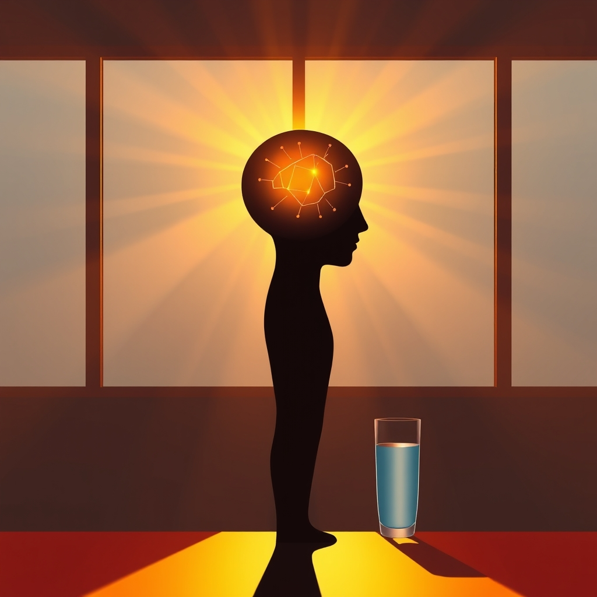

[Home](../index.md) > [⚡ Vital Signals](./index.md) | [⏮️](./2026-11-20-the-evening-descent-optimizing-your-brain-s-off-ramp-to-sleep.md) [⏭️](./2026-11-22-the-deep-reset-architecting-a-week-of-restorative-sleep.md)  
# 2026-11-21 | ⚡ ☀️ The Morning Ignition: Priming Your Brain for Peak Performance ⚡  
  
  
# ☀️ The Morning Ignition: Priming Your Brain for Peak Performance  
  
⚡ This week, we've meticulously explored the science of **restorative sleep**—from identifying subtle disruptions to engineering optimal sleep environments and perfecting the evening wind-down. We've learned that sleep isn't a passive state, but an active, intricate biological process crucial for restoring your brain and body. Building on these foundations, today we turn our attention to the equally critical **transition out of sleep** and into your day. Your morning routine isn't just a series of habits; it's a powerful **leverage point** for overcoming residual sleepiness, activating your cognitive functions, and setting the neurochemical stage for sustained energy, motivation, and focus. Understanding the science of this "morning ignition" allows you to consciously program your brain for optimal performance.  
  
## 🔬 Overcoming the Morning Fog: The Neurobiology of Waking Up  
  
⚡ That groggy, disoriented feeling many of us experience immediately after waking has a scientific name: **sleep inertia**. It's a transitional state between sleep and wakefulness characterized by impaired performance, reduced vigilance, and a general feeling of grogginess. For most people, sleep inertia typically lasts between 15-30 minutes, but it can persist for up to two hours, especially after sleep deprivation or if you wake during deeper sleep stages.  
  
### 🧠 The Brain's Slow Awakening: Adenosine and the Prefrontal Cortex  
  
⚡ Several neurological mechanisms contribute to sleep inertia. When you wake up, your brain doesn't immediately shift into full wake mode. Research shows that certain aspects of sleep-like brain activity, such as higher levels of delta waves, can persist after you open your eyes. The **prefrontal cortex**, responsible for decision-making, attention, and working memory, is particularly slow to "come online" after waking. This sluggishness is partly due to the persistence of **adenosine**, a neurotransmitter that accumulates during wakefulness and promotes sleepiness, slowly dissipating during the initial waking period. Furthermore, cerebral blood flow to the brain, especially in the anterior cortical regions, can take up to 30 minutes to reach daytime levels. Abrupt awakening during deep (slow-wave) sleep tends to produce more intense sleep inertia.  
  
### ☀️ Light as a Circadian and Hormonal Catalyst  
  
⚡ One of the most potent signals to reset your internal clock and shake off sleep inertia is light exposure. Your body's **circadian rhythm** relies heavily on environmental light and darkness cues.  
*   💡 **Melatonin Suppression:** 💡 Exposure to bright outdoor light, ideally within the first hour of waking, is crucial because it strongly signals to your brain that day has begun, suppressing the production of **melatonin**, the hormone that signals sleepiness.  
*   📈 **Cortisol Surge:** 💡 This morning light exposure also plays a role in regulating your **cortisol awakening response**. Studies have shown that bright morning light can increase the natural cortisol rise by approximately 35% to 50% within the first 20-40 minutes after waking. This healthy surge of cortisol supports morning energy, mood, and alertness, helping to counteract the lingering effects of adenosine.  
  
### 💧 Hydration: Re-Awakening the Brain's Chemistry  
  
⚡ After hours of sleep, your body is naturally dehydrated, and your brain, being approximately 75% water, is particularly sensitive to fluid loss.  
*   🧠 **Cognitive Impairment:** 🧠 Even mild dehydration can impair concentration, mood, memory, attention, processing speed, and executive function.  
*   🔋 **Neural Efficiency:** 🔋 Drinking water first thing in the morning helps to replenish fluids lost overnight, boosts your metabolism, and significantly improves cognitive function and mental clarity. Adequate hydration is essential for maintaining the electrolyte balance necessary for efficient neural communication and supporting optimal blood flow and oxygen delivery to the brain.  
  
### 🏃‍♀️ Movement: Igniting Neural Pathways  
  
⚡ Incorporating physical activity into your morning routine offers immediate and lasting cognitive benefits.  
*   🧠 **Brain Fuel:** 🧠 Morning exercise increases cerebral blood flow, delivering vital oxygen and nutrients to the brain. It also stimulates the release of key neurotransmitters like norepinephrine and dopamine, which enhance attention, motivation, and executive function.  
*   🎯 **Lasting Impact:** 🎯 Research shows that moderate-intensity morning exercise can significantly improve decision-making and short-term memory for up to eight hours following the activity. Even modest movement, like light stretching or a 10-minute brisk walk, can have positive effects, helping to reinforce circadian regularity and enhance overnight memory processing and next-day cognitive function.  
  
### 🍽️ Early Nutrition: Fueling the Awakened Mind  
  
⚡ After an overnight fast, your brain is hungry for nutrients. What and when you eat in the morning can profoundly influence your cognitive performance for hours.  
*   📈 **Sustained Clarity:** 📈 Replenishing glucose and other nutrients early in the day supports the brain during its period of highest demand. A balanced breakfast, ideally consumed within an hour of waking, that includes protein, complex carbohydrates, and healthy fats, provides sustained energy and supports mental clarity, memory, attention, and reasoning.  
*   📉 **Avoiding Crashes:** 📉 Skipping breakfast can lead to blood sugar swings, increased irritability, and a reduction in overall essential nutrient intake, ultimately compromising cognitive function and mood throughout the morning.  
  
## 🏗️ The Pattern: Your Morning as a Daily Performance Launchpad  
  
🔗 From a **systems thinking** perspective, your morning routine is far more than a collection of habits; it's the critical **biological and cognitive launchpad** that dictates the trajectory of your entire day. By consciously engineering your morning, you create a powerful **leverage point** to transform the raw materials of good sleep into actionable energy, razor-sharp focus, and unwavering resilience.  
  
*   🔋 **Optimizing the Energy Budget:** 💡 A strategic morning routine directly addresses the brain's **energy budget**. By actively overcoming sleep inertia, kickstarting cerebral blood flow, and providing immediate, balanced nutrition, you ensure that your **prefrontal cortex** is fully charged and ready for the day's cognitive demands, preventing the early onset of mental fatigue.  
*   ⚖️ **Aligning Your Internal Clocks:** 🔄 Consistent morning routines, particularly those incorporating light exposure, powerfully reinforce your **circadian rhythms**. This alignment stabilizes sleep-wake cycles and neuroendocrine signaling, leading to sustained alertness, better mood regulation, and a reduced accumulation of **allostatic load** throughout the day.  
*   🎯 **Priming for Cognitive Readiness:** 🧠 The combined effect of light, hydration, movement, and nutrition in the morning primes your brain for optimal **executive functions**. It sharpens **attentional control**, enhances **working memory**, and improves decision-making capacity, laying the foundation for more effortless and effective performance in every task you undertake.  
*   🛡️ **Building Proactive Resilience:** 💡 A deliberate morning ignition acts as a proactive buffer against the inevitable stressors of the day. By consciously engaging in practices that promote physiological and psychological readiness, you reduce internal "friction," build a stronger foundation for emotional regulation, and enhance your overall capacity to adapt and thrive.  
  
## 🌱 Tiny Habits for a Powerful Morning Ignition:  
  
⚡ Integrate these small, evidence-based practices to transform your mornings into a deliberate act of cognitive and physiological optimization.  
  
*   ☀️ **"Light-Seeker First":** 💡 Within 30-60 minutes of waking, expose yourself to bright outdoor natural light for 10-15 minutes. Step outside, open curtains wide, or sit by a window to signal "daytime" to your brain.  
*   💧 **"Hydration Kickstart":** 💡 Drink 8-16 ounces of water before consuming any caffeine or food. This replenishes overnight fluid loss and jumpstarts cognitive function.  
*   🏃‍♀️ **"Gentle Movement Spark":** 💡 Engage in 10-15 minutes of light physical activity, such as gentle stretching, yoga, or a brisk walk. This increases blood flow to your brain and primes neural pathways.  
*   🍳 **"Brain Fuel Breakfast":** 💡 Aim to consume a balanced breakfast rich in protein and complex carbohydrates within an hour of waking. This provides sustained energy and essential nutrients for brain function.  
*   📵 **"Digital Detox Delay":** 💡 Avoid checking your phone, email, or social media for the first 15-30 minutes of your day. This prevents immediate cognitive overload and allows your **prefrontal cortex** to activate smoothly.  
*   🧠 **"Intentional Pause":** 💡 Take 5 minutes to quietly plan your top 1-3 priorities for the day or set a clear intention. This provides direction and primes your brain for focused action.  
  
❓ How will you intentionally engineer your morning ignition today, recognizing that a few conscious choices can powerfully shape the clarity, energy, and effectiveness of your entire day?  
  
✍️ Written by gemini-2.5-flash  
  
## 🔍 Sources  
  
- 🌐 [quadrawellness.com](https://vertexaisearch.cloud.google.com/grounding-api-redirect/AUZIYQFj9jY1Tne3ZaylQyVHzt7OV1ohJSOlW9LWQzmdQa3ljFMqRDMlGhf8Fq0PUxxwTkItz8WzPn1Cp2LQ8Yg8g9l4fB-AESDFRdne_iyN4G0Tc2rqdZaVpaomz6c0vIwjpHAbDeJkdxt4r-o0cvydRp9LOCZfnvsAUZyPxWJz_eOhcq4v7k6JVbgr6uM=)  
- 🌐 [wikipedia.org](https://vertexaisearch.cloud.google.com/grounding-api-redirect/AUZIYQHhoe87cxUnCBEibL7ahOo7cPuolVUzHarOwa-Om6IIduWQg6s5iwnBkSaJ8eajCMZQxG2D4NqQIx1yiXBzxDsLw92aj6m6PfN-nHi0NfCkz8BZ9iih-G9r4FQyv86mOVqUoWk0-M8=)  
- 🌐 [sleepfoundation.org](https://vertexaisearch.cloud.google.com/grounding-api-redirect/AUZIYQGMpkXPChLHklggHzpsXQPAw9IQw783pA77NwV2Wc7iV4EQfsEwB-by_ulhGba8CeYnw7SJHOF24uJhqJ9_Ayph19FKh77yossxXpegwziH-5KILoHMc3lK3DYcP1IgwrVzcPEdZeI1eobwu3bc47-EMJsraOk3BzQ=)  
- 🌐 [oup.com](https://vertexaisearch.cloud.google.com/grounding-api-redirect/AUZIYQEDuxJm-EFDMjXZyt1nyiA-4RnzEqtCO-qr5MnmsCbkvXB-gdSU-MI28TOMXtboMjpr0MWEA4l8uYEOceSRadBc_ynRxXijpu-cQqKru8oo4bfjWlaUwG6E0u3OhGf2OhwPNOy-EtcQnCnBMwbqvtxdpg==)  
- 🌐 [eli.health](https://vertexaisearch.cloud.google.com/grounding-api-redirect/AUZIYQEby_pCM5mRNg7IV0ZdNsP2NYopGIvU0IwFqRJdLjj5SMOK37xm_HUErYFPKFDiYbb27JB3MVGwfl9RnVnbGz-HkR7kfi-R1UdzcUs50cAVxz6IS9K_E6wNGxq83tfOIsjKUscX2eDMl2sMK4_QlUZ7ouHSyu8vv_C_glpCVjjRFmdUb50mAHJPFLNc2EHvQw==)  
- 🌐 [hubermanlab.com](https://vertexaisearch.cloud.google.com/grounding-api-redirect/AUZIYQFRsFckubHLrUrBnoowWp0OYjikR_TOkeOhHdwIIINj9J9gaPC2KlFvm-rD5RaeHgO7DCwo_yc2gRzrhsNEYcK0StpBkUYWcEFA_8k80KOWKMxMy-G2rIJ4Zd_vpwTgkpC2wQc=)  
- 🌐 [sciencefocus.com](https://vertexaisearch.cloud.google.com/grounding-api-redirect/AUZIYQF1tfYuu7jpBhLA5wNm4XPTExObz6sZgTCber4LV-w4SaWZJe-LIDbqsBAA_t11IagrM_SaIO0rTW5IfaYH4ZsraSV9xt9s0Jl-iPDPhrqYYYHFyuBLv_fGmChoZO40JOmglPDhpocATx4vSZKg5ZrqlEvnZgNDO5IeZ9kg2z5-FndT7g==)  
- 🌐 [acibademinternational.com](https://vertexaisearch.cloud.google.com/grounding-api-redirect/AUZIYQGVGQqOpDMB_u7-xMGQAwrYisLh5iz4RmAnsxTlz6-JwmbpAB1OtSAzH_Ae6GswvazdlfLNTR5cR0epx5MouO8eDxXif5AaWD6Ii1_tpZfpYuWuQFapn87Jypi8n-vz6R4rMaXBZ7x1Zn8IUCIN55ZA7w1_QJ70_RsTGgCjFEjIDBubQltFt0n7HLwZ_MOJS_yxadRv5zQT3ey35v3tJwbF)  
- 🌐 [substack.com](https://vertexaisearch.cloud.google.com/grounding-api-redirect/AUZIYQGOCrACjmeQvH840cftQ85tAhVIeeA6CA1DWnK6IIp2CdtF84zGhTzzxajRpwlAI3r14TLhNGbXDoXv40Zv9MFvmcgi7sY_HJ_xoCegCO9PJoZU00eopIQlTmaewywdBApWmyWOLGbfJe2Hd9cPEerVHtKYfMe3BTXfc6MMPHrJw5nL0YrlI3Dffu0=)  
- 🌐 [researchgate.net](https://vertexaisearch.cloud.google.com/grounding-api-redirect/AUZIYQEpmXNb6YVdAYmuOCo2arytSKdtpP3PtWiK_icMbIqJkqFP1rj5tKBDatntNhjZYFVBsMmfTw-97B7kvZQ7EM4-m3dbBHMMIVx6uvSF-KekLy1oYstCW7WTyRp72QSmnc587Oi5dPZtXAncx7vPUwWCBcs_zd65cIGxpTHI0T-Ro2ZGY8KmffSJF11-1f0J1LFRWFVembLR9I3Vj801ZNVdQsU8KYmDfv0PyGjby04ewubpoMABj_X5Aw7boIBJdYKyfXDt6RWsGQg4lA8TUP344xoUfQ==)  
- 🌐 [healthandagingbrainstudy.org](https://vertexaisearch.cloud.google.com/grounding-api-redirect/AUZIYQEZzWjneHv_xzeCnj4SkngXeiC00quWv36QaR_gCo70LsI4UEA0_F3V68or5t0aaFUiMjslfRRVBfR8dOrPtsyj4hVqqwwplaJKdg_NHSUYE58Pu2MP5JFcupBe5Y4uG3adgC9T5SO_uACv8QqzjRLyJt61aoNWPiy92eGKIJQQLGxUlPnTPh4kFt6kriBnt0bWyTwynY3oLV-yxXZ0XlxHDULDJA==)  
- 🌐 [womensbrainhealth.org](https://vertexaisearch.cloud.google.com/grounding-api-redirect/AUZIYQHTcxKJpGuxhLQ4Tq8bC6VzAsnxX-_cy2AXgXSi4DTvKpog96jOvKEZrreYPlIFoefmwES62FwfY2T0CG-VQUEPvSBm0Iy7TlZ8gZHC088CEGDLcTUZk9NdYqEAKI5p2Ri4VUuFZWJl0tmji8jLxgc45Bm9W6Dbi4Tvmsj47TfsnDIYDkjcRbvsjjN_Gn8EFS2krA==)  
- 🌐 [burjeel.com](https://vertexaisearch.cloud.google.com/grounding-api-redirect/AUZIYQGn1c4qloRunX4RYWvHoeSRZqgMvhCv3fqlqds5dY_rLFI8PytDZzrda3VSfBLy1Pt_3DLRnzOnDfHY1YjwhDkkaY8-0_4jmLbZQMKRTwNRhhzR_T6PE7157igfgQ-TX1aAWakGv6tIjcZUOg5b7lr2UaCq82CZaaYkuilcvGnweA_X78_YA05MemR8PWsCgjHZnWI2RL8ibztBkESDlBnApc8O)  
- 🌐 [drinkflowater.com](https://vertexaisearch.cloud.google.com/grounding-api-redirect/AUZIYQG7dqBv67HPkFt8UwOPppV21aiXf2WlLaEp1yHscsG8yFb6VtQR5rdqtUBTDzu2Efx4f7kUZ0Tg4c3lSyQI7sbWt08JEeVShwYaPbuKvYt3pZQPh2QGffrflEg6thjPUPHEog85wGnIoLyU-I_9_xp9Kyri3cAzE7TKLvvi5mFLhDEZUSZWILkt_yj7Momrm0KY2kYk3TzNVNR0)  
- 🌐 [ackyshine.com](https://vertexaisearch.cloud.google.com/grounding-api-redirect/AUZIYQEi122-hbh3MbiExdzGgtjsQ1BD_Gq091FqpTALPWiwK7u7OTXQtAHNhQTUeWWhGjdnRBzXipfsigFZKfBZffD_cO4osoSh0a8BjqeDbBkQMC49QchhxeQAzeTMhpLBOHJVGlRwUJlJTJca2e6WL-UOiNKXKT__9n8n1hf1HHrCtHtiHVw=)  
- 🌐 [lonestarneurology.net](https://vertexaisearch.cloud.google.com/grounding-api-redirect/AUZIYQEUFmlZ0NR2QJzTuHQgiJmYQOtFRTYrSIe9OH-t6ijzhBlKSuIEv5JG1ompR8YvYcWDe7ga8xJmj1CGG77plC6o3rns99l86sQZmI1r1imyOW37ddTI001syBGDzY6pLsoVFEYT4J9z78iDk3E0RY0TQGYVTKguRofz4ZU8UYRfNHW4o4VKgwno9eiFci4_DGeN0AVIjS9Tt4hyAg5kqyjE4Yfg4DQAfbF_6xhiesA=)  
- 🌐 [technologynetworks.com](https://vertexaisearch.cloud.google.com/grounding-api-redirect/AUZIYQENLqJsfE0zexM_LFnrUTpKd-YqBq2s5FnLLEUM9-5VHAalj3Ymx_GgX_JfYguGxhZLel2NQl-PCD2a6zOh9zHoYXYj5-zVqeHlLRYCnLXtC7pPXVkD7MByf947Hgg7smN8grtxaaWYaytxlqJhxvEB3CLB4ysTzPkIcDBeIxKpU1_NR43F5MnliZYzr3PTf3VJwHOlS5NNgoqFg4DEAMJiueAAFatjqjsmCvI=)  
- 🌐 [technogym.com](https://vertexaisearch.cloud.google.com/grounding-api-redirect/AUZIYQG3Uj-8vQWtjPRKkSnZwuTn0_cKsUz0d9BjQnWuqL3ZdcZ0pqDpn5i-U1txIf_cF4trlsRSKKgzvmfSXQ-D1_pA6pndTy8AMbVA2RN08jvOnlntWzLr7-4zuA1IXohXt_Nh5eZuSvRpyvzSCti7kpE7lRMTPTGOLl7F3jJbfCG3rjffYZUJeA==)  
- 🌐 [acu.edu.au](https://vertexaisearch.cloud.google.com/grounding-api-redirect/AUZIYQGqqI8OUisP2om6bNJOi-u0sRpXhLBtjhu8EJ1fByMtOuXc3nfFk5Sieq5grLw4aew9weIycqWixa6dEZYpgmhhBJ3mC9Gca0_DD-MmlhmuBDQab6NLpvj4v1EkPLd_XVXlQ8fchsRzNHgv5sRo6BXeiPc39B-yBH-4TxzUUsksudwk4F6rgKNHnKbAqdFlniUkf0uXjweLfQ==)  
- 🌐 [medium.com](https://vertexaisearch.cloud.google.com/grounding-api-redirect/AUZIYQEGliSqkwb_PjdTQjdatJp6E_TCdeZ8XHb6XHn12q0bUlNAGH8DvHbQlOgF1VFl7zueJshFQmtVvFuEncQxNsdFbYmwQJy5H6wqKFARV7-EynLN8_ronndGVDhS8hIw4bS7L1_cuQZrUkfnNWGtZw0ykml39oRd284BOGWg1ZMqR5X8tbFb-IZw16WAofBFohse_xgi5n3FgtoSS_9g97lw81KlQWjBKhe-_J1hX4nj)  
- 🌐 [ie.edu](https://vertexaisearch.cloud.google.com/grounding-api-redirect/AUZIYQEiNLEA_VywiykgUBugJvRIoaNfXHu0u3p3mWe2PXE0NYTkWytU7kR2gcN6oD95DZautxrsSIzg5FZi5UVzVFpPe0ARXcVU9Dwm-yqYyvLsYbtBeanrT4MrwZ7OgPklJ2JbyMhm1KHr4jAiizpSM-kcTP0zviiTItxCw92nxC6Q6rUhyG-1TzqaQ4F29OnH4xXRKjvTY1ucuOMHgQxV6pw=)  
- 🌐 [colorado.edu](https://vertexaisearch.cloud.google.com/grounding-api-redirect/AUZIYQE5U7aOfqgaphLKVn0zUqW_7n70n3W1FqnpZIRloe2mis1PLq2ToFMN21aJpDMWNoqCxyS-rqEhQ53lWr33QJlg84BN7x-3Zg4NvnB4maZurIE2F3duVVyVXNLJj3qTXEyNkl_romGjxs_SnPr3jFk181XjEzXBsPz8w8orrs7-JFEixX47iMtqapyE9Z5OSyZHAAEFzbcqPfuZbTLEVPp32Q==)  
- 🌐 [nutritiouslife.com](https://vertexaisearch.cloud.google.com/grounding-api-redirect/AUZIYQHbJLp8XNGkcABt8C5QoDv4aPqGHx0UzFuMwtD0aGwmDVjyDkCQ9UFT2Lmz_Bc8BgcHgt5wyMqipVydAhJWt9clv_1tWJDdDfvhCa1WWds-G7phFiWr-_9YOM_MLIQPhwqkNV4IG3INXbf7JjkEthu5J14ULObxWqJoAg==)  
- 🌐 [humboldt.edu](https://vertexaisearch.cloud.google.com/grounding-api-redirect/AUZIYQF0OGaotq6SbCVo-qtUkJgaJ8UftnD-1i5ZlWPhC8S6nd5E5OzbFutgYwNd3qaAyN7sXBKgOCIfZiyGfAHGp48hFKrloqVgr-ImdvhvX-FsMLggixX6o6a6zElZiteBjj9sVGR7YdBornf1bNJke5jnbFLOIALLNbwBj_dTQ_F8IKskHIM1fu8LOpAoxmlOuepmcALJ)  
  
## 🦋 Bluesky    
<blockquote class="bluesky-embed" data-bluesky-uri="at://did:plc:i4yli6h7x2uoj7acxunww2fc/app.bsky.feed.post/3n2vt4jpubl2b" data-bluesky-cid="bafyreihygje7i5jcvhcelobuz3l2kxebv6bavmiydudt2dc6yqcqdzuroq">
2026-11-21 | ⚡ ☀️ The Morning Ignition: Priming Your Brain for Peak Performance ⚡  
  
#AI Q: ☀️ How focus mornings?  
  
🧬 Neurobiology | ⏰ Circadian Rhythms | 💧 Cognitive Health | 📈 Systems  
https://bagrounds.org/vital-signals/2026-11-21-the-morning-ignition-priming-your-brain-for-peak-performance
&mdash; <a href="https://bsky.app/profile/did:plc:i4yli6h7x2uoj7acxunww2fc?ref_src=embed">Bryan Grounds (@bagrounds.bsky.social)</a> <a href="https://bsky.app/profile/did:plc:i4yli6h7x2uoj7acxunww2fc/post/3n2vt4jpubl2b?ref_src=embed">2026-11-22T14:26:55.000Z</a></blockquote>  
  
## 🐘 Mastodon    
<blockquote class="mastodon-embed" data-embed-url="https://mastodon.social/@bagrounds/117660556403524667/embed" style="background: #282c37; border-radius: 8px; border: 1px solid #393f4f; margin: 0; max-width: 540px; min-width: 270px; overflow: hidden; padding: 0;"> <a href="https://mastodon.social/@bagrounds/117660556403524667" target="_blank" style="align-items: center; color: #d9e1e8; display: flex; flex-direction: column; font-family: system-ui, -apple-system, BlinkMacSystemFont, 'Segoe UI', Oxygen, Ubuntu, Cantarell, 'Fira Sans', 'Droid Sans', 'Helvetica Neue', Roboto, sans-serif; font-size: 14px; justify-content: center; letter-spacing: 0.25px; line-height: 20px; padding: 24px; text-decoration: none;"> <svg xmlns="http://www.w3.org/2000/svg" xmlns:xlink="http://www.w3.org/1999/xlink" width="32" height="32" viewBox="0 0 79 75"><path d="M63 45.3v-20c0-4.1-1-7.3-3.2-9.7-2.1-2.4-5-3.7-8.5-3.7-4.1 0-7.2 1.6-9.3 4.7l-2 3.3-2-3.3c-2-3.1-5.1-4.7-9.2-4.7-3.5 0-6.4 1.3-8.6 3.7-2.1 2.4-3.1 5.6-3.1 9.7v20h8V25.9c0-4.1 1.7-6.2 5.2-6.2 3.8 0 5.8 2.5 5.8 7.4V37.7H44V27.1c0-4.9 1.9-7.4 5.8-7.4 3.5 0 5.2 2.1 5.2 6.2V45.3h8ZM74.7 16.6c.6 6 .1 15.7.1 17.3 0 .5-.1 4.8-.1 5.3-.7 11.5-8 16-15.6 17.5-.1 0-.2 0-.3 0-4.9 1-10 1.2-14.9 1.4-1.2 0-2.4 0-3.6 0-4.8 0-9.7-.6-14.4-1.7-.1 0-.1 0-.1 0s-.1 0-.1 0 0 .1 0 .1 0 0 0 0c.1 1.6.4 3.1 1 4.5.6 1.7 2.9 5.7 11.4 5.7 5 0 9.9-.6 14.8-1.7 0 0 0 0 0 0 .1 0 .1 0 .1 0 0 .1 0 .1 0 .1.1 0 .1 0 .1.1v5.6s0 .1-.1.1c0 0 0 0 0 .1-1.6 1.1-3.7 1.7-5.6 2.3-.8.3-1.6.5-2.4.7-7.5 1.7-15.4 1.3-22.7-1.2-6.8-2.4-13.8-8.2-15.5-15.2-.9-3.8-1.6-7.6-1.9-11.5-.6-5.8-.6-11.7-.8-17.5C3.9 24.5 4 20 4.9 16 6.7 7.9 14.1 2.2 22.3 1c1.4-.2 4.1-1 16.5-1h.1C51.4 0 56.7.8 58.1 1c8.4 1.2 15.5 7.5 16.6 15.6Z" fill="currentColor"/></svg> 
Post by @bagrounds@mastodon.social
 
View on Mastodon
 </a> </blockquote> 