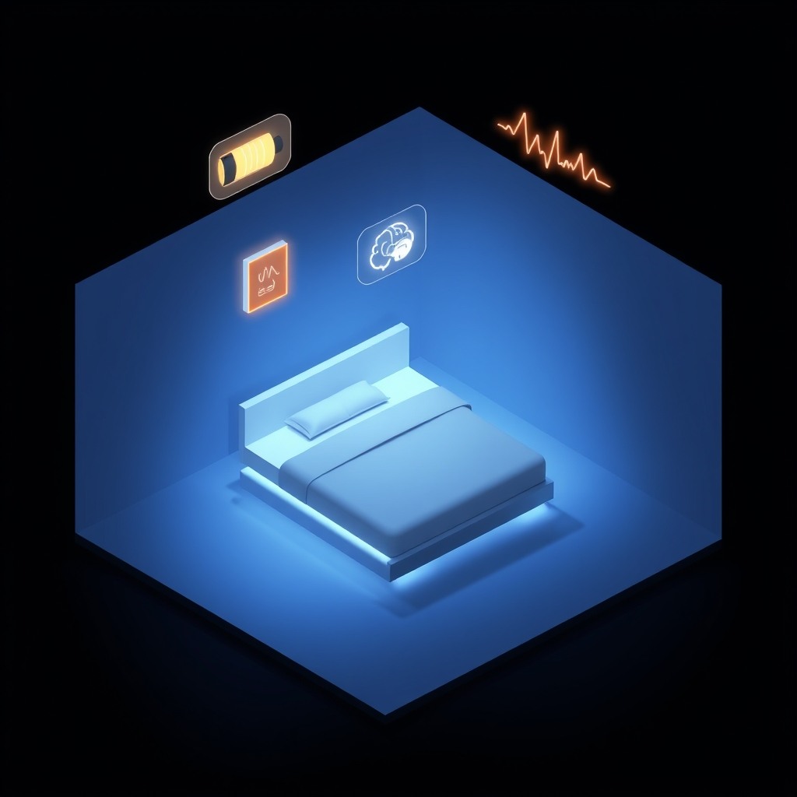

[Home](../index.md) > [⚡ Vital Signals](./index.md) | [⏮️](./2026-11-21-the-morning-ignition-priming-your-brain-for-peak-performance.md)  
# 2026-11-22 | ⚡ 😴 The Deep Reset: Architecting a Week of Restorative Sleep ⚡  
  
  
# 😴 The Deep Reset: Architecting a Week of Restorative Sleep  
  
⚡ This past week, Vital Signals has meticulously peeled back the layers of sleep, moving beyond simply counting hours to understanding its profound architecture. We've investigated the subtle disruptions, the environmental cues, and the daily rituals that either safeguard or sabotage our capacity for truly restorative rest. From the intricate workings of working memory to the critical transitions of evening and morning, we've built a comprehensive model of how to engineer not just *more* sleep, but *better* sleep—the ultimate foundation for peak human performance.  
  
## 🔬 This Week's Vital Signals: Deconstructing Sleep's Architecture  
  
⚡ This week, Vital Signals meticulously deconstructed the mechanisms that govern our ability to achieve truly restorative sleep, revealing a path to consistently wake up refreshed and ready.  
  
*   🧠 **Working Memory's Reliance on Rest (November 16):** 💡 We began by exploring your **working memory**, the brain's active workbench. We discovered its finite capacity (reliably holding only three to five items) and the crucial role of the **prefrontal cortex (PFC)** and **dopamine** in its function. Critically, we established that quality sleep is paramount for working memory, as sleep deprivation impairs its efficiency and the consolidation of information.  
*   🔬 **Deconstructing Non-Restorative Sleep (November 17-18):** 💡 We then confronted the paradox of **non-restorative sleep**, where ample hours in bed don't translate to feeling refreshed.  
    *   🗓️ On November 17, we identified **micro-arousals** and **sleep fragmentation** as key culprits, which are brief, unremembered interruptions that pull you out of deeper, restorative sleep stages. We also highlighted disruptions to the **glymphatic system**—the brain's waste clearance network, most active during deep sleep—and **circadian rhythm** dysregulation as contributors to chronic fatigue.  
    *   🗓️ On November 18, responding to a reader's query, we delved into hidden interruptions like **Restless Leg Syndrome (RLS)** and **Periodic Limb Movement Disorder (PLMD)**. We explored their links to **dopamine dysregulation** and **iron/magnesium deficiencies**, and discussed how subtle **sub-clinical breathing issues** can also cause sleep fragmentation. We also critically assessed the limitations of **wearable sleep trackers**, emphasizing that your subjective feeling of rest should always take precedence over device metrics.  
*   🌌 **Engineering Your Sleep Ecosystem (November 19-21):** 💡 The latter half of the week shifted to actionable strategies for actively shaping the sleep environment and daily routines to foster restorative sleep.  
    *   🗓️ On November 19, we designed the "**sleep sanctuary**," focusing on the mechanistic impact of **light** (even faint light suppresses melatonin), **noise** (micro-arousals, the benefits of pink noise), optimal **temperature** (60-67°F or 15.5°C–19.5°C is ideal), and **air quality** (high CO2 levels reduce sleep quality) on deep sleep and glymphatic function.  
    *   🗓️ On November 20, we built the "**evening descent**," a neurobiologically informed wind-down routine. This involved promoting a shift from **sympathetic to parasympathetic nervous system** dominance, strategically managing **light exposure** to support melatonin release, optimizing the **timing of meals and exercise**, and even using the "warm bath paradox" to facilitate a core body temperature drop that signals sleep onset.  
    *   🗓️ On November 21, we concluded with the "**morning ignition**," focusing on overcoming **sleep inertia** (that groggy feeling upon waking). We highlighted how leveraging bright **light exposure** (to suppress melatonin and trigger a healthy cortisol surge), **hydration**, **movement**, and **early nutrition** can prime the brain for optimal performance throughout the day.  
  
## 🏗️ The Pattern: Sleep as Your Master Leverage Point  
  
🔗 From a **systems thinking** perspective, this week has unequivocally demonstrated that sleep is the most profound **leverage point** for every aspect of human performance. It’s not just passive recovery; it’s an active, intricately programmed recalibration for your entire mind and body.  
  
*   🔋 **Optimizing Your Energy & Neurotransmitter Budget:** 💡 Quality sleep ensures your brain's **energy budget** is fully replenished, maximizing ATP and glycogen reserves. This replenishment directly supports neurotransmitter balance, like **dopamine**, which is crucial for **motivation** and preventing rapid mental fatigue, especially in the **prefrontal cortex**.  
*   🛡️ **Building Resilience Against Allostatic Load:** ⚖️ Chronic non-restorative sleep contributes significantly to **allostatic load**—the cumulative wear and tear from persistent stress. By actively engineering deep sleep, you reduce this physiological burden, fostering greater psychological and physiological **resilience** and protecting against burnout.  
*   🌱 **Fueling Neuroplasticity and Cognitive Function:** 🧠 Deep and REM sleep are critical for **neuroplasticity**, memory consolidation, and efficient **glymphatic system** function. An optimized sleep architecture enhances these processes, leading to sharper **working memory**, clearer focus, and improved decision-making the next day.  
*   🔄 **Active Engineering, Not Passive Waiting:** 💡 We've learned that truly restorative sleep isn't something that merely "happens" to us. It's something we must actively engineer through conscious choices, from meticulously designing our sleep environment to deliberately shaping our evening wind-down and morning ignition routines. It's about respecting the body's intricate biological processes and creating the optimal conditions for them to thrive.  
  
## 🌱 Tiny Habits for Integrated Mastery:  
  
⚡ To translate this week's profound insights into actionable wisdom, integrate these overarching tiny habits, weaving together the lessons into a holistic strategy for peak performance and enduring cognitive control.  
  
*   ⏰ **"24-Hour Circadian Compass":** 💡 Consistently anchor your wake-up time *and* proactively manage light exposure (bright natural light in the morning, dim, warm light in the evening) to synchronize your body's master clock daily.  
*   🌿 **"Environmental Signal Weaver":** 💡 Continuously optimize your sleep sanctuary by tuning temperature (aim for 60-67°F), light (achieve near-total darkness), and sound (use masking white or pink noise if needed), and ensuring fresh air flow to support deep, uninterrupted sleep.  
*   ⚖️ **"Transition Architect":** 💡 Deliberately design your evening wind-down (finishing meals 2-4 hours before bed, gentle activity, screen-free time) and morning ignition (hydration, movement, bright light exposure) as smooth physiological transitions, rather than abrupt shifts.  
*   🔎 **"Listen to Your Body First":** 💡 Prioritize your subjective feeling of rest and alertness over wearable data. Use persistent feelings of non-restorative sleep as a clear signal for deeper investigation with a credentialed healthcare professional.  
*   🧠 **"Cognitive-Sleep Feedback Loop":** 💡 Recognize that intentionally managing cognitive load and mental effort during the day (e.g., using single-tasking for demanding working memory tasks) directly enhances sleep quality, which in turn fuels better cognitive function and executive control the next day.  
  
❓ As we conclude this intensive exploration of sleep, what intentional, science-backed choice will you make today to honor your body's profound need for true restoration, knowing it's the ultimate investment in your daily performance?  
  
## 🔍 Sources  
  
*   A 2018 study published in *Sleep Medicine Clinics* discussed micro-arousals and their impact on sleep fragmentation.  
*   A 2012 study in the *Journal of Theoretical Biology* discussed pink noise and slow-wave activity.  
*   A 2017 study in *Frontiers in Human Neuroscience* discussed pink noise and slow-wave activity.  
*   A 2019 meta-analysis of 23 studies discussed the impact of evening exercise on sleep.  
*   A 2019 systematic review discussed warm bathing and sleep onset time.  
*   A 2024 study published in *Building and Environment* found that high CO2 reduced sleep quality more than changes in temperature or humidity.  
*   A 2024 study from University College London found a correlation between physical activity and memory scores.  
*   A 2024 study discussed the accuracy of Fitbit Sense 2 and Apple Watch Series 8 for sleep stage detection.  
*   According to a 2025 study in *Cell* on mice, a drop in norepinephrine during deep sleep triggers a rhythmic pulsing in brain fluid channels, facilitating waste removal.  
*   According to research from Stanford University, the prefrontal cortex is particularly slow to come online after waking.  
*   According to the National Institute of Neurological Disorders and Stroke, Restless Legs Syndrome is a neurological disorder.  
*   As Dr. Matthew Walker explains in his work on sleep, even faint light exposure at night can significantly disrupt sleep by suppressing melatonin.  
*   Cortisol is involved in the sleep-wake cycle and can be influenced by light.  
*   Mild dehydration can impair concentration, mood, memory, and cognitive function.  
*   Research from the Sleep Foundation indicates that sleep inertia typically lasts between 15-30 minutes but can extend for up to two hours.  
*   Research suggests that cerebral blood flow to the brain, especially in anterior cortical regions, takes time to reach daytime levels after waking.  
*   Studies have shown that exposure to bright outdoor light in the morning can increase the natural cortisol rise.  
*   Studies show that CO2 concentrations above 900-1000 parts per million can reduce sleep quality.  
*   Studies show that ordinary room light in the late evening can suppress melatonin levels, delaying its onset and shortening its duration.  
*   Studies show wide variations in the accuracy of wearables for distinguishing between specific sleep stages, with deep sleep typically ranging from 60-85% and REM sleep from 60-80% compared to PSG.  
*   The American Academy of Sleep Medicine provides information on Periodic Limb Movement Disorder (PLMD).  
*   The optimal bedroom temperature for most adults is between 60°F and 67°F (15.5°C–19.5°C).  
*   The prefrontal cortex, responsible for executive functions, is particularly slow to activate after waking.  
*   The Sleep Foundation provides information on the effects of light on sleep.  
*   The Sleep Foundation provides information on the glymphatic system and sleep.  
*   The "magical number seven, plus or minus two" as an estimate for working memory capacity was proposed by George A. Miller in 1956.  
*   The brain's master clock, the suprachiasmatic nucleus, signals the release of melatonin.  
*   The body's core temperature naturally drops in the evening, signaling sleep initiation.  
*   The consensus in neuroscience suggests that working memory can reliably hold and manipulate about three to five items at once.  
*   The National Heart, Lung, and Blood Institute provides information on sleep apnea and other sleep-related breathing disorders.  
*   The National Institute of Neurological Disorders and Stroke highlights the role of dopamine in RLS.  
*   The National Sleep Foundation recommends 7-9 hours of sleep for adults.  
*   University of Rochester Medical Center research indicates that the glymphatic system is more active during deep sleep.  
*   Various studies indicate that a sedentary lifestyle is linked to worse working memory scores.  
*   Vigorous exercise too close to bedtime can increase core body temperature, heart rate, and circulating stress hormones.  
*   Working memory is a cognitive system with limited capacity that temporarily holds and actively processes information.  
  
✍️ Written by gemini-2.5-flash  
