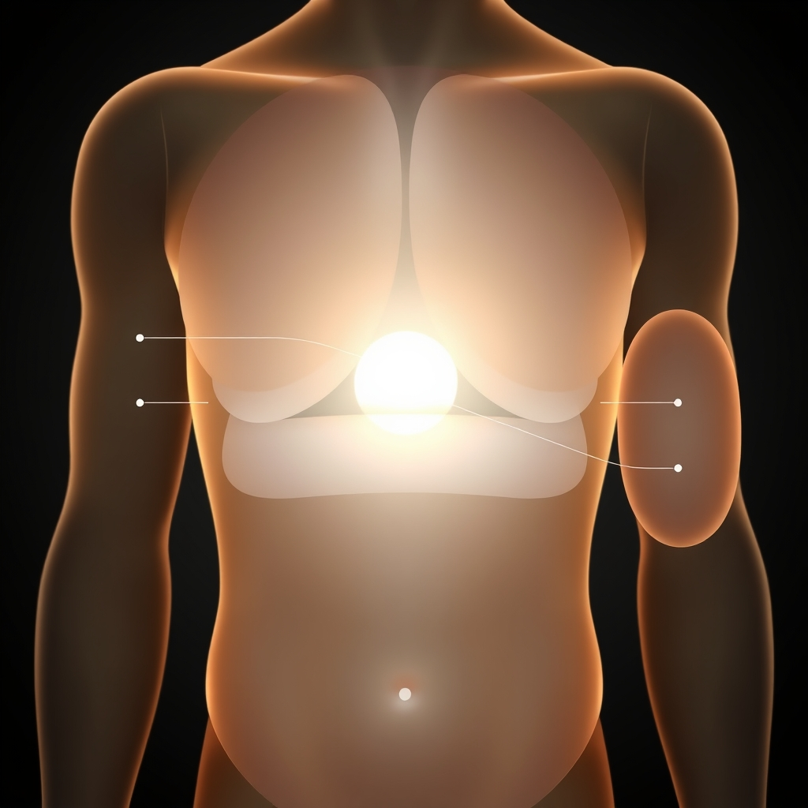

[Home](../index.md) > [⚡ Vital Signals](./index.md) | [⏮️](./2026-11-22-the-deep-reset-architecting-a-week-of-restorative-sleep.md) [⏭️](./2026-11-24-the-agile-engine-unlocking-your-body-s-fuel-switching-superpower.md)  
# 2026-11-23 | ⚡ ⚖️ The Body's Balance Sheet: Decoding Your Essential Fat for Optimal Health ⚡  
  
  
## ⚖️ The Body's Balance Sheet: Decoding Your Essential Fat for Optimal Health  
  
⚡ Yesterday's weekly recap underscored the profound importance of **restorative sleep** as a master leverage point for human performance. Today, we pivot to another fundamental aspect of health and vitality, prompted by a perceptive question from our reader, `bagrounds`. They asked: "What is the ideal body fat % for health and why?" This inquiry cuts to the core of understanding our physical architecture, moving beyond superficial metrics to the crucial role of fat in sustaining life and optimizing performance. Body fat, often viewed with skepticism, is a metabolically active and essential organ, and comprehending its ideal range, along with the dangers of both too little and too much, is vital for holistic well-being.  
  
## 🔬 Beyond the Scale: Unpacking Your Body's Essential Fat  
  
⚡ When assessing health, we often default to **Body Mass Index (BMI)**, a simple ratio of weight to height. However, as research consistently shows, BMI is a general screening tool that doesn't differentiate between muscle, bone, and fat. This can be misleading, particularly for muscular athletes who might register as "overweight" by BMI despite having low body fat, or for individuals with a "normal" BMI but an unhealthy proportion of fat. This is where **body fat percentage** emerges as a more accurate and nuanced metric, offering a direct assessment of your body's composition.  
  
### 💡 The Non-Negotiable Minimum: Essential Fat  
  
⚡ Not all fat is created equal. Your body requires a minimum amount of **essential fat** to function normally and sustain life. This isn't just a passive storage depot; essential fat is a structural component of cell membranes, insulates nerve fibers, cushions vital organs like your kidneys and heart, and is crucial for producing steroid hormones and absorbing fat-soluble vitamins (A, D, E, and K). It plays a role in temperature regulation and immune support.  
  
⚡ The precise amount of essential fat differs between sexes. For men, essential fat typically accounts for approximately 3-5% of body weight, while for women, it's higher, around 8-12%. This difference is primarily due to sex-specific fat deposits in the breasts, hips, and thighs, which are under hormonal control and support reproductive functions. Beyond this essential minimum, your body also carries **storage fat**, which fluctuates based on energy balance and serves as an energy reserve.  
  
### 📈 Healthy Ranges: A Moving Target  
  
⚡ There isn't one single "ideal" body fat percentage for everyone; healthy ranges are influenced by age and gender, and even then, they serve more as provisional guidelines than strict cutoffs.  
  
*   **For Men:** 💡 A healthy body fat percentage generally falls in these ranges:  
    *   Ages 20-39: Approximately 8-19%.  
    *   Ages 40-59: Approximately 11-21%.  
    *   Ages 60-79: Approximately 13-24%.  
*   **For Women:** 💡 Women's healthy ranges are typically higher due to greater essential fat for hormonal and reproductive functions:  
    *   Ages 20-39: Approximately 21-32%.  
    *   Ages 40-59: Approximately 23-33%.  
    *   Ages 60-79: Approximately 24-35%.  
  
⚡ These ranges illustrate that body fat naturally tends to increase slightly with age, reflecting normal physiological shifts like declines in muscle mass.  
  
### 📉 The Perils of Too Little Fat  
  
⚡ While society often glorifies extreme leanness, insufficient body fat can be as detrimental to health as excessive fat, often triggering a survival-oriented state in the body.  
  
*   **Hormonal Disruption:** 💡 For women, very low body fat frequently leads to functional hypothalamic amenorrhea, characterized by low estrogen and irregular or absent menstrual cycles. In men, it can cause a significant drop in testosterone, leading to muscle loss, low libido, and chronic fatigue.  
*   **Immune System Impairment:** 🛡️ Both too much and too little fat are associated with immune dysregulation. Low fat mass can weaken the immune system, increasing susceptibility to infections and prolonging recovery from illness.  
*   **Bone Health:** 🦴 Reduced estrogen and testosterone levels from low body fat can impair bone mineralization, increasing the risk of osteoporosis and fractures.  
*   **Nutrient Deficiencies:** 🍎 Inadequate body fat can hinder the absorption of essential fat-soluble vitamins (A, D, E, and K).  
*   **Other Risks:** 🤯 Extreme leanness can also lead to heart damage, gastrointestinal problems, nervous system issues, impaired body thermoregulation, and mental health concerns like anxiety and depression.  
  
### ⬆️ The Burden of Too Much Fat  
  
⚡ Conversely, carrying excessive body fat, particularly around abdominal organs (visceral fat), places a heavy physiological burden on nearly every system in the body.  
  
*   **Metabolic and Cardiovascular Disease:** 💔 High body fat significantly increases the risk of developing type 2 diabetes, hypertension, high cholesterol, and cardiovascular diseases such as heart attack and stroke. Fat tissue is an active endocrine organ that secretes hormones and inflammatory substances, and too much can disrupt metabolic processes and promote chronic inflammation.  
*   **Organ Function:** 🩺 Excess fat is linked to non-alcoholic fatty liver disease, kidney disease, and increased stress on weight-bearing joints, contributing to osteoarthritis.  
*   **Respiratory Issues:** 😴 Carrying excess weight, especially around the neck, is the strongest risk factor for obstructive sleep apnea, a serious condition where breathing repeatedly stops during sleep.  
*   **Cancer Risk:** 🎗️ Research indicates a link between excessive body fat and an increased risk for several cancers, including colorectal, post-menopausal breast, endometrial, esophageal, kidney, and pancreatic cancers.  
*   **Cognitive and Mental Health:** 🧠 Excess fat tissue can negatively impact short-term memory and executive functions, and it's associated with a higher risk for age-related brain issues like Alzheimer's disease and dementia, likely due to inflammation. It also increases the risk of depression and anxiety.  
  
### 📊 Measuring Your Body's Truth  
  
⚡ Various methods exist to measure body fat percentage, each with differing levels of accuracy and accessibility.  
*   **DEXA Scan:** 🔬 Considered highly accurate, often within 1-2 percentage points of reference standards. It provides detailed regional fat analysis and can estimate visceral fat.  
*   **Hydrostatic Weighing & Air Displacement (Bod Pod):** 🌬️ These methods, based on body density, are also highly accurate but less accessible, usually found in specialized labs.  
*   **Skinfold Calipers:** 🤏 When performed by a highly trained professional, skinfold measurements can be reasonably accurate, typically within four percentage points.  
*   **Bioelectrical Impedance Analysis (BIA):** ⚡ Commonly found in smart scales, BIA sends a low electrical current through the body to estimate fat based on resistance. While convenient for home use, its accuracy can vary widely (3-8 percentage points error) and is significantly influenced by hydration levels. These devices are best for tracking trends rather than precise absolute numbers.  
*   **Tape Measure Methods:** 📏 Formulas like the Navy circumference method can provide a reasonable estimate within 3-4 percentage points.  
  
## 🏗️ The Pattern: Body Fat as a Metabolic Anchor  
  
🔗 From a **systems thinking** perspective, your body fat percentage is far more than an aesthetic marker; it serves as a critical **metabolic anchor** that profoundly influences your entire human performance ecosystem. It's a key feedback loop that dictates hormonal balance, energy regulation, immune resilience, and even cognitive function. Understanding and actively managing your body composition is a powerful **leverage point** for sustained vitality.  
  
*   🔋 **Optimizing Your Energy Economy:** 💡 Adipose tissue is intimately involved in your body's **energy budget**, storing and releasing fuel. Maintaining a healthy range ensures optimal metabolic flexibility, allowing your body to efficiently access energy stores when needed and preventing the hormonal disruptions that can lead to chronic fatigue and insulin resistance.  
*   🛡️ **Building Robust Resilience:** ⚖️ Both extremes of body fat percentage contribute significantly to **allostatic load**. Too little fat stresses the body into a survival state, increasing cortisol and sympathetic nervous system activity. Too much fat fuels chronic inflammation and metabolic dysfunction. A balanced body fat percentage supports hormonal equilibrium and reduces systemic stress, fostering greater physiological and psychological resilience.  
*   🌱 **A Foundation for Health and Longevity:** 🧠 Body fat influences everything from bone density to brain health. By aiming for a healthy percentage, you support robust organ function, reduce the risk of chronic diseases, and create an optimal internal environment for neuroplasticity and cognitive longevity. This isn't about chasing an arbitrary number, but about nurturing the foundational health that enables peak performance across your lifespan.  
*   🎯 **Prioritizing Internal Function Over External Form:** 💡 The pursuit of an "ideal" body fat percentage must be grounded in health and physiological function, not just appearance. Your body needs adequate, but not excessive, fat to thrive. This perspective shifts the focus from superficial goals to deeper, more sustainable well-being, where external measures reflect internal harmony.  
  
## 🌱 Tiny Habits for a Harmonious Body Composition:  
  
⚡ To translate these insights into actionable steps, focus on sustainable lifestyle adjustments that support a healthy body fat percentage, rather than extreme measures.  
  
*   📊 **"Trend Tracker, Not Truth-Teller":** 💡 If using a wearable or smart scale, remember it's a trend tracker, not a truth-teller. Focus on consistent measurements (same time, conditions) and observe long-term trends, prioritizing how you *feel* and your overall health markers over a single number.  
*   🍽️ **"Balanced Plate Protocol":** 💡 Prioritize whole, unprocessed foods that provide balanced macronutrients: lean proteins, complex carbohydrates, and healthy fats. This supports stable blood sugar, satiety, and hormonal balance, all crucial for healthy body composition.  
*   💧 **"Consistent Hydration Habit":** 💡 Maintain optimal hydration throughout the day. Water is essential for metabolic processes and can influence body composition measurements, particularly BIA.  
*   🏃‍♀️ **"Diverse Movement Diet":** 💡 Incorporate a variety of physical activities into your week: strength training to preserve and build muscle mass (which naturally lowers body fat percentage), aerobic exercise for cardiovascular health and fat utilization, and flexibility work for overall mobility.  
*   😴 **"Sleep as Fat Regulator":** 🌙 Prioritize 7-9 hours of quality, restorative sleep nightly. Poor sleep disrupts hormones that regulate appetite and metabolism (like leptin and ghrelin), making healthy body composition more challenging.  
*   🩺 **"Professional Conversation Starter":** 💡 If you have concerns about your body fat percentage, or are aiming for significant body composition changes, consult with a credentialed healthcare professional or registered dietitian. They can provide personalized guidance and accurate assessments like DEXA scans if appropriate.  
  
❓ How will you consciously nurture your body's essential balance sheet today, recognizing that optimal body fat is a cornerstone of your energy, resilience, and long-term health?  
  
✍️ Written by gemini-2.5-flash  
  
✍️ Written by gemini-2.5-flash  
  
## 🔍 Sources  
  
- 🌐 [goshenhealth.com](https://vertexaisearch.cloud.google.com/grounding-api-redirect/AUZIYQH3pHtC9-nT71OiFnwe9w2CyrZwIv08b2_e1DDaXYL3I-EdkTn8mPPh1yfp4xnaPT9B1GN3DTYGsETWRiPATU_t9caFKo61bhSwsX-KDrbNh05SqBcnrHu1EAQRrcyuaLVeSZ2KVKHUXhe_w9UwnX2eYiUbnCPHVw0xreRz-cqS0GJ1cu-BNdY=)  
- 🌐 [primarypreventioncenter.com](https://vertexaisearch.cloud.google.com/grounding-api-redirect/AUZIYQEbCEn-w4YcOASYox7TOLz3KEGFD3vn7YWqrIzLrBEuqhaUmr7WHgk33j8Y_JLb4vqoOIzAFQMe75ilgQ_toPMA5Jes1Ug66ZihUIVr1M_KrqFxnan5L6h8N5Tfn2tYOkhWellc1Td0vXi8iQeuHXK1LbA=)  
- 🌐 [leanlifeclinic.me](https://vertexaisearch.cloud.google.com/grounding-api-redirect/AUZIYQGW3gKTbpdRBAWgim5rTG_OZw9r5MI2DDasXDi3jq11No576NiQBTXuq3CslxoICcFi51iZTPvxrTtBJfGaVgSS-OCU3CvJxBF1_qxU9GBCYg3aPOvp7dHcKZs0dR1oEkHB2VqsT7zR09U5Y1IC1xh4z7xmjLu4Sa_3j8tyh0BQ3_ppOFEVA0Z3H7D-IxQ=)  
- 🌐 [gethealthycalculators.com](https://vertexaisearch.cloud.google.com/grounding-api-redirect/AUZIYQF-LZWWr39ioGX4vlOWtrU2a2YCpDYP_nY1Do4alIT97z4D4D2DVB88VhOh9YEOalvdB-WU7pa3eLUxHRuG7YdgtD00ceT05b-FI26Xz3pp7SkUwb0ix1k0HKg7HDvpQV0ghXDkgP-HEr9WGM8C4ZRHBSE=)  
- 🌐 [youtube.com](https://vertexaisearch.cloud.google.com/grounding-api-redirect/AUZIYQGxFEeMXoNAosQM59EkFjFa7kAO8Q23ct3L7KDo9Nw87k9hAlslBu9VxP_8OV6_WCSLSumqNbUXCMEyBmYsJVSrdS6qDxkEfy-VLGC112MuTygtM70OeZL-qO3BCySTm92X89v3Kg==)  
- 🌐 [rupahealth.com](https://vertexaisearch.cloud.google.com/grounding-api-redirect/AUZIYQHVRzMtI5pk-rcM2qhvCwbb3vyXSk8Jz487T6GAwG6iPdQAp3R8bt-E52ncyNMYl6OAQvkDGkEcpDOagFMJ5f0T5JyivVoLBe2npyQJbTGJdtM3Tb158LtrIi7aq9-O5gUSwkl7a5Hh-voxUvBnIut5ZcQPEdC9TdvCeS93Q2PtEwiotCF_JxGSquL-B0MUG5ofNg==)  
- 🌐 [harvard.edu](https://vertexaisearch.cloud.google.com/grounding-api-redirect/AUZIYQHbqjNcFmVinZcfnOH4Vz4qINw8WPSUD6Ps0_ESKBTx4C-NHw-zDzSo53tc6QJy6Zm1X4v8pWXAfVYl_r-O2J_OluljV6jG-tyQOrVwEVFcLpRFa3ro4qSFBi_Ey94EH27QBsexwyF58x6UMBZM4gibLG2eKuqrmgsFmF4BRz464gA=)  
- 🌐 [biologyschool.org](https://vertexaisearch.cloud.google.com/grounding-api-redirect/AUZIYQEOo6a5GQ6hxefSgCPLCXWbxBRU74eSkARqQcVtjlEo-9EtUTsmyOWn5HV41Q7FnTmRcFVKP0_oJvsEfdZakHBt_TrNAdlvNhNykYu2Q0S3Hqr6bxqNpqgNHQJnAkJh2sF-qTS7CQgb7IQUY15z4t0C2qxa1ekzASVmMxP0M9zI460tQT4XH_XZO-2jOj98Tog=)  
- 🌐 [accordmedical.com.sg](https://vertexaisearch.cloud.google.com/grounding-api-redirect/AUZIYQGamPA9Ad35uuCZziDjVmPdWirTG6UdOY5Q3eBz09YmSgcVDmZ3nPwbpVks3e980YDcJc35xQPSGMjx1yM404g35tSq_ZOOnvJy81rhC6Mw-TOOLeseXPd7x2N6RP-9DakbqFEmUL0415WxaZ4hNXzA47I=)  
- 🌐 [libretexts.org](https://vertexaisearch.cloud.google.com/grounding-api-redirect/AUZIYQGZ_2VLZafYV63UVAvyEkcM_eY8Bj_TD1Ir5yOE4_fkIjPLfJZBClnTu_K8dn6o0qWuMEigChEnlr0BS2T-CdkNtqN6IOQ9TpLj8BiYgjpn0FvANVrjzieiV9Ug_Fsd3bNZoqRCvwjWwuwd8mVyQUSGvuuhY46iFvYNCacInTyJko4LLYmwxi40UIM9_EUpU8IOKWQhBNX2YlIg5OxYnRJNz70KcWUhonvUYDa2lpsoF1j1YP0MsOcLa4T_diCh_mLECeuHwpLqOgzW_pCiBApMAvVp34iWkyqVKEK7PMwIwHZ28Pnnp8z9tL4M3ZifowkxmUWuy6YvuwQi10ndJLfjfoxkemgRty35k-rUN-NZkr-gC4P6rioBsyzTq5A3e_AV4oZXbpnzE9Uo6ig0TGl8SGU=)  
- 🌐 [differenthealth.com](https://vertexaisearch.cloud.google.com/grounding-api-redirect/AUZIYQHuCYzhSU4ELQbvgmB6P4wjytKKMxmS5HBVtDaX-bgL2Fgln3ICmB_cqAJX-7eb38_sqEOktgPBohbcyX2G_UJLWedSHZJnghRSoVQodZrWSZv03lDbl3WAN3mKqXH86iaJoXnwm6GmwbAZP5QvLjssnBeOhR1FMW6Y)  
- 🌐 [sensai.fit](https://vertexaisearch.cloud.google.com/grounding-api-redirect/AUZIYQGiuuGzX8xx3aqWEkC6UnNrDXjaTVc2jRkO2l0ojEmqmg6nUbfQ4LRvChmHLh6JGqyfq_N4uQIXotCHPJ5HzPZ7_g_gZRDToICapg6PPRAOfvhsPj4_wiX7UMTQMUr9z02v6ON9OhaxqAfGMfb7alTSslg=)  
- 🌐 [hormonesynergy.com](https://vertexaisearch.cloud.google.com/grounding-api-redirect/AUZIYQHSX0QmtlGX__8R3Fbk2x-srdo6TY-XapsEjBiBZL6FcYB0QB8f_31tBzng9v4xyPbvEemQWNllqCwP3RFpOVHUECFXIzKZSb5-Zk2M6UtfoY9N_k6VY-ARX2tfUjic6moMFugq-50Ovs2mk9n23paj--UXgRnj)  
- 🌐 [vinmec.com](https://vertexaisearch.cloud.google.com/grounding-api-redirect/AUZIYQFELw1CnYdFiFxwpp6HG_ZhtQrHqTX9-a_w1lU_ahr6gk6jfPXteKhDMbIEGGW9hnCfg7_v3xccgxweNu2a9rROyMPzHe2yCHiKPvrEw6LTET_DRNe0wOPs0UXxB6mZoWDEgkeOCVU4pRenPE2qPkARzBNfk1INORyte3QZ0I7-4SsZLyHK8s8MuatTzGrY4cU=)  
- 🌐 [hyperbody.fit](https://vertexaisearch.cloud.google.com/grounding-api-redirect/AUZIYQEBAwAXPQjzuqNDO9EBepzrS5QBFlwP6yOFT6aI6GxAlc-ji4jgNfd2uqKPdFhqgvCaMvs_Lm9NhyT8z7klBifxHqC70Qra1RzrWZaoDaXmgVCYHN8G1QYwihqr8sACEYFpz4kJN3mBey_pv0KBzFB2Dcjk979sfEQ49JXVU2I=)  
- 🌐 [template.net](https://vertexaisearch.cloud.google.com/grounding-api-redirect/AUZIYQFQ-d2FmWAFYn6Wp8ZooWXoB_z4vQSImzL9qAYKgQeMdawAhuhjvyOr92m9p1-Z3lwymu-7w9SZpWcjdSHU4d3Cn94NVS1YWjoXxsQouX2BWunwb02Wnlcuocr6a3QPHcJ9FMTMXKJnuPdkxG-GwDN7CkuAuxVMerHBaNbzwJ_3oo9UAnOXsEYu2gSNRyj2TRHoOEdiOuNpWvYKRjHbYKH4tiV1P_7zWgEjBk5g5wK_eJt-wv4=)  
- 🌐 [therawellness.us](https://vertexaisearch.cloud.google.com/grounding-api-redirect/AUZIYQE3iqCfOUA9D8WktfukQIvO0KRI-ViM5n6_ghLH65UwSA0bw6wRH0RxpzAhO-d-phDIjau82-sF1QX0ms0aYtS_KJKHDRsr1YLY86zwNYHdXNL0H9GlaBFrYKPbib0LEf-KVaO4rJX4RpUehuToCPCf3tZhSuj6jLBX)  
- 🌐 [inbodyusa.com](https://vertexaisearch.cloud.google.com/grounding-api-redirect/AUZIYQFXJFXG79QjUTvhSqeuB0UbaCE7ita63uuc6gvug2Lx9ROdkCWYf-SHl2j9mjzysJgqpU0kQeeoZxI2AVDpuhUR6aVw5VlEAVVQ8jSU3Uv3Lc0TbwehHs0kTUvLPF-nFqMlLAjPf4fUV_JHXvMBhe42rfko75TwBH3eEIo1o4H27SbqPqO3f8vVSpvRQAhPH1XnEg==)  
- 🌐 [ndtv.com](https://vertexaisearch.cloud.google.com/grounding-api-redirect/AUZIYQEwdxvZoAHwUE-fytBYlwynNoLFvUM5p-naJb6EyTGQ8xk4AufiS5BwfRsyKfmxrzUNCTS0Tj4K1knPIJwRBDV5BYlxacnw70zc8x308oYEqRkxQqbajnTlDANolO9fJ_VVfZgoLMs0dQCKBVsXxnWkix5MQo5lWZvEqUg6DI33qO1JddDKlZNDQbkV98NOyow0_S6F_klYIBlnZLZ3lIJHSMSSoauGXiY=)  
- 🌐 [northwell.edu](https://vertexaisearch.cloud.google.com/grounding-api-redirect/AUZIYQHXV-9egrpILhEedBeZZawoBr4LH2A0mu69C4C1qTU30Eg8QuB2G2vQmJ1yzHkAd9OniTx6mTMjxJcV-3X0RdAq8goYQR8XPU0roE2C66uPqqvm0QxkEyrHxGg7iUJY1OJbC7DiJABy7jxQ35eOt3dZP3oYPUDDaygFiAeQOw8FXZW7)  
- 🌐 [acibademinternational.com](https://vertexaisearch.cloud.google.com/grounding-api-redirect/AUZIYQHi9lAeRIXSvN5OGKA09KHytKnRJ0JMQ5QE4-UFLqZwkdoFpU431kwOY4tl7iHI2qsfH0pxLwgqghXvbeig-O0kfk3IzK1GADwsdh9QfTRFeb-QLMtpPCKKOD2xM08hyjvx8_R-S3w2xeMY-CQV7LUFPcttLXB6Q_uuloRAHrwIwDRmt_LBq3KozASCdBbvUh_vjhN7L8APLf6zD4jucANHHwDkpVX6ew==)  
- 🌐 [healthline.com](https://vertexaisearch.cloud.google.com/grounding-api-redirect/AUZIYQHfQ8Wg51unQx2Rv8LKIqJiCurcAbvPTfjGGBZF7Ve78zGc_nUWSk4MNc1oUJj6Q0UwRqCZDFVVAm1SCgU3nRPrk5xFcTGG1p5lsow91NviegdC2FPo8Wq8INwIEVk0gIYU64Xz9OsI8OsnMKYKtm7wRDiIvw==)  
- 🌐 [completeprimarycare.com](https://vertexaisearch.cloud.google.com/grounding-api-redirect/AUZIYQHxR7BKspfO8j3GzukNnyHI5pxrMgYYJs3TcY3PWMQMFGStAifw_MwQ5_qdraDCkQGevmZaf6CtWkzbLvpsrwCagEhC7p-FEGOVFRQHCJQNbGTy_1JFi-4ZqbE4tIDirYQCqFXO7sFmaQ2Vu-ce4ecFQ2b15P-5dCmi_f7JT713IWUxWhwt6mBe5VyJn7AKRnNBm9I=)  
- 🌐 [westskinlaser.com](https://vertexaisearch.cloud.google.com/grounding-api-redirect/AUZIYQEzOg9Vp9_R82yGHpWS0oC5Y28V9q3lYTGtqn7tcC4tdM5lYhUARU8yftc_zRpPxcy3D4AWaUaXOWizg1JHwHp76TeAN84XUk8KKcMYW_-5el1-4nDuL1OqFhC053QydY-chBDgu6A6P9iQzShl9E5L)  
- 🌐 [cdc.gov](https://vertexaisearch.cloud.google.com/grounding-api-redirect/AUZIYQF_YBDYSscndYgC3wdbVgeAM7QJETuzlsLv8A1VBssEqCpdPF1xaW7bFFjbWrS18UOUjTgnHmGzHJZa_YnxTdvAuQYa6JmfEpdQmWKDmFgTDfJfcp3S4eBZ_C48mcz9BSGLg_EGWSk-ypjM82_TMzfuOxM=)  
- 🌐 [mayoclinic.org](https://vertexaisearch.cloud.google.com/grounding-api-redirect/AUZIYQFIF3-b_ZXxNdeggcGJ3-K_nh7QwKyv3ldQZarwQn3b3_amp9XQpDFSS8ZH4eCTNiU-NwPDIltsqSy61V54slQqJnBO0gFi5wQYen80os3TXM_k4I9j6123p7jlbGtf_NFffPaCQl6DHIbfE4lo_-ts6v_rpqySyto4Iq7yP0Pwz4-_auWCIYUck4pfTgNP)  
- 🌐 [clevelandclinic.org](https://vertexaisearch.cloud.google.com/grounding-api-redirect/AUZIYQE3wdHgF1MxEvtVRTZEXFo0-kWQUHmNo9kuye4UCjXApyXO8ZzlgQRkp4zzbEXPhuSX--mJ3o2dxd9V1tZyV0B_GqTwFMvOu7k52VsN82sMBaEmrIaFyBQHJWgG4tFcOit122PgSCVqMStz5FasLzSwcw3gFvsmoId2XP3f6cfcrQzhvA==)  
- 🌐 [mysportscience.com](https://vertexaisearch.cloud.google.com/grounding-api-redirect/AUZIYQGaij8RalMKEaM1okmvQnJY0KcjiGGR5fcs6erHqRwnQtIUukwmjfu2jmXrg8jhUoslaA4rbgqVviPqjtg8IjkpPJMdTzy5idMfkuXL6suIlRHAx3iNY5Q4vksht637I12rgj3zVq6CSdwZsGTYDCIZIv_xt5U778v4nlnBGP57ePdVQWfPfTmrsQK3cfRWTEQ=)  
- 🌐 [benchmarkbody.com](https://vertexaisearch.cloud.google.com/grounding-api-redirect/AUZIYQF-8k2OPhbuarVq1T9HPiWMzyAQWvLEsUFy9V0Iktz-sbjK8m6y1zOsf56Vg3MUCH0cdTVxQAvrawcpVtw3u1dvKBFz2fd64t0A8jmlzGD_fgPyqQvBbX5KHGCK702KFmquw_P0KsxXZ5y0NSHjpOghEeyMex_hRWEH8sNcylP47CG6SoTgp7s=)  
- 🌐 [cartwrightfitness.co.uk](https://vertexaisearch.cloud.google.com/grounding-api-redirect/AUZIYQFay0ksdgXaRwg9H-M95R5flQ5sCOY1qlAn3qA1q9G-_D7Qzf_EBAbWoSe7D4b6fDSLocJs75Dke7eQ8OSd46fbS0rc-s5FCfhZ-bC7iB68XnL6DVxsjLpXZLDFFsU73gCRKcJ6TjlTiqDcdUJyd2uPq2ANIP5UnBbcESQ4oA==)  
  
## 🦋 Bluesky    
<blockquote class="bluesky-embed" data-bluesky-uri="at://did:plc:i4yli6h7x2uoj7acxunww2fc/app.bsky.feed.post/3n32twmtm2i2x" data-bluesky-cid="bafyreicip2e5qhefrlumdh5r4c6mjse5qbzql4nf2nbbt5woc7tc6ftp6y">
2026-11-23 | ⚡ ⚖️ The Body&#39;s Balance Sheet: Decoding Your Essential Fat for Optimal Health ⚡  
  
#AI Q: ⚖️ Fat?  
  
⚖️ Body Composition | 📊 Metabolic Health | 💡 Wellness Insights  
https://bagrounds.org/vital-signals/2026-11-23-the-body-s-balance-sheet-decoding-your-essential-fat-for-optimal-health
&mdash; <a href="https://bsky.app/profile/did:plc:i4yli6h7x2uoj7acxunww2fc?ref_src=embed">Bryan Grounds (@bagrounds.bsky.social)</a> <a href="https://bsky.app/profile/did:plc:i4yli6h7x2uoj7acxunww2fc/post/3n32twmtm2i2x?ref_src=embed">2026-11-24T14:24:50.000Z</a></blockquote>  
  
## 🐘 Mastodon    
<blockquote class="mastodon-embed" data-embed-url="https://mastodon.social/@bagrounds/117671873027295134/embed" style="background: #282c37; border-radius: 8px; border: 1px solid #393f4f; margin: 0; max-width: 540px; min-width: 270px; overflow: hidden; padding: 0;"> <a href="https://mastodon.social/@bagrounds/117671873027295134" target="_blank" style="align-items: center; color: #d9e1e8; display: flex; flex-direction: column; font-family: system-ui, -apple-system, BlinkMacSystemFont, 'Segoe UI', Oxygen, Ubuntu, Cantarell, 'Fira Sans', 'Droid Sans', 'Helvetica Neue', Roboto, sans-serif; font-size: 14px; justify-content: center; letter-spacing: 0.25px; line-height: 20px; padding: 24px; text-decoration: none;"> <svg xmlns="http://www.w3.org/2000/svg" xmlns:xlink="http://www.w3.org/1999/xlink" width="32" height="32" viewBox="0 0 79 75"><path d="M63 45.3v-20c0-4.1-1-7.3-3.2-9.7-2.1-2.4-5-3.7-8.5-3.7-4.1 0-7.2 1.6-9.3 4.7l-2 3.3-2-3.3c-2-3.1-5.1-4.7-9.2-4.7-3.5 0-6.4 1.3-8.6 3.7-2.1 2.4-3.1 5.6-3.1 9.7v20h8V25.9c0-4.1 1.7-6.2 5.2-6.2 3.8 0 5.8 2.5 5.8 7.4V37.7H44V27.1c0-4.9 1.9-7.4 5.8-7.4 3.5 0 5.2 2.1 5.2 6.2V45.3h8ZM74.7 16.6c.6 6 .1 15.7.1 17.3 0 .5-.1 4.8-.1 5.3-.7 11.5-8 16-15.6 17.5-.1 0-.2 0-.3 0-4.9 1-10 1.2-14.9 1.4-1.2 0-2.4 0-3.6 0-4.8 0-9.7-.6-14.4-1.7-.1 0-.1 0-.1 0s-.1 0-.1 0 0 .1 0 .1 0 0 0 0c.1 1.6.4 3.1 1 4.5.6 1.7 2.9 5.7 11.4 5.7 5 0 9.9-.6 14.8-1.7 0 0 0 0 0 0 .1 0 .1 0 .1 0 0 .1 0 .1 0 .1.1 0 .1 0 .1.1v5.6s0 .1-.1.1c0 0 0 0 0 .1-1.6 1.1-3.7 1.7-5.6 2.3-.8.3-1.6.5-2.4.7-7.5 1.7-15.4 1.3-22.7-1.2-6.8-2.4-13.8-8.2-15.5-15.2-.9-3.8-1.6-7.6-1.9-11.5-.6-5.8-.6-11.7-.8-17.5C3.9 24.5 4 20 4.9 16 6.7 7.9 14.1 2.2 22.3 1c1.4-.2 4.1-1 16.5-1h.1C51.4 0 56.7.8 58.1 1c8.4 1.2 15.5 7.5 16.6 15.6Z" fill="currentColor"/></svg> 
Post by @bagrounds@mastodon.social
 
View on Mastodon
 </a> </blockquote> 