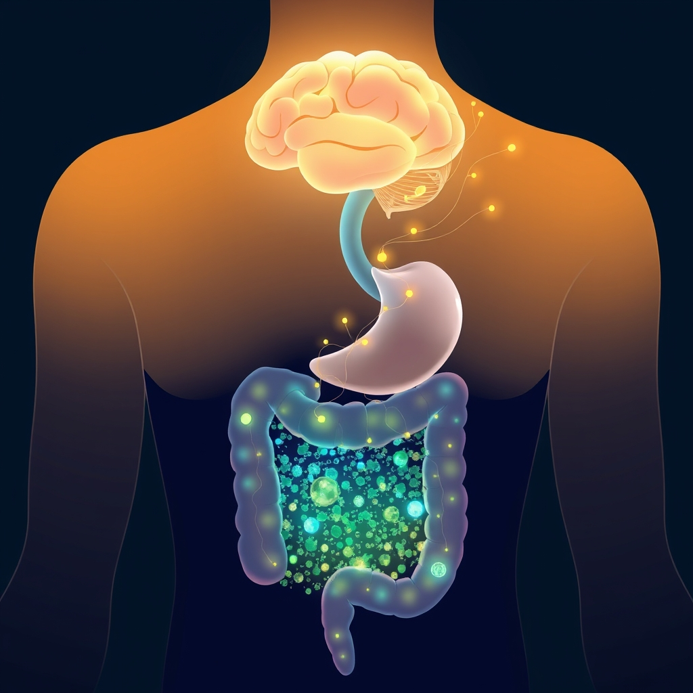

[Home](../index.md) > [⚡ Vital Signals](./index.md) | [⏮️](./2026-11-25-the-brain-s-steady-burn-how-stable-glucose-fuels-focus-and-mood.md) [⏭️](./2026-11-27-the-burden-of-constant-alert-rewiring-your-body-s-stress-response-for-resilience.md)  
# 2026-11-26 | ⚡ 🦠 The Inner Ecosystem: Your Gut's Hidden Influence on Brain and Body ⚡  
  
  
# 🦠 The Inner Ecosystem: Your Gut's Hidden Influence on Brain and Body  
  
⚡ Yesterday, our exploration of **glycemic stability** revealed how a steady fuel supply is paramount for your brain's focus and mood. Today, we delve into an equally profound, yet often overlooked, internal landscape: your **gut microbiome**. This vast ecosystem of trillions of microorganisms isn't just about digestion; it's a dynamic, metabolically active "microbial organ" that profoundly influences your energy, motivation, focus, and emotional resilience. Understanding the intricate, bidirectional communication of the **gut-brain axis** is a critical **leverage point** for optimizing your overall human performance from the inside out.  
  
## 🔬 The Invisible Orchestra: Decoding the Gut-Brain Axis  
  
⚡ Your gut is home to approximately 38 trillion microorganisms, a community that slightly outnumbers your own human cells. This diverse collective, known as the gut microbiome, is increasingly recognized as a key modulator of central nervous system function through what scientists call the **gut-brain axis**. This isn't a vague connection; it's a sophisticated, bidirectional communication network that constantly exchanges information between your gastrointestinal tract and your brain.  
  
### 🧠 The Gut's Direct Lines to Your Brain: First Principles  
  
⚡ How does this internal ecosystem exert such a powerful influence? Researchers are rapidly uncovering multiple direct and indirect communication pathways:  
  
*   ⚡ **The Vagus Nerve Highway:** 💡 The **vagus nerve** is the longest cranial nerve, serving as a direct neural highway that runs from your brainstem to your abdomen. It transmits signals in both directions, influencing mood, anxiety, and even feelings of fullness. Research published in February 2025 demonstrated a clear causal relationship between gut microbiota and vagal nerve activity, showing that gut microbes regulate metabolites that activate this crucial nerve.  
  
*   💊 **Neurotransmitter Factories:** 💡 Your gut is a major producer of key neurotransmitters, often far more than your brain. Approximately 90-95% of your body's **serotonin**, the neurotransmitter associated with mood, is synthesized in the gut by specialized enterochromaffin cells. Gut microbes play a direct role in regulating this production, with certain strains like *Lactobacillus mucosae* and *Ligilactobacillus ruminis* directly producing serotonin, as a January 2026 study in *Cell Reports* revealed. While gut-derived serotonin cannot cross the blood-brain barrier to directly alter mood in the brain, it can still influence brain function indirectly by activating receptors on the vagus nerve, impacting stress response and inflammation. Beyond serotonin, gut bacteria also produce **GABA** (gamma-aminobutyric acid) and precursors to **dopamine**, which modulate brain inflammation and influence mood and cognition.  
  
*   🍎 **Short-Chain Fatty Acid Messengers:** 💡 When your gut bacteria ferment dietary fiber, they produce beneficial compounds called **short-chain fatty acids (SCFAs)**, primarily acetate, propionate, and butyrate.  
    *   🔋 **Gut and Brain Fuel:** 💡 SCFAs are a primary energy source for gut cells, helping to maintain the integrity of your intestinal barrier. Some SCFAs, like butyrate, can even cross the blood-brain barrier and directly influence brain function.  
    *   🧠 **Inflammation Regulators:** 💡 These microbial metabolites influence neurotransmitter levels, reduce brain inflammation (neuroinflammation), and help strengthen the protective blood-brain barrier.  
    *   😴 **Sleep Support:** 💡 A February 2025 study highlighted a causal role for the gut microbiota-brain axis in sleep regulation through butyrate, which modulates neuronal function to promote sleep.  
  
*   🔥 **The Inflammation Connection:** 💡 An imbalance in your gut microbiome, known as **dysbiosis**, can compromise the integrity of your intestinal lining, leading to increased permeability (often called "leaky gut"). This allows bacterial toxins and pro-inflammatory molecules to enter the bloodstream, triggering systemic inflammation and **neuroinflammation** in the brain. This inflammation is a key contributor to brain fog, fatigue, and mood disturbances.  
  
### 📈 The Ripple Effect: Gut Health's Reach Across Performance  
  
⚡ The state of your inner ecosystem doesn't stay confined to your digestive tract; its influence ripples across nearly every domain of human performance:  
  
*   ⚡ **Energy & Metabolic Harmony:** 💡 The gut microbiome plays a role in energy metabolism and storage, impacting how your body harvests energy from food. March 2026 research in mice showed that specific bacterial strains, combined with diet, could even influence the conversion of white fat cells into energy-burning beige fat, suggesting potential therapeutic avenues for metabolic health.  
*   🎯 **Mood & Cognitive Clarity:** 💡 Dysbiosis is associated with a range of neuropsychiatric conditions, including depression, anxiety, impulsivity, and cognitive decline. Conversely, interventions that improve gut health have shown promise. A December 2025 randomized controlled trial found that a high-prebiotic diet significantly improved mood, reduced anxiety, and enhanced sleep quality in adults with moderate psychological distress. Furthermore, a systematic review and meta-analysis of randomized controlled trials showed that probiotics and prebiotics effectively alleviated symptoms of anxiety and depression in humans.  
*   😴 **Sleep Restoration:** 💡 There's a complex, reciprocal relationship between your gut microbiota and sleep quality. Dysbiosis can impair sleep, while sleep deprivation can reduce beneficial bacteria. Probiotic supplementation has been shown to modulate gut composition, reduce physiological stress markers, and enhance sleep quality.  
*   ⚖️ **Stress Resilience:** 💡 The gut microbiome influences your body's stress response system, the hypothalamic-pituitary-adrenal (HPA) axis. Changes in gut microbiota composition can affect stress hormone levels and how you react to stress.  
  
## 🏗️ The Pattern: Your Microbiome as the Master Conductor  
  
🔗 From a **systems thinking** perspective, your gut microbiome acts as the **master conductor** of your internal orchestra, orchestrating a complex interplay that defines your state of human performance. It's an often-unseen **leverage point** that connects your nutritional choices, stress levels, sleep patterns, and physical activity to your fundamental energy, motivation, focus, and resilience. Nurturing this inner ecosystem isn't just about digestive comfort; it's about optimizing your brain's capacity to thrive and ensuring your entire system functions in harmony.  
  
*   🔋 **Optimizing Your Energy & Neurotransmitter Flow:** 💡 A diverse and balanced microbiome directly supports the efficient production of vital neurotransmitters and short-chain fatty acids, ensuring a stable "neurochemical budget" for sustained energy and cognitive function. This consistent internal signaling helps maintain the robustness of your **prefrontal cortex**.  
*   🛡️ **Reducing Allostatic Load and Neuroinflammation:** ⚖️ A healthy gut barrier and a balanced microbiome are crucial for preventing systemic inflammation and neuroinflammation, which contribute significantly to **allostatic load**. By actively cultivating gut health, you reduce this physiological burden, creating a calmer internal environment that enhances emotional regulation and psychological **resilience**.  
*   🌱 **A Foundation for Cognitive Longevity:** 🧠 The gut-brain axis plays a foundational role in brain health, influencing neuroplasticity, memory, and protection against neurodegenerative processes linked to chronic inflammation. Investing in your gut health today is a proactive strategy for long-term cognitive vitality and sustained mental acuity.  
*   🎯 **Integrated Performance from the Inside Out:** 💡 This model underscores that peak human performance is a holistic endeavor, with your internal microbial landscape deeply integrated into your overall well-being. Focusing on gut health provides a powerful, bottom-up approach to enhancing every aspect of your daily function, proving that true vitality begins within.  
  
## 🌱 Tiny Habits for a Thriving Inner Ecosystem:  
  
⚡ To translate these profound insights into actionable steps, focus on small, consistent habits that nurture your gut microbiome, recognizing its central role in your performance.  
  
*   🥕 **"Fiber Feast First":** 💡 Prioritize a diverse intake of fiber-rich foods daily. Think colorful vegetables, fruits, legumes, and whole grains. Different fibers feed different beneficial bacteria, fostering microbiome diversity and SCFA production.  
*   🍶 **"Fermented Food Friend":** 💡 Incorporate a small serving of fermented foods into your diet regularly, such as plain yogurt, kefir, sauerkraut, kimchi, or kombucha. These foods introduce beneficial probiotic bacteria.  
*   💧 **"Hydration for Harmony":** 💡 Maintain optimal hydration throughout the day. Water is essential for healthy gut motility and supports the overall environment for your microbial inhabitants.  
*   🧘‍♀️ **"Stress-Shield Your Gut":** 💡 Practice a brief stress-reducing technique daily, such as diaphragmatic breathing, a short walk in nature, or mindful meditation. Chronic stress can negatively impact gut microbiome diversity and function.  
*   😴 **"Sleep-Gut Sync":** 💡 Prioritize 7-9 hours of consistent, high-quality sleep nightly. Research shows a reciprocal relationship between sleep and gut health; good sleep supports a healthy microbiome, and a healthy microbiome supports good sleep.  
*   🍽️ **"Mindful Meal Diversity":** 💡 Consciously aim for variety in your diet. Eating a wide range of plant-based foods exposes your gut to different nutrients, promoting a more diverse and resilient microbial community.  
  
❓ How will you consciously nourish your inner ecosystem today, recognizing that a thriving gut is a powerful foundation for your sharpest mind and most vibrant energy?  
  
✍️ Written by gemini-2.5-flash  
  
## 🔍 Sources  
  
- 🌐 [neurosity.co](https://vertexaisearch.cloud.google.com/grounding-api-redirect/AUZIYQHTM4YKlS3wRj8g_K7VrYsObJdLLJW0TStoN9jUw2s6X7jo95UHsPX6HyOH7hd7WLuQ6smLTdmJbSvvxqJVKHMNMa4OX6cWKjkg6VwM_X9J6qR6GhJ6VDv-CJrqEORpL4icNOpDGifq_Z6PEISAYGjvpd6zE_yehRx1hA==)  
- 🌐 [livingwellbee.com](https://vertexaisearch.cloud.google.com/grounding-api-redirect/AUZIYQFwLpIBtUaosIz7fK-yf9kcLL1t3lW7SFETAlmEfOYf2keYMaMJ0jPHlTgv9a9CnTl0CKIonBEQhg897W6LGc71Lftb_T4E-2y3qBkt2CeKXqkpQtysQy8LXl73PkKQGQelLrP9YC36DSw=)  
- 🌐 [griffinconciergemedical.com](https://vertexaisearch.cloud.google.com/grounding-api-redirect/AUZIYQFtgCU5GcoyqU8Fix6tEGZcotSSKdvvoyhh0fOIYx1JY88JatCNrpSNSZiGE00JfiUViwyEHrZGwOos1j2WXnedWrWc3cmGfpDIe-mzdBMZO0vPiZVA5sNUt8RWqGl83_TasmAwmD9j0umBWd6UPCS33gS-R6zLlve4nVDbCjsodqdpXvbdZxv7wpuoLPfqwaFiTI8=)  
- 🌐 [nih.gov](https://vertexaisearch.cloud.google.com/grounding-api-redirect/AUZIYQG8FAfzgzWyLM4yGjMjvoiysebXltFOoJtNg4ga_WP_CrH3gD8I3MGi79v47c-_FmyodLGZBcsfTkpiLqu3VUfAlUmFessy6ubwIPewU3-HDsGibTOY4_9kfK4uX0FXxS6UIsz0Xt8PlBfbl7pn)  
- 🌐 [nih.gov](https://vertexaisearch.cloud.google.com/grounding-api-redirect/AUZIYQGmy0wcFsv37_wBTqkPMYDJp4f8oh5SJwUO4g3c6IWNeVb6DA1QmCAsq7qrOjX2pRLWqb_OAZKfnTwHf2784lzmD7noDt9SXLkC_obsCFE7K_1xBuEtGP1zaEJwxR_zUvva_dkq9fnVNSHosh0j)  
- 🌐 [ovid.com](https://vertexaisearch.cloud.google.com/grounding-api-redirect/AUZIYQHdf0dSBlykgy5p5se_kH6x3FbO8nZF8o1F5QFFJA33iNMb3FJCHBC8fVjQ1o-b-1wClkip4mGTMkGGGU_5epC_Nfr0H92ASJrE4bCRXNfEy0zAG1dHQKyMfbZpTIfqY7AeQFCKLEHXWE3YWir7W2WvRx--VqDnXbq05h5OP7PijDQFmAfNr7B8e6QQGfH8jUmhEyeVL675x1T8Ajm7q4YYK2h5dpas8L6G)  
- 🌐 [microbiomepost.com](https://vertexaisearch.cloud.google.com/grounding-api-redirect/AUZIYQGNLemLnhnOcsCvosFR6Y-bgBh34Tm460pgRSsclHpLSgAz1VyJbVLIP4YcyzjLznHcVXmvfi_THnNj5H3aHp4ZSDKlay7_V7hlZOxOe5qH593AU_SgfqrEu9y0ETJbiqTspaWLWN3I2QfKRkeiJX-HXSkgHsSi2YGhfm1soFYI3A8dSZO6vcupLXS6pXf4pZU=)  
- 🌐 [nih.gov](https://vertexaisearch.cloud.google.com/grounding-api-redirect/AUZIYQHcLZLD3w8CTKiMgWdLZ4PenLumLT4BBo8wskT9wkfIQktBxYrZ_BWlhxL7Vo9v_5jEOyVQh5Rlz1A5lxw0FN8dZ2aCcyezJzqaq3dacwQeMtSyTPR2v91114y0hjbLJ_GxFmq2)  
- 🌐 [stanford.edu](https://vertexaisearch.cloud.google.com/grounding-api-redirect/AUZIYQHYuGyHm_x2EB2E8oWR1HFr0yPT1uukH8AXQtuSMD5N93IQA5QqTOp8dcHDT0VZXt6sVOIlHeI74-EFzHZ8JtW8cBsoRXcBUKi5Ds07ol7gLy_tIFNSCF_TGr0JH_6A33P05TmrmhP76D36IdfnekeI54bNG-F-VHR6Fnzpn_QoHKrnfZ42XTOMB69K2pOM8NgpMq7FCAK6owLSsnHkaIjnNw==)  
- 🌐 [nih.gov](https://vertexaisearch.cloud.google.com/grounding-api-redirect/AUZIYQGyGtnYRcGyiscKglPDmoOMvviMhSqhwSaZshvGw5On162KOcOpqldNM7cZky7fnjdgAYSZoo-wqHHFCa8lrZ1HLZquQidtBj5eRL62ndk16F1V3fL7x3aZHUMo8Ke-SColf-stoe6Cy8g3wDi_)  
- 🌐 [nutritioninsight.com](https://vertexaisearch.cloud.google.com/grounding-api-redirect/AUZIYQG7rV9vJgXSSp1Qbmohe9nLqjmt4YZqtl4zFw0qr2M_pNPnM5LcxFFeA6ZIg6kV3h7t_7fqDVe3rO_63NCpJ4kXdRnbY8-7R6ruzhTnWPOMenpsi9hWzx8BcJIV-f1TMM2cSUrQP4giEpI22569FpTUf726SVvrn1z4vM-Daefk4t04uPXvcDFS750wrATc657C6I2DqliY)  
- 🌐 [nervahealth.com](https://vertexaisearch.cloud.google.com/grounding-api-redirect/AUZIYQH_pj1l-pTE3TelDEgqMDjgFoeQTR9Iy9ohfKl449BCk-o7Qte3F9vIitO5LUn3ya_nbiRpZ5PsyDMJCqCxlIeOZkTPNRBaz5lhHAX90t0vCca26cuQSTlMsAoelrRyN8rNR48iAn0WITwFcg==)  
- 🌐 [the-microbiologist.com](https://vertexaisearch.cloud.google.com/grounding-api-redirect/AUZIYQH7XM9n8n9adoRajx7I0jgBge93G4ST1eazFBzMftQOv-TSaWnXnfrO8dB7qaH_sZudOPyRYsKY9IVNM8rlp475AkxAxexU89wTZ8-GjB2gFH4rTj5laQ501zK3YDU9F0ZbZ05p-Y4VwYgfpcPdT7woAr0vGZTNZhcEWM435ypP69RSB_WvVYDPB3jgFIOk9lZvSNt-opD8-Mcj7uHir8grGiTCRRn4jWlI_cSs)  
- 🌐 [silverfernbrand.com](https://vertexaisearch.cloud.google.com/grounding-api-redirect/AUZIYQHdlHlFiHwv1sHsqlAstg2tPFbhrERLZVelMzel56xCvaL0TjJysUJ7nSGOTH1QHAiBCKllbD-vLuVpXixR1hXanNSQN6o58XUWbXjNrRuPNeUg3o7QFX44Mf0nFmAZnmYMjxg2hi8bqTZlvTn7ppwJPHqLIivQVP63qli6CDPRMDEalthwIA==)  
- 🌐 [tinyhealth.com](https://vertexaisearch.cloud.google.com/grounding-api-redirect/AUZIYQFGqNBBAKbcSfbduU_e_4BnlPLsUmQsXFO1cuq58_zLcDI3j4hKQwetDTr_ZFAGruNmPa2Slu5P9jzlmT-YLiFFDd16dAmcfEhjNcFFh3T2V9vObyIJt-BwKK6dD1KnrVxO6rbuei1d_znxS3EsWi7NuJZv4haCvQEsIlexdMygIx5jp386)  
- 🌐 [bluehorizonbloodtests.co.uk](https://vertexaisearch.cloud.google.com/grounding-api-redirect/AUZIYQHdWMyKH8C4ufJyX85RHd1V9LroMPiKMwBmv8na1MXv0xVGvJu2eVt-DFxEnV2QqHcVnP3_evQqRaT3IOUPPImnqkx7vTLInbmGIKhtPbQ2MBRbqxJRb4Z8SmyjcmkyC_Iu6TMGBYCOn8-WkBKQvFaiaEYqWtXqjd86dRN1UaeXKd0pU30eVYxCCa_B7vtY4CAGvuN5y9ls40earRF9RXMMI9Yvc8FyWw==)  
- 🌐 [microbiomepost.com](https://vertexaisearch.cloud.google.com/grounding-api-redirect/AUZIYQGlxnQrba1Btufm2_WtZCjU1QSrg1euDH6u3XFV24lADjcnArz9cmde7JVQp9wogQIL1WAQ4wlH58q8l3kFZoJZGU83tcO0nEjY06Cnq-KGatUzevpWgMIgTW7GEfcic0e2DEVccI08H96TOInhU67-7LrOJ4jGBrqcekxpJLyK_JGwM9vVHWoK1X9I4PCUSj0k6AZ7Kd_areO5w0lauF6P)  
- 🌐 [nih.gov](https://vertexaisearch.cloud.google.com/grounding-api-redirect/AUZIYQFvMRyHkr7NFJhJfs4y7KcsZWGs_8KazPZYt7R-E-QX0SOi1e1DWUfZ03vtQP8dTMYD1jcDffoac_Y9x4gH9eGMwQF-a47ytzsTFUE15F--fQPu5uq44X-eqJ9uR9Pc6zczyCNjHR9ljF7g3WRn)  
- 🌐 [rebiirth.com](https://vertexaisearch.cloud.google.com/grounding-api-redirect/AUZIYQHVafXk3eV8t0nfFgPOsJ8txH8RhTMZwj_5PErk2MVyUtWZ6GpECAYQ9dV_ZBOtsfJM2kIjFJg2902DYOqjlukiJtRH8XxF7JMQ8lxlDcck3xaO8XW_mqo6XRO5GPLW4r8u1hTu5_1l8MXuYMy4HxgWsyMJU97QVj5s8VEwWcqPkzI0-qX4_Uk=)  
- 🌐 [curatedwellness.com](https://vertexaisearch.cloud.google.com/grounding-api-redirect/AUZIYQEfa6mmI7BVfTq2g5Bz0OFc-PZUn5U46mPvCqilJdUj4oExd2LbsQajYmEyWhBs9frSo-I98JyJA0ZJtaTdeSMyYYsMI0AykZxUPLrTsSArcOXSHsUDwt9I4KYt8Tu2-EwmaBfUBC6yRUFxPRj4zxYErEQrQuKf4KqdQG8ku3JwgMtvtWNyajPYhIv8RMmWoNJmegvIR7aGPDs=)  
- 🌐 [newbrainnutrition.com](https://vertexaisearch.cloud.google.com/grounding-api-redirect/AUZIYQFSi7_1-fFQzq3bMbPcYGqnM8PJay4OQ8s7vJsTBsK9-Tf9kLuItJdhOgFsob8ts_UcVXFu4HjG4tG47B92k34ll8J2L8LZjaIsHr_7htsoWaD5RukVQgzF_gqaPLIMhQwo-Za1diRpReBi4k8kRVUnnWnbItNebgMx7xZ4B1nwDd-9jcUeixUTcjmV40TWaxDX-jGw6AoziFVIRu7SCql51-aTLCiSP8XPhxZJr3EEBXHHR2TKeOKQ1yrpRc8j1Ln_pOYQwHD0v8lbcIXht-HOkVk6Q46W7A==)  
- 🌐 [unite.it](https://vertexaisearch.cloud.google.com/grounding-api-redirect/AUZIYQFuX0sna12XU52b45jAXktMgqHCAiIpwrqeQ7ANGVzeMEPJdlpxCqFuUVsvo78POqb-JW7TwNxu75J95gj1VWrvzHcysuODIVxDkOwnKoYrfMPB7JLdwYlv3mx3jCSHncaQaPUzcEE5iMmAnbKuj0cFhqpHL30shq7YGZn4lrgpGGL0lhPMGaQPpVoB910SPffA7Re3iZ-AGMdHZBAfPiv6ORc-7UtoXq-3ZmArSS4sQ9o-NSMZ3grWuZ04nS5erDKfbE4cL4urd1ZCAi533RjloC3oVj73QXFBfOznjuqIXXbzUJ5hBoImGOPXzqfltCE=)  
- 🌐 [urbanwellness.co.uk](https://vertexaisearch.cloud.google.com/grounding-api-redirect/AUZIYQEUN7eoTbiN60wDTikvYE6ulbUji4xIj5k1jUYYAZX-CuMA37cP1JjF7Q9ouzBCTjokprRt-J7rwyerVoMp1LlLOyH-L5PqWB7pb_RObtReZrmj4mnxhJWb65szBt3VW_ETTXJ6KGp7BxGV4sMJ9lbfvW8vK9ADFvwZFEa-TZnqseUa2Myyz_mLFrPdO8nKmRVBvDwNVKGeDPEruZbR-wU=)  
- 🌐 [innerbuddies.com](https://vertexaisearch.cloud.google.com/grounding-api-redirect/AUZIYQGlm8aobptmuMEm4UZTCzIuTmXBp6Pm006auktPWq3ISQJVhOfv_x5yGCqgOWUypsl0AI0s2KwfYoGFj06Jz7irX0qa18q6TNmIPEAu4DiC5SeKJGbrcHuyeU1Ld0txgOMarp9E4gYTcPlQ8SygsSJK9YtC7yyVFlymRVLMKH2Y9xFzB1tFbwtWwQ==)  
- 🌐 [biocodexmicrobiotainstitute.com](https://vertexaisearch.cloud.google.com/grounding-api-redirect/AUZIYQEiC-Gf5ey5IJfc22pJwXb8a6nCzcTCG9CKaHfLi6GPKCsMv9LyOLXHa8hF3Yctun0OpMx5Pc34jS1hcoaW9rhod_yBcZr19ytHghLqNb2k7--J7WLjF0ehIJk1r4ugTqhwDTG2YeiScZ7v-YNvNwUJYYehXd2sJrVAYHABI578z5FogJlMx00uXMjLe5L76tvzKznsrlMwuVw1cSgwQrZ-LCu5ijEl1eSYTGbk7uIo77RWMKSQp0MM5sDGJ5_pZuQU)  
- 🌐 [frontiersin.org](https://vertexaisearch.cloud.google.com/grounding-api-redirect/AUZIYQHtiYSnzSc1rmHUDgs17ivojFeL4h48bNuuauM_mQ_8SA6Nmj5l76S4R2CgGrztG-BCiXonlrYRc-SEtN5XvlEa-60zFvu5sEU_RHQPHtfbI8dJXQzbisTE703O-h0K7DD_JW5cUGePGYuYx17wikHPX51LWgDqVNciEXqY_OJLlDl367gSW6rkGj_lfNcKOO3Kv-nH5g==)  
- 🌐 [nih.gov](https://vertexaisearch.cloud.google.com/grounding-api-redirect/AUZIYQHpntXmadRJIbNVpXm1KRWJ_z5wkSOg4fh3aum8A0_jV2Mqm4bUyM0jsmhWolJgH8UUzMOXqMxV7Os5_Z3SoNVzygvceD8C12vCM5y96WHLn5ZrXA9Vuf6bplJvYyuXJooEsusZOT0wve5dDh8=)  
- 🌐 [nih.gov](https://vertexaisearch.cloud.google.com/grounding-api-redirect/AUZIYQFHeUTOXiOjC7E2c-lTCgaIjVXTXrv-IDoDr1rW3BqIW01cSMBSiIe7d9Jw1zuze5Uyiwt4fTFvKUpjiSp5EF_sovHilMmDl4Fgk2yRdAcS9Tkb43KwY8PokrebgrAEhBkybQPP8JOR78ZuL_E=)  
- 🌐 [frontiersin.org](https://vertexaisearch.cloud.google.com/grounding-api-redirect/AUZIYQGJhDLObnQSukowdzTwgQUUC1qNZouSo0nTtxi5SAA6C8Ab8eb5lTr3dYJaJVLlaFvdmPzDfYwrl8dRop3rglhB_kTTuIaCcEpDkURvO5SnZOqtbfXANHDAOpy6DsKm8HOvibWVv0RZdgfIqeiR4IFqyMyon71diKK8mbaqHPodhpPv2imUXnnqicMpvD7xCE-1DWI=)  
- 🌐 [endocrine-abstracts.org](https://vertexaisearch.cloud.google.com/grounding-api-redirect/AUZIYQFrCQWwIy_vvQ2yVuvvT3tX9EGnHAENzovrFeam_H8mXkMZ0Ff1MxdIrtxvVKG0TZqRgrNmJtCm6dSADEfqaQ8dodIALDbgFWgQiVZpi8-bvcx1yfz5x6frageI0KeYntIcpGXBrZdqxXxXjkrLj9XYww==)  
- 🌐 [metabolon.com](https://vertexaisearch.cloud.google.com/grounding-api-redirect/AUZIYQHzC3r6Xpx2-iABLZdg-Omu0mj_ip2PdMaM9Jzsl4RnRJaZqnBw07iyCO9FbOORXm_zXqhP45tmhH6XamHAOct4j5j5E9NpA_Y8gyOC6MjOSzaX04EJTaxe-uLW5diFYodbJPnHeGMbHI0JuCqK3TRDKvomDEeU3lcDJvEYyTAmM3OeC2Kga5Ipglj2ciA02guIgWLALtPnI8cZfwK58GYLOg==)  
- 🌐 [ovid.com](https://vertexaisearch.cloud.google.com/grounding-api-redirect/AUZIYQEFyaWCyP8217xxSpUm9NL_HEBOPkesEtQj7LNnGnmZoz8n3l7QlIaa3lu8hbCqCf1W5eGA8YbwgSN4W63PQUiL9D9fkgKTkfQMsYAUb2CBAkswG2BeGg0cDABRKGq91y8PUyFkb2QCfH0prm6hR6zXAaLAKcTIox24TotZ382TdzcVdpZdmqjk1vLJPP_OTn1h8drwuBhytZgSedHRxCo9YB7drSlwauBw3MgqZJQrfYkjF4gdNHBdCamJo2bjoETypA4K)  
- 🌐 [broadinstitute.org](https://vertexaisearch.cloud.google.com/grounding-api-redirect/AUZIYQGScydfKpXsJfzK33k7bKw9CKcmaYYJADueapbyD1ZtZf_HSSFMJrkfD-LQ8HYlE5Gy6Smp9i6uIsRneB0eYHZ67MzBeIM33sGqHfe-0ZqouTrYgDFVejXviup4reCGgD1Kcg9o5JqtiKKIs6E7dR8SQHo7G0HWBkdHRZwlS1fwmOVwGpaIuIe3CWiL3Xbm)  
- 🌐 [microbiomemedicine.com](https://vertexaisearch.cloud.google.com/grounding-api-redirect/AUZIYQHTvTOZWs8TS6Dh9T1MIq4sbwKqmKt1PtjdDB5DEgEXe5qXKfmkN9wfN6bbNtBf9nJlraiqUDV5Z5l9LBwNggSQOXuFZtP5_UfIv0F3wiuwg0Ozh4ULenyPvzaQ0hB1v1OtSwGUrHlNT1JyNl27VmE1waVXQ-8VOVs6ZA3XeDcFlqecjcsbW4TLzQg4vrjEZsqQc5eTdXRXNyVkGDuG1buOwxEvud5rcJoFc_YmmB_e4yoQz91ql_XQRAARf4WW34srLKeJklO-jC7kvDJt0bb3AF8VRLHKZ3TzcZoxQtWcpvW0Klxj0qA4je13X8qBLiHTVAogJs-Zmz5bBbKg)  
- 🌐 [nih.gov](https://vertexaisearch.cloud.google.com/grounding-api-redirect/AUZIYQEOvrH3IeHRnALtk8XBxY7axRAw-V896LvHQ5a1sfMb5wXqH3VR5dCMmQpTXuvy8ESuOIn3xSN65jhba4ntH88iu2kTH_FM2-X9Cx85zweYUgg9VlU42NOoQwwS2D39EfrYEQIUyG50VklVL1eJ)  
- 🌐 [gutmicrobiotaforhealth.com](https://vertexaisearch.cloud.google.com/grounding-api-redirect/AUZIYQFG-3Bb6QoF10SLGY0Y2MT1St-iiSAcFvYY0aRzjSrjxiyC7XbIsYGRrX1oQHNJQky9DnfxkwfE7UEogR9YJ1-ylZSQTvQOssAI4eLAFJ1ng7r5lYE50rUThSMOgnL3_7PLBskqHJYMO-iYZtfYy-L91NKuyu9tuiTkldRQXIIbg6o7QqSqwqYVxMzvns7O7rEwdLxGgUT8Bco3h_qpudXxi4MBQCNfuSOu5YYcS8lnGIrHuS-coAuyPax3Jp7Guvt28CciYr4Jxjnd-qehtxLGyjluG5Y=)  
- 🌐 [cuny.edu](https://vertexaisearch.cloud.google.com/grounding-api-redirect/AUZIYQFzPVAhoLG1q9HEyyyPGrC5WWjpkz9isVnMW0nU22d63skVGM-uB0uNy_tUDaHZALja5jd8QNEIRN2LiAHwfljuh4PkEu-KNkihRfgL218oSUemye3C53HCuCO6xjTNGvwAQoAph24Fu3ew0QSR1qrCiIz7qX-lWpXzj8Fi1ivfybU7qH1SJHkXHoNSZmHWCF8=)  
- 🌐 [nih.gov](https://vertexaisearch.cloud.google.com/grounding-api-redirect/AUZIYQE77GxxS1VJUfiU0vTSRSzJWt_gLK3bWx1zsPgvv0WStFXU3tqNNNxI64v5AmG6d959s5FMFYVzv50QMUdlMpgnDR9ODX4KII9xg3Ijsv0LmDul8ZPr79zLsoU2brxEKSwb4_BS)  
- 🌐 [nih.gov](https://vertexaisearch.cloud.google.com/grounding-api-redirect/AUZIYQEMuSdvsjaWH0pdcNgOALMASdvnZJKH_rQOrOwXzM4YPA7egy8iPcCj_trUuQpk8HEGMk1PWPmjlCh-zJ1zcbwutAfhwIqxU7TU1b1E_caot7xQw3zs7pZWKPeQ8XsbXW1zhU2G)  
- 🌐 [gutmicrobiotaforhealth.com](https://vertexaisearch.cloud.google.com/grounding-api-redirect/AUZIYQGYFKYrBEC4k4vrdTrgAJIihLpeL-QMfdSTTqTrwuUiccUe2_99O8c-mDhbH8G3HpWd8AJS3xGQAYcPegX10vJ_-ubodgt2oG93TVH1co8EP6lp1mrpFGlNfBwqLTfRG-d0Gd_V2Kr06It23626F3-XqsTS5kwkuC76n32QodkfoxCPM3w8lTqi7KQEQXlaMPPl-31ymLIxA0E6ftsUqqcYziyc7CqmtdH2MDw=)  
- 🌐 [archivespsy.com](https://vertexaisearch.cloud.google.com/grounding-api-redirect/AUZIYQHOo-cmldJLV9HJXOVmfVwG0-vfjpnEI85tRTlN3brqmBelRefCHRDjbUkmKzEht6rVoKcDcCzqBWds0FM4Y-WwIipXyPzayW11rF1XCHBRjrbMycS_KzRUOpGsPlHU5j5n6yJ-kta-4H2dk297Nbbv0p73wxVyJqufbk8BDXJ7uHiOmxVQeabbYwPOpg==)  
  
## 🦋 Bluesky    
<blockquote class="bluesky-embed" data-bluesky-uri="at://did:plc:i4yli6h7x2uoj7acxunww2fc/app.bsky.feed.post/3n3cfhxwrdf2m" data-bluesky-cid="bafyreifhly5bdvfmassl7tvtnfsugkaqzsuq6j4n675jgqodwkmhtnlzw4"><p>2026-11-26 | ⚡ 🦠 The Inner Ecosystem: Your Gut&#39;s Hidden Influence on Brain and Body ⚡  
  
#AI Q: 🦠 How do you feed your gut?  
  
```text  
https://bagrounds.org/vital-signals/2026-11-26-the-inner-ecosystem-your-gut-s-hidden-influence-on-brain-and-body</p>&mdash; <a href="https://bsky.app/profile/did:plc:i4yli6h7x2uoj7acxunww2fc?ref_src=embed">Bryan Grounds (@bagrounds.bsky.social)</a> <a href="https://bsky.app/profile/did:plc:i4yli6h7x2uoj7acxunww2fc/post/3n3cfhxwrdf2m?ref_src=embed">2026-11-27T14:27:24.000Z</a></blockquote><script async src="https://embed.bsky.app/static/embed.js" charset="utf-8"></script>  
  
## 🐘 Mastodon    
<blockquote class="mastodon-embed" data-embed-url="https://mastodon.social/@bagrounds/117688870115161922/embed" style="background: #282c37; border-radius: 8px; border: 1px solid #393f4f; margin: 0; max-width: 540px; min-width: 270px; overflow: hidden; padding: 0;"> <a href="https://mastodon.social/@bagrounds/117688870115161922" target="_blank" style="align-items: center; color: #d9e1e8; display: flex; flex-direction: column; font-family: system-ui, -apple-system, BlinkMacSystemFont, 'Segoe UI', Oxygen, Ubuntu, Cantarell, 'Fira Sans', 'Droid Sans', 'Helvetica Neue', Roboto, sans-serif; font-size: 14px; justify-content: center; letter-spacing: 0.25px; line-height: 20px; padding: 24px; text-decoration: none;"> <svg xmlns="http://www.w3.org/2000/svg" xmlns:xlink="http://www.w3.org/1999/xlink" width="32" height="32" viewBox="0 0 79 75"><path d="M63 45.3v-20c0-4.1-1-7.3-3.2-9.7-2.1-2.4-5-3.7-8.5-3.7-4.1 0-7.2 1.6-9.3 4.7l-2 3.3-2-3.3c-2-3.1-5.1-4.7-9.2-4.7-3.5 0-6.4 1.3-8.6 3.7-2.1 2.4-3.1 5.6-3.1 9.7v20h8V25.9c0-4.1 1.7-6.2 5.2-6.2 3.8 0 5.8 2.5 5.8 7.4V37.7H44V27.1c0-4.9 1.9-7.4 5.8-7.4 3.5 0 5.2 2.1 5.2 6.2V45.3h8ZM74.7 16.6c.6 6 .1 15.7.1 17.3 0 .5-.1 4.8-.1 5.3-.7 11.5-8 16-15.6 17.5-.1 0-.2 0-.3 0-4.9 1-10 1.2-14.9 1.4-1.2 0-2.4 0-3.6 0-4.8 0-9.7-.6-14.4-1.7-.1 0-.1 0-.1 0s-.1 0-.1 0 0 .1 0 .1 0 0 0 0c.1 1.6.4 3.1 1 4.5.6 1.7 2.9 5.7 11.4 5.7 5 0 9.9-.6 14.8-1.7 0 0 0 0 0 0 .1 0 .1 0 .1 0 0 .1 0 .1 0 .1.1 0 .1 0 .1.1v5.6s0 .1-.1.1c0 0 0 0 0 .1-1.6 1.1-3.7 1.7-5.6 2.3-.8.3-1.6.5-2.4.7-7.5 1.7-15.4 1.3-22.7-1.2-6.8-2.4-13.8-8.2-15.5-15.2-.9-3.8-1.6-7.6-1.9-11.5-.6-5.8-.6-11.7-.8-17.5C3.9 24.5 4 20 4.9 16 6.7 7.9 14.1 2.2 22.3 1c1.4-.2 4.1-1 16.5-1h.1C51.4 0 56.7.8 58.1 1c8.4 1.2 15.5 7.5 16.6 15.6Z" fill="currentColor"/></svg> <div style="color: #9baec8; margin-top: 16px;">Post by @bagrounds@mastodon.social</div> <div style="font-weight: bold;">View on Mastodon</div> </a> </blockquote> <script data-allowed-prefixes="https://mastodon.social/" async src="https://mastodon.social/embed.js"></script>