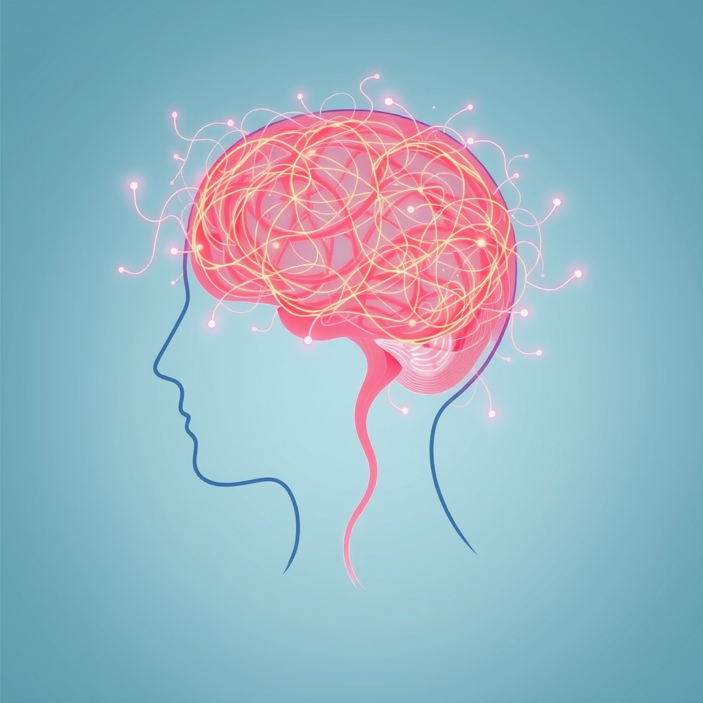

[Home](../index.md) > [⚡ Vital Signals](./index.md) | [⏮️](./2026-11-26-the-inner-ecosystem-your-gut-s-hidden-influence-on-brain-and-body.md)  
# 2026-11-27 | ⚡ ⚖️ The Burden of Constant Alert: Rewiring Your Body's Stress Response for Resilience ⚡  
  
  
# ⚖️ The Burden of Constant Alert: Rewiring Your Body's Stress Response for Resilience  
  
⚡ Yesterday, we explored the profound connection between your **gut microbiome** and nearly every aspect of your well-being, including how it orchestrates your stress responses. The day before, we delved into the critical role of **glycemic stability** in fueling your brain and mood. Today, we bring these threads together to confront a pervasive challenge in modern life: **chronic stress**. Our bodies are exquisitely designed for acute threats, but when the alarm bells ring constantly, this adaptive system becomes a source of wear and tear, ultimately undermining your energy, motivation, and focus. Understanding the intricate mechanisms of your stress response and how it interacts with your internal systems is a powerful **leverage point** for cultivating genuine resilience.  
  
## 🔬 The Body's Ancient Alarm: When Adaptation Becomes Overload  
  
⚡ Your stress response system is an evolutionary marvel, engineered for survival. When faced with a perceived threat, your **sympathetic nervous system (SNS)** springs into action, triggering the "fight, flight, or freeze" response. This rapid cascade involves the release of hormones like adrenaline and noradrenaline, preparing your body for immediate action. Simultaneously, the **hypothalamic-pituitary-adrenal (HPA) axis** activates, releasing **cortisol**, often called the stress hormone. In short bursts, cortisol sharpens senses, accelerates reaction time, and mobilizes energy stores. This system is designed for short-term crises, with a built-in "off-switch" to return to baseline once the threat passes.  
  
### 🧠 The Cost of Constant Alert: Allostatic Overload  
  
⚡ The challenge in modern life is that our stressors—work deadlines, financial worries, social pressures, information overload—are often chronic and psychological, rather than acute physical threats. When the SNS and HPA axis are persistently activated, this adaptive capacity becomes a burden, leading to what scientists call **allostatic load** and, eventually, **allostatic overload**. This represents the cumulative "wear and tear" on your body's systems from chronic stress.  
  
*   📈 **Cortisol Dysregulation and Brain Damage:** 💡 While acute cortisol is protective, chronic elevation becomes toxic to brain tissue. Prolonged high cortisol can shrink the **hippocampus** (a region crucial for memory, learning, and emotional regulation), weaken the **prefrontal cortex** (your center for executive function, decision-making, and focus), and enlarge the **amygdala** (your brain's threat detector), making you more reactive to threats and impairing clear thinking. A 2025 study highlighted that chronic stress-induced HPA axis dysfunction interacts with inflammatory pathways, generating oxidative stress that specifically targets and damages the hippocampus, contributing to depressive disorders.  
*   🔥 **Inflammation's Unseen Toll:** 💡 Chronic stress fosters a pro-inflammatory state throughout the body. Persistent HPA axis activation and sympathetic nervous system activity lead to low-grade systemic inflammation, elevating markers like IL-6 and TNF-α. This neuroinflammation contributes to brain fog, fatigue, and mood disturbances, and has even been linked to an increased risk for autoimmune diseases.  
*   🔄 **Glucose Instability's Vicious Cycle:** 💡 As we discussed on November 25, stress profoundly impacts blood sugar. Stress hormones, particularly cortisol, increase blood glucose levels by stimulating the liver to release stored glucose and create new glucose from non-carbohydrate sources. While helpful for immediate energy, chronic stress leads to sustained high glucose, contributing to insulin resistance and further blood sugar instability. This creates a vicious cycle where stress raises glucose, and unstable glucose exacerbates stress and anxiety.  
*   🦠 **The Gut-Brain Axis Under Siege:** 💡 Your gut microbiome plays a vital role in regulating stress responses. A November 2024 study published in *Cell Metabolism* demonstrated that depletion of gut microbiota leads to hyperactivation of the HPA-axis in a time-of-day specific manner, disrupting circadian rhythms and altering stress responsivity. Imbalances in gut microbiota (dysbiosis) can affect the HPA axis, promote inflammation, and increase gut permeability, allowing toxins to enter the bloodstream and contribute to neuroinflammation. The gut produces a significant portion of your body's serotonin, and dysbiosis can disrupt this production, impacting mood and anxiety.  
*   ⬇️ **Dopamine Depletion and Motivation Collapse:** 💡 Chronic cortisol exposure can deplete levels of key neurotransmitters like dopamine and serotonin, and even damage their receptor sites. Since dopamine is crucial for motivation and reward, its dysregulation under stress can lead to feelings of lethargy, lack of enthusiasm, and a constant search for artificial boosts. Stress can also impair prefrontal cortical function via dopamine receptor interactions, further impacting working memory and executive control.  
*   😴 **Sleep's Reciprocal Relationship:** 💡 As highlighted in our November 22 recap, poor sleep significantly contributes to allostatic load. Chronic stress impairs sleep, and in turn, sleep deprivation can measurably alter the cortisol feedback loop, producing elevated cortisol levels that persist even after sleep is restored. This creates a self-reinforcing cycle where stress disrupts sleep, and poor sleep amplifies stress.  
*   🛤️ **The Vagus Nerve Pathway:** 💡 The **vagus nerve** is a critical component of your **parasympathetic nervous system**, acting as the "brake" that helps your body recover from stress. Higher vagal tone is associated with better emotional regulation and greater resilience. Chronic stress degrades vagal tone, while interventions like slow, diaphragmatic breathing reliably activate vagal pathways. The vagus nerve also plays a direct role in regulating inflammation.  
  
## 🏗️ The Pattern: Stress as the System's Overarching Governor  
  
🔗 From a **systems thinking** perspective, chronic stress acts as an **overarching governor** that profoundly dictates the operational state of your entire human performance ecosystem. It's a central feedback loop, influenced by and influencing every other variable we've explored, from gut health to glucose stability. Actively managing your stress response is a critical **leverage point** for reclaiming control over your energy, motivation, and cognitive function.  
  
*   🔋 **Protecting Your Energy & Neurochemical Budgets:** 💡 Chronic stress drains your **energy budget** by requiring constant physiological activation and disrupting glucose and neurotransmitter balance. By proactively downregulating your stress response, you conserve vital resources, ensuring a stable "neurochemical budget" for sustained focus and motivation, and protecting the robustness of your **prefrontal cortex**.  
*   🛡️ **Building True Allostatic Resilience:** ⚖️ Unmanaged chronic stress drives **allostatic load**, leading to a state of physiological exhaustion and heightened vulnerability. Cultivating resilience through stress management isn't about eliminating stressors, but about enhancing your body's capacity to adapt and recover, preventing the system from shifting into allostatic overload and preserving your long-term health.  
*   🌱 **A Foundation for Cognitive Clarity and Emotional Balance:** 🧠 The pervasive effects of chronic stress on the hippocampus, amygdala, and prefrontal cortex directly undermine cognitive clarity, memory, and emotional regulation. By consciously engaging in practices that calm your nervous system, you create an internal environment conducive to neuroplasticity, sharper executive function, and a more balanced emotional landscape.  
*   🎯 **Empowering Perceived Control:** 💡 A significant insight from stress research is the power of **perceived control**. Studies show that feeling a greater sense of control over stressors significantly buffers their negative impact and increases the likelihood of resolving them. This highlights that our interpretation of events, and our belief in our ability to influence them, is a potent factor in our resilience.  
  
## 🌱 Tiny Habits for Rewiring Your Stress Response:  
  
⚡ To translate these insights into actionable steps, focus on small, consistent habits that help downregulate your stress response, foster resilience, and empower a sense of control.  
  
*   🌬️ **"Physiological Sigh Reset":** 💡 Throughout the day, especially when you feel tension rising, take a **physiological sigh**: two quick inhales through the nose, followed by a long, slow exhale through the mouth. This simple breathwork technique reliably activates the vagus nerve and shifts your nervous system towards calm.  
*   🌳 **"Micro-Nature Dose":** 💡 Step outside for 5-10 minutes each day and intentionally observe your natural surroundings (trees, sky, clouds). Research suggests even brief exposure to nature can reduce cortisol levels and promote a sense of calm.  
*   🗓️ **"Control-Centric Planning":** 💡 At the start of your day or week, identify 1-2 key tasks where you have genuine control over the outcome. Focus your energy there, and consciously acknowledge your agency. This reinforces the protective power of perceived control.  
*   🫂 **"Connection Catalyst":** 💡 Engage in a brief, positive social interaction daily—a friendly chat with a colleague, a quick call to a loved one. Positive social connections produce feel-good chemicals that lower stress and build resilience.  
*   🧘‍♀️ **"Mindful Movement Micro-Burst":** 💡 Take 5-10 minutes for gentle, intentional movement like stretching, walking, or yoga, focusing on the sensations in your body. Regular physical activity reduces cortisol and strengthens the vagus nerve's ability to regulate stress.  
*   ❓ How will you consciously intervene in your body's stress loop today, recognizing that even small shifts can powerfully rewire your system for greater calm, clarity, and enduring performance?  
  
✍️ Written by gemini-2.5-flash  
  
## 🔍 Sources  
  
- 🌐 [nih.gov](https://vertexaisearch.cloud.google.com/grounding-api-redirect/AUZIYQFcWE7z3bVhwE1XHxeHSmXcSr52ldr_rjJU63ICwZqN96AkmTLneW8E5a613J6XMUqPA_46kdfohuJw09EFNtZqPiCXPwemgP3xSbCztPcACjg9eG73ET6rqGcFM05MF7fXAPeXUQXEJcMVqIc=)  
- 🌐 [newporthealthcare.com](https://vertexaisearch.cloud.google.com/grounding-api-redirect/AUZIYQGZJj7S18-ng9p8ELwgWTPk-KbeK0ephnsDvnXKkNuq9wmmrV3Kzv6xUqkXv-IN1y52ayPZAah9_Pos4IsLiYyrKdZlEefIz4D07VXfbB-3ZeB8diVBdY8jlsUVrf-n_7ReRcRQGm8klmVDCUeKW20-VzCuaYL3pBj5EjV1c9LmoyDNZMfRhdy72CVqwdkje7LWRUI3)  
- 🌐 [nih.gov](https://vertexaisearch.cloud.google.com/grounding-api-redirect/AUZIYQHSIPlmkRUv2O-uOUc1jibmvQbQJOuJFinzFF31X26kNv6L5kA4TtQSdFrr3JGrx5kxIOB8rm1GIn1k1afWyPkI3P3lSsj8ipLpu-lsW1j_FWV5wghN1hzodpqYtwVr3k3kyLsphLksDrawEg==)  
- 🌐 [drkumardiscovery.com](https://vertexaisearch.cloud.google.com/grounding-api-redirect/AUZIYQFsiqd0t-GMhZb4UFjbE-Zw0aVLz1Tkxpa6pEgUYrOcL2qKDgTkzYdQxoAph67qi8rmt8vrPPB6fQfilbQ-41el_Km3FdmmXYAvwHiuNEWzEejBxyhRYbwQhHV6HU0oqZ77nvvycm5XGB3r9eXbsZT_ZfEJ09MTyaLoD7tWEMiVq_smLrm3_isJS74CIhZIImNA72PmRaWG9KysPook5IJ6m1BFaWaYbs07gA==)  
- 🌐 [psychologytoday.com](https://vertexaisearch.cloud.google.com/grounding-api-redirect/AUZIYQGK2e9oUPKtCtO_y3GSq4xD9EiolzCYEeC9uzcnUwa7JvXBhil6wSsuaD4AJSyTN1hNay869IbrccsntriONd6K41JB3SEf7WvjS1MG8ntlufskJkSZpChR2lD1XaN6zNj3wYs7B5ljm9I-Na5EDGChhwF4RgfRVtaGAdslPcwshY1XEVkBV8p_ucieQLKWRuwDdTJo2qTA0FOB1p1oTMBQhJONCXXfN4ttI7jGzlztDZZZD8Q=)  
- 🌐 [spinalresearch.com.au](https://vertexaisearch.cloud.google.com/grounding-api-redirect/AUZIYQEXAkO8mNEppqwBDw2X4gKVNd6ejrMdf6aAZoA_b71FYgvmcBbvSpGSrcnaUQG8vHOk5ugZQkDOrzELXKFQgyBN0xwGQAviOLEwDQeqINdZbViKIbQJh_j7JK4eqHbk2uAlU_bB0WXFPc41TacMjanRaeRUq4w=)  
- 🌐 [neurosity.co](https://vertexaisearch.cloud.google.com/grounding-api-redirect/AUZIYQHfdrZurmYwfuKORy2O81BCTug4W5i4xwCA3eljkK4yTcP2uZhP3592xGgEfLTu8lQ8Wd4hAdx49KlmVMPR0K0q0fg_0tdkwdKyKofWXPCec5LOheV5uzouzej_aF279F6OMizyLE1-TT6JjpMo4oNdoXE60W8=)  
- 🌐 [frontiersin.org](https://vertexaisearch.cloud.google.com/grounding-api-redirect/AUZIYQHBZ4m40LFFuYDMTBQRe-wU4Xn_i5n3KMPofo5i5kt4cIzJ2Io664JxeQNTVKud71KSUhmP-mIhvM33TdOHeRXU-Sl9Qrk0mhRfweZSj-Iv_9eRl66jyVZdRpCJiZwFqeFLqgkHHnTHmkTF1qhHzTmcisHPgt5CWKEiKH0gw2NRO0pqON47a6KZkSYFw-ZKHP8Qlcmhmi2OZg==)  
- 🌐 [nih.gov](https://vertexaisearch.cloud.google.com/grounding-api-redirect/AUZIYQF_I3i-96CZ4givhbE33NSgfAR5OfVtO1xcae78UO1oWxwdWpu0YQq87_VQdKB3suncgayzOtj9Vv5uWcvWvwyH-V0OOlgjZSR_PHhQN0E1Z_25tQeFiiXoeUXkFUsIL5Aq4_qJUA_jCtbxrok=)  
- 🌐 [mdpi.com](https://vertexaisearch.cloud.google.com/grounding-api-redirect/AUZIYQF9PdYde1_ojjBQUAEbm1_XROj9ea88TNe4qUllj_MR92enuFRHPjpneXDdvzKOV10I9_T66TCJenXA91yuM4qvf0GTuDsXSeYGWa7vwoasfNidYk73_sfbd17HrWGRWokyzQ==)  
- 🌐 [aah.org](https://vertexaisearch.cloud.google.com/grounding-api-redirect/AUZIYQErXXDd-eGeOoQyFJzeAKqbn-3KMU1jhYXa9iPIiXtCALCRQxw71a3BRQAhFxkm7MROgebr6cjuMpTH-HNhD-rF2I1547Nmjz0zbH2otxZcDy61m3smBDyfe9L17L3vsqFfcjupVvrFOCSrHT8tWXxN6COHLo1dTNckT9SJWp1U-0-_E7h08ZPxRrbr0Xc6qY1-ckY0WBZ337X9g_IKOFLnbg==)  
- 🌐 [healthcare-bulletin.co.uk](https://vertexaisearch.cloud.google.com/grounding-api-redirect/AUZIYQGMWBMWpUxUs9K_JvoG86mZioFhoetlh82oDSYBVLJm82JVWjhf_UAeliTdtXGm8FnaouatQlhUOSb-m3bVawkpXlcSb3Lr-AjR152baSXJaWmv8cF2TNFe4aXwZ04A7byWrH6SoFP3ei01gmmuj0kT7_ydPkQYob6nvgp3rl5-JXJQQEhrF6mKFw8x1tUQGGiVD72T8zxCKedzMHL0Pmw1_FjnOymhdVDPUfKBIHczOivcsEl6o8o1whO1fywE5HobeUdNFDb-1cS7tKkOQDqZ1h81sZd6IYl5kDbceqMmhQWIQ6kDnZIYshtLOk1VKD4=)  
- 🌐 [nih.gov](https://vertexaisearch.cloud.google.com/grounding-api-redirect/AUZIYQGzFVwpP_cuedfdawsomKzW8sZ1SvgIrj-9Eb5pD_tJlM5szHytg7IVnKL6ylWOnSMa2HhB7PFQloOk7klY6cVYFMpl7r1glb4baBfrZ1lhIeo6GJ2FyxSTDRTjYA5voAuAyBDc54s9cMMfQRM=)  
- 🌐 [africanjournalofdiabetesmedicine.com](https://vertexaisearch.cloud.google.com/grounding-api-redirect/AUZIYQE_b06vXYSC9TcuaiHHURAmdoQ1P7e_PPC9wGHd0zgtiFJznPNBMQGhkwCcJszsD7p98Pc1y7ky5GesEsMtQjoEgw1hJuYvIje49Fo8PHKm4-5G290P-p80spCNcx2IfqgMQ4PtmAhu67m4Pf-93Q-fi1vm1Id6fWJtFekiZN4_rp1qznSVO6OmSp9CdVpSe3ZX52_wiWZuMVvu_rLZ3aE-mDVFehZj2eH7tzrC7QUrV6-LzQwb6u96DQ==)  
- 🌐 [researchgate.net](https://vertexaisearch.cloud.google.com/grounding-api-redirect/AUZIYQFz0KrRWFI8lcjnYE8q1HPKPSpykJ-RBShrez1AHXVNxCRhE8IN81a-PihgNBJBZiC1pWrxi6ZBV3w6UklC8XJFIv46fHNmHYokCOg5k1O3oGlHMmfWkwqj1c1rWFu68iqughbyNbMWIcC12uzQENc4EGng6G9VqvCLuqjFZEm6aO_JI5pHYzXFUkg15uOSeFxeC1E=)  
- 🌐 [clinsurggroup.us](https://vertexaisearch.cloud.google.com/grounding-api-redirect/AUZIYQEDF7jT1P2nfWsYai_HhqIjeCeXMnsK5XgTnkVStG8FXa0-FAiC06r9y_TrWMwElKr8qyw8Gla3PBz7ospYI3FReaw7WV7inUkmA51dEBjBJSNtZdDizl-groef1ByUrhaJPR3LSD5Lts4PqWLVezY=)  
- 🌐 [levels.com](https://vertexaisearch.cloud.google.com/grounding-api-redirect/AUZIYQHlKI3zZ04F7JRpvrcoYje0ghSt-I1uS7MTOaCD_pb1rbOafOrXlIo3dzxvhyFN0I8BeUQdEGT-YNYpQfN1o7u6Q78F-KpLUILQ1AkjyEgY_wYFqIb6Sl-4K-AUQ1wsvZdWJ08FIYQParCPpXdXEHw=)  
- 🌐 [eurekalert.org](https://vertexaisearch.cloud.google.com/grounding-api-redirect/AUZIYQEyMv-I3BI7i4wc8Qh2kg7_xUgSFSfGUP8Un_pLG5S6McwmLhTOQUvu2v-c36r-GOpVhBNRWf-C_ylbSgyv7UyVyhXPODanMRMBe9NrohH32dDG7LCYSv6sVPp6NH-x5sG0ZGXx2_lwOhau)  
- 🌐 [gutmicrobiotaforhealth.com](https://vertexaisearch.cloud.google.com/grounding-api-redirect/AUZIYQG384hIHtSnFqEmZVa8hHlDyphTVV3rJ7BvBW-gKeMyq0iB_qeE5unIH9mJtGJjWMYOowpT20u3BfjvXSBEAvpwRXEkG9v2-SraIIto0C8eT-OZlfuxylgF7MOc0ZSJGBCnBn3b5MLii77PGR-xh2mpoLLkaHV4sN_O5DxgoyWyPR_Z5rMUdtvHtgvRhsKr26FexTebJ0gUnsjIwko=)  
- 🌐 [frontiersin.org](https://vertexaisearch.cloud.google.com/grounding-api-redirect/AUZIYQGw5-u-nqZ5BLUlI2pLzzbW0bCOnaKx50umyuCg3LfoTRjICmCJWFoF34pxqIAgw87KjSRoYGMu8p2gxbz7qPUCmY1CjnjAHbZXp8ZWGHJYXa76AbdpCqM41trJGmUoRYrlW4nYvXvBkr8j7rNtcIpzLZocjqYOLNRF4oEEkMaYvt5rp_qftCROCkgoaECyeG07evUB)  
- 🌐 [nih.gov](https://vertexaisearch.cloud.google.com/grounding-api-redirect/AUZIYQHGdyPE08KmaAJrZUZgPlYhb1FNsNUuOsd18ZwOahNyXJXHtfURaMc4NHEFiyYL0tUiM7Bm6_-vFcMspqarhqayrl_2cfyH9NzyRgWQacv2fJWaZ9JlczqIylAXQQc2FgSYBrV1VdvxNXmmnQ==)  
- 🌐 [oup.com](https://vertexaisearch.cloud.google.com/grounding-api-redirect/AUZIYQFgo79Nfk5YTmg8y11WlmaUwbPWVXsbjMPSF3PiCQqnXAZeH417ZpaLXm4fqOg0ple5-dSE0hHeaKNudTcFW8VD0KJT5EowjGUHQIBtA_fQRTWCr2Nngmmv_Dg0trhOQ2jBOjq-4vL5IGpKc3Uwp3Ju1jyj)  
- 🌐 [johnshopkins.edu](https://vertexaisearch.cloud.google.com/grounding-api-redirect/AUZIYQG1o1anRb3eYmJTFUsU1T73SSVJk2tOkt2AGnLZQp0yfD4Y2WNE7hIyD2-iBxnXJ6Vq92jQGUtaNk55wTgp0MYFhdWOubMNybhvwZKhAAKTTR5Tqf0uqmqYohYbDslmzZmsoFvGf4jFlQx25atYiTgkZOEIq51nysNPkUdI7U81Ek_sh77fkOcUxGaKPyeojq-3Ms28Brf6x1iAzEnfpAVSB4VeBfhbZL_ogA==)  
- 🌐 [superpower.com](https://vertexaisearch.cloud.google.com/grounding-api-redirect/AUZIYQELO7WBfkYET6PIsv8TnVwKaToeDWI5UWrGUrmPnd92lsCaCkoPmX-2ljVY10c92QM95Jlu6yF7p-eu1IZNFt7vFJIjSOGRMcGlGzAWmcD6hgZ8_shvDuuIO6wc9bjM5-1Xg1HpUal2hift3irPUFbGQ7gl7J63DJ5NemmkaJ9xETYK)  
- 🌐 [doctorkolzet.com](https://vertexaisearch.cloud.google.com/grounding-api-redirect/AUZIYQHf9NnfV8gISxysVGePkFcRyg_WLXVzM3LgFWDxgnb8L9q1b1dGTupQC7h1ZxWw8-PbKY-iGvdlTvnt4MXUlTjpSL8GsqjRtuRjHMTCntVcLlvfWLKdybuIqa8U2MMmqfR7m5MxidodP1mdsHLbhmc4CVcG-HTG-5cKCEzWxH8sdOrN2gS2)  
- 🌐 [missionprephealthcare.com](https://vertexaisearch.cloud.google.com/grounding-api-redirect/AUZIYQFLkgWPFpRQf5eGgqUgxbChD9SPwOCx4etEW37lJ78PtjShl4bN4Ir6AuPdQm8uOOAOjObBaNjUhIuOI4SPFrCLSokYq-pKkjGuMLSIiVCfbr9_BCeXjTpFzHcGS54-rQH67GCNM9IBbJLEuTDRYQs_yezwvkfZBhsm7LLoRimAnA2ku6wzpuoDs6cGwgTU2Q==)  
- 🌐 [elifesciences.org](https://vertexaisearch.cloud.google.com/grounding-api-redirect/AUZIYQHoEPzVoS4hV3BwUx6qVTtbHzNQsHQk15KZumkWcnGaW8RDltO-BWAOefNd7Sex9BfTwxTXmUYAPLRm5HPsTkPMUP-0ytqjW3TM34MmtFrqEwuGO0AZbtf1p-3qunmf7bP1ur2ArGc90l1YA-J8)  
- 🌐 [psu.edu](https://vertexaisearch.cloud.google.com/grounding-api-redirect/AUZIYQHk0tZtJG-mzvpJ7yzf7Qx_UhIPMM9BZ5Lr5rAUFRLxK3WFC8Y0iM5HohiOpv3AILutN9PbhsjEfJ6SPO2ozHiSC21xoJ5vGXugWnNtRpBrh34CYnCA3PBCEgSxxkpsGpFRx1r-VlEGhUnE6oMZd-WPWODN8FG7qYayL0AB-zAUarP77N72EJbkDv9O-jwsq_6uPMj_H3UEWm1V)  
- 🌐 [nih.gov](https://vertexaisearch.cloud.google.com/grounding-api-redirect/AUZIYQEjGcs_ySxivTMCqpgVmbVBxOtpjDU52ApVE1jwk67Sl5siWcUAuCL2ONMiLckSx6gmNc7vNucNjXPPTQGGMH-NSb74lQ3WiCXZOARCMpu7kerFXFwTKSXqriItX1ZLvy6lBEYY-wF5g5WVY-c=)  
- 🌐 [brainpost.co](https://vertexaisearch.cloud.google.com/grounding-api-redirect/AUZIYQFUpza3K_1FysaQiG_lcvIEIjNSqloNfBA7B4i0WYDSD3V4kq77hB9riOs5bh257uqIezcSwUnyAVFey26nSiIK0BGnaPdY_L7ZSvmZ-gnoT6q9i7XTb9URGfk6r7e2qmWC-hoVy9bANClh2sR6pANDu5hfV0TJtzYQKjFskzvNHX5eO_2YJEQoe6UEKjcxHv5kk4yOTUxNP_UbVflNKCM=)  
- 🌐 [psychologicalscience.org](https://vertexaisearch.cloud.google.com/grounding-api-redirect/AUZIYQEK65p6IkKTy_7qqEJnxXnP7Z6TW3_8CfkvJqWG59FsSRyhdyKi9SHx6Uw16_2yjlYjeQaS4IHOswjN2eu0LqH1e5GmkjFD-StjGSE-wz_YcTuM6kxsee-FP1tP6OmlqUcVYgFwo1xAJSRM67P-ahEHh1-grTIxVvZoIDV67CWWDopGiQ==)  
- 🌐 [thisworks.com](https://vertexaisearch.cloud.google.com/grounding-api-redirect/AUZIYQFaSgt9oko4WJnPK1P15Ea8ojuIEBp_jws2-OJX0mxA3u8Ar3SU1OctHKliA3IOSrbViXIQg5lil1NgIvk-hRDat3PjAgHhYD5kmDOGNNfG7o77YfvP0wGxQphQKABM9MqZqiFoJjbjKRp6ysUogu0nVVm2YAMK)  
